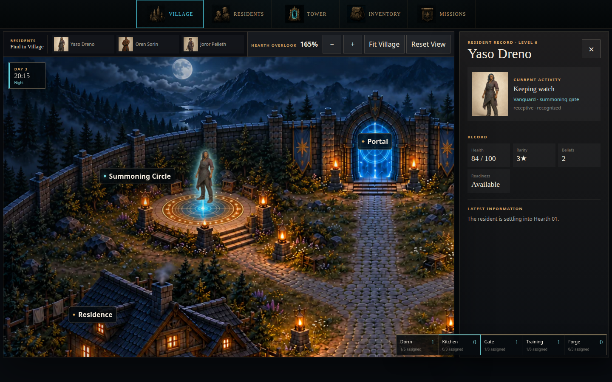
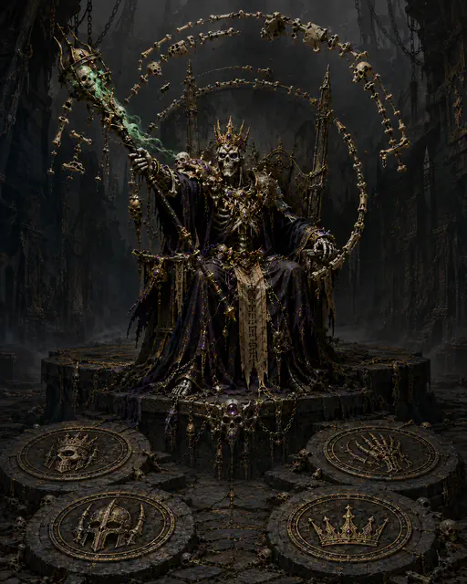
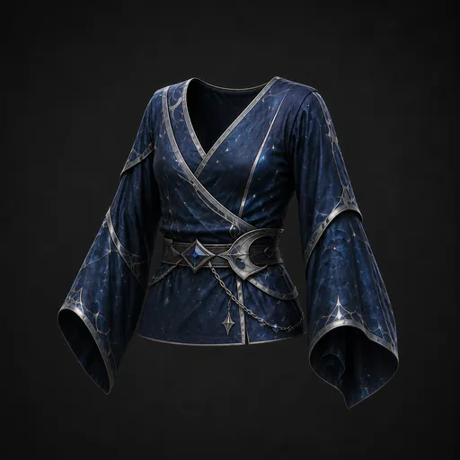
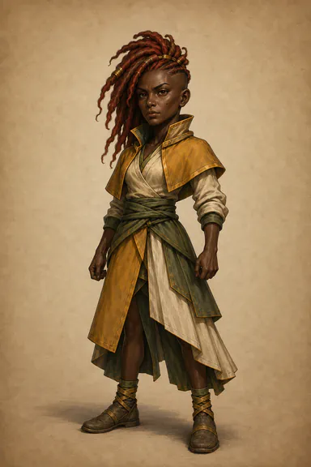
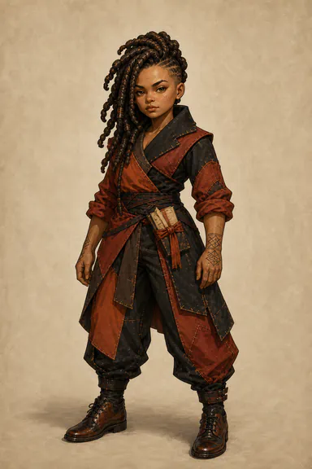
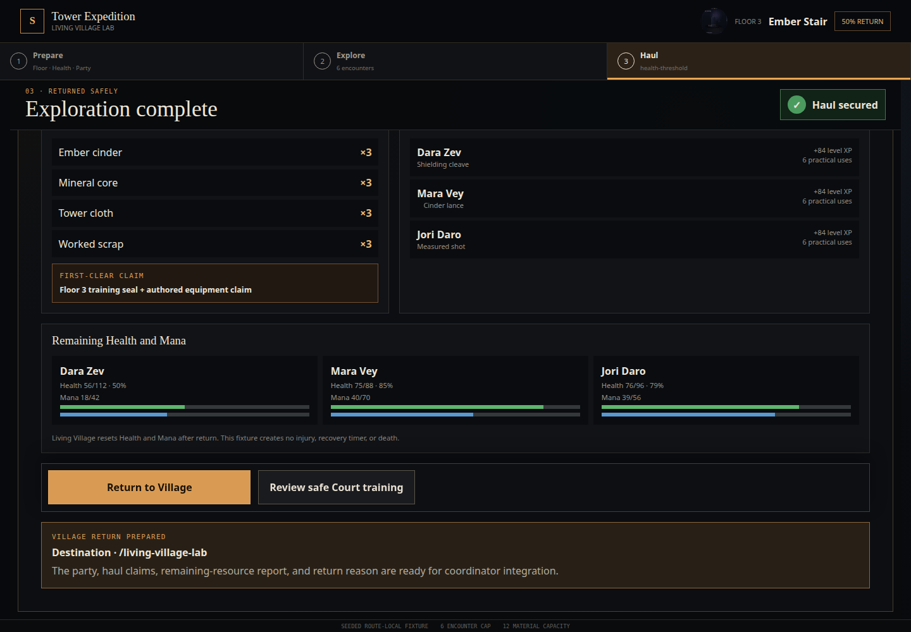

<div align="center">


# Summonlab

**A hero-summoning game where every hero is an autonomous agent.**

</div>

Summon heroes, build a home around them, prepare parties, and climb a randomized
one-hundred-floor tower. Heroes develop through experience, relationships, habits, training, and
the systems the player creates around them.

## Meet the heroes

<table>
  <tr>
    <td align="center" width="25%"><br><strong>Aear Soro</strong></td>
    <td align="center" width="25%"><br><strong>Senia Lorel</strong></td>
    <td align="center" width="25%"><br><strong>Nelan Mora</strong></td>
    <td align="center" width="25%"><br><strong>Ori Loran</strong></td>
  </tr>
</table>

A summon begins with a stranger. The intended game asks you to learn who arrived: what they want,
what they fear, whom they trust, and where they might find purpose. These are four people from the
[approved summonable roster](assets/heroes/approved/summonable-roster-v1/catalog.json).

You are the Master, the nonphysical presence guiding their settlement. You provide a home, open
opportunities, listen to advice, and decide when to send a party into danger. Heroes interpret your
directions and make their own choices. A quiet craftsperson, a patient teacher, and a capable fighter
can each become essential to the town.

## A home worth returning to


*Village screenshot from the prototype.*

The Hearth is where those strangers become neighbors. The Residence offers a place to rest and share
meals. The Training Grounds give practice a rhythm. The Forge turns preparation into something a hero
can carry. The Summoning Circle brings someone new into a town that already has a history.

The vision is a settlement that keeps living between expeditions: work, friendships, rivalries,
mentorship, and habits. Your choices shape the conditions around those lives. A building matters
because it changes what people can do and whom they meet.



*Resident detail view from a prototype review scene.*

## The monsters beyond the threshold

<table>
  <tr>
    <td align="center" width="33%"><br><strong>Goblin Runt</strong></td>
    <td align="center" width="33%"><br><strong>Lich King</strong></td>
    <td align="center" width="33%"><br><strong>Elder Wyrm</strong></td>
  </tr>
</table>

Beyond the Tower Portal lies a randomized one-hundred-floor campaign. Goblin camps, undead rulers,
and dragons belong to a broader [monster family catalog](docs/wiki/creatures/monster-races/README.md),
with distinct forms, battlefield roles, and elemental affinities.

The climb is meant to test what a party has learned together. Reading a threat, covering a weakness,
and knowing when to retreat should matter alongside strength. The tower's rules and story anchors
are authored; the people who face them bring their own histories and decisions.

## Give them a fighting chance

<table>
  <tr>
    <td align="center" width="33%"><br><strong>Bronze sword</strong></td>
    <td align="center" width="33%"><br><strong>Moonweave robes</strong></td>
    <td align="center" width="33%"><br><strong>Starmetal spear</strong></td>
  </tr>
</table>

Preparation connects the village to the expedition. Choose equipment, make room for supplies,
balance a party's skills, and give tired heroes time to recover. The
[equipment catalog](docs/wiki/mechanics/equipment/README.md) explores weapons, armor, materials, and
rank progression as part of that shared work.

<table>
  <tr>
    <td align="center" width="50%"><br><strong>Aear Soro in combat</strong></td>
    <td align="center" width="50%"><br><strong>Ori Loran in combat</strong></td>
  </tr>
</table>

The same hero has a full-body summon portrait and a matching chibi for combat. Keeping that identity
recognizable is part of making a party feel like people you know.

## Live with what comes home



*Expedition aftermath screenshot from the prototype.*

An expedition should leave a mark. The intended story continues through injuries, discoveries,
changed relationships, equipment wear, and the empty place left by someone who does not return.
Hero death is permanent. Synthesis permanently ends one hero to strengthen another; keeping that
person in the community remains a meaningful alternative.

The long story is the history of a Hearth: who you welcomed, what they became, what you asked of
them, and how the town changed. Reaching Floor 100 gives the campaign a destination. The people give
it a reason to matter.

## Explore the archive

This repository preserves a prototype, approved artwork, experiments, and the broader game design.
The story above describes the intended experience; implementation coverage is recorded in the
[release roadmap](docs/wiki/roadmap/README.md) and [implementation progress](docs/progress.md).
The [vision](docs/system-architecture/vision.md) develops the full player fantasy and its rules.

## Run locally

Requires Node `24.19.0` (pinned in `.node-version`) and pnpm `10.33.0`.
The source artwork uses Git LFS; install Git LFS before cloning, or run `git lfs pull` in an existing clone.

```sh
pnpm install
pnpm dev:app
```

Open `http://localhost:5173`. This lightweight mode does not require Docker; database-backed
features report PostgreSQL as unavailable.

For the complete local stack, including PostgreSQL and migrations, run `pnpm dev`. This command
uses Docker.

## Useful commands

```sh
pnpm dev       # web, worker, and local PostgreSQL
pnpm dev:app   # web and worker without PostgreSQL
pnpm check     # full repository validation
pnpm test:e2e  # browser tests
pnpm db:stop   # stop local PostgreSQL
```

## Deploy

The SvelteKit application and public wiki target Vercel through the repository's configured Vercel
adapter. Point the Vercel project at the repository root and build with:

```sh
pnpm --filter @summonlab/web build
```

A full persistent deployment also needs a hosted PostgreSQL database supplied through
`DATABASE_URL` and the standalone `apps/worker` process on an always-on Node host.

## Project guide

- `apps/web` — SvelteKit game client, server endpoints, and public wiki
- `apps/worker` — background decisions, catch-up simulation, and job processing
- `packages` — engine, contracts, persistence, policies, and shared libraries
- `docs/wiki` — canonical game rules, world material, and visual catalog
- `docs/system-architecture` — ownership boundaries and integration contracts
- `docs/evidence` — reproducible implementation proofs
- `assets` — source and runtime visual assets
- `tools` — validation, export, and production workflows

## Documentation

- [Game wiki](docs/wiki/README.md)
- [System architecture](docs/system-architecture/README.md)
- [Release roadmap](docs/wiki/roadmap/README.md)
- [Implementation progress](docs/progress.md)
- [Web application](apps/web/README.md)

---

**Archive notice:** Active development has ended. Summonlab is preserved here for reference, including
its prototype, artwork, and intended design. Features described in the design documents may be
unfinished or experimental.
