<div align="center">


# summonlab

**A hero-summoning game where every hero is an agent.**

Climb one hundred floors. Build a life between missions. Learn who your summons become.

_Status: Phases 0–2 and 4–5 are complete; Phase 3 remains human-gated, and Phase 6 is implemented through bounded Master fallback doctrine._

</div>

## The game

The Master—the player's embodied character—awakens in a walled settlement built around an ancient summoning gate. Beyond the walls stands a one-hundred-floor tower. Other destinations exist only through unstable portals to resource-rich worlds.

The goal is clear: **reach floor 100 without the Master dying.** Hero death is permanent. If the Master dies, the run ends.

Summoned heroes arrive as clean slates. They have bodies, temperaments, affinities, and fragments of culture, but no memory of the settlement, the Master, or why they should recognize the Master's authority. They learn those things from what actually happens.

## Three connected loops

### Settlement loop

The settlement runs continuously on an accelerated server clock. The initial target is `4×` real time: one game day every six real hours.

Heroes eat, sleep, work, train, socialize, practice skills, idle, and form routines. The player can talk to available heroes, issue orders, send them to speak with someone, construct buildings, prepare missions, or ignore settlement management and train the Master instead.

### Mission loop

There are two mission families:

- **Tower missions** provide the objective. Difficulty rises every five floors, with larger tests and promotion resources every ten.
- **Portal missions** open temporary routes to other worlds for ore, ingredients, knowledge, equipment, and unusual encounters.

Combat heroes can climb. Non-combat heroes can cook, brew, craft, heal, research, maintain equipment, train others, or operate buildings. Roles remain choices rather than permanent castes.

### Master loop

The player can remain in the settlement, join tower and portal missions, or invest heavily in personal training. Strength is one source of recognized authority, but provision, competence, trust, fear, relationships, and demonstrated judgment also matter.

Only the Master can trigger construction, summoning, and synthesis. Heroes can suggest, operate, resist, negotiate, or react to those decisions.

## Habits make a life

Personality describes tendencies. Habits describe what a hero has actually learned to do in a particular situation.

Every hero develops cue-bound routines such as stretching after waking, training before dinner, visiting the workshop when anxious, or seeking a particular friend after a difficult mission. Buildings, schedules, needs, injuries, relationships, weather, orders, and available resources change which actions are possible and attractive.

Routine behavior does not require a model call every minute. Each hero makes at least one agent-authored daily plan, while a deterministic habit system carries out familiar actions until something meaningful interrupts them.

## How agency stays playable

<div align="center">


</div>

> **An agent may choose what happens next. It may never mutate game state directly.**

```text
world state + habits + remembered context
                  │
                  ▼
       legal choices / mission tools
                  │
                  ▼
          independent hero policy
                  │
                  ▼
       validated action or fallback
                  │
                  ▼
       deterministic engine + event log
```

The server owns the clock, state, context, memory, legality, costs, and consequences. The phone can be off while settlement decisions continue. Model responses are independent jobs assembled from the context Summonlab deliberately chooses to provide.

## Tower rules

- The tower has exactly 100 campaign floors.
- Each five-floor band introduces a new difficulty tier, environment, or rule pressure.
- Each tenth floor is a major gate, boss, or promotion checkpoint.
- The tower supplies the mission objective: eliminate, survive, protect, recover, reach, or discover.
- Hidden rooms, paths, and Easter eggs only appear when a hero tries a valid revealing action.
- Secrets are seeded and engine-owned; the model can discover them but cannot invent them into existence.

Floor 100 can end the campaign. An endless postgame mode can come later if the finite tower is fun.

## Heroes, stars, and synthesis

Heroes use a `1★–7★` progression:

- ordinary summons overwhelmingly produce `1★` or `2★` heroes;
- `3★` summons are special;
- a natural `4★` is an extreme anomaly;
- `5★–7★` are reached through promotion rather than normal summoning;
- each star raises the level cap by ten, ending at level 70 for `7★`;
- promotions unlock capacity, skill growth, and evolution choices without changing who the hero is.

Anyone can learn any skill, but aptitude, teacher quality, facilities, habits, physical constraints, and practice time determine how quickly.

Synthesis permanently consumes one hero to strengthen another. It is not a consequence-free duplicate system. Friends notice absences, witnesses remember, rumors travel through the social graph, and remaining heroes may become afraid, angry, compliant, ambitious, or distrustful.

A hero cannot permanently leave the roster on their own. Their terminal outcomes are death or synthesis.

## Clean-slate people

The first generator focuses on humans. Physiology stays stable unless a major promotion or evolution changes it. Temperament, values, drives, social style, habits, capabilities, loyalties, and beliefs can change through lived experience.

New summons do not automatically recognize authority. They may ask where they are, demand an explanation, distrust the Master, or refuse a dangerous order. Their knowledge graph begins with what they can observe and what others tell them.

Heritage, culture, gender, physicality, personality, capability, and rarity remain separate dimensions. Ethnicity or ancestry never implies intelligence, morality, temperament, or value.

## First playable slice

- one walled settlement with a gate, dormitory, training ground, workshop, and kitchen;
- the Master plus three clean-slate human summons;
- a continuous `4×` clock and one agent-authored daily plan per hero;
- habits for sleep, food, training, work, idling, and social contact;
- tower floors 1–5 with one hidden route;
- one temporary mining portal mission;
- one contested order and one authority conversation;
- one death-capable combat encounter;
- one synthesis decision with social propagation;
- a replay of contexts, choices, knowledge, and state transitions.

## Visual prototype


[Open the interactive prototype](prototype/index.html) to switch between the settlement, tower, and portal views, inspect heroes, change time speed, and resolve sample agent choices.

## Playable proof of life

The first runnable path now carries one deterministic adult hero through the entire opening beat:

```text
Character Forge → first-person summon → independent choice → settlement walk → event journal
```

The same recipe reproduces manifest bytes, SHA-256 identity hash, personality, habit, first policy
choice, and story branch. Four control modes demonstrate immediate autonomy, seeded randomness,
wait-for-step, and a five-second direction handoff without giving the hero direct access to state.


### Persistent mission aftermath checkpoint

`/aftermath` launches **The Red Tithe**, a database-backed Floor 03 mission where the Master gives a
best-effort direction and the summoned hero still chooses independently. The guard-breaking impact
can create a persistent injury, equipped gear loses durability, and permanent death seals the
attempt. Only surviving, co-located heroes receive the memory and relationship consequence; reload
and replay preserve the exact source, location, health, item, and witness evidence.

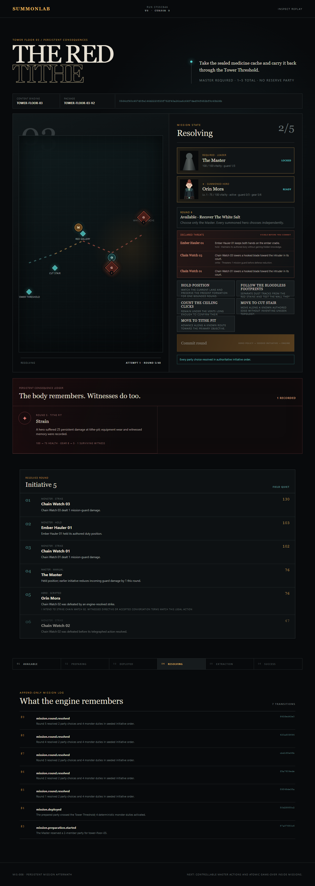

### Cross-attempt aftermath proof

`/attempt-aftermath` executes a checked `engine-v18` scenario across two real missions. Floor 04
records a persistent Master wound and retreats; preparing Floor 05 atomically archives that
consequence under its source attempt and starts with an empty active consequence ledger. All 13
events strictly replay to the same state hash, while immutable `engine-v16` and `engine-v17`
streams keep their original payload contracts.

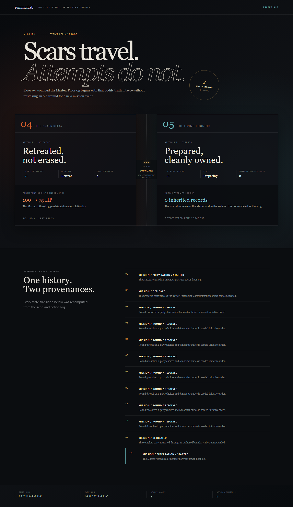

Run `pnpm validate:attempt-aftermath` to regenerate and compare the machine-readable proof at
`docs/evidence/phase-6-attempt-aftermath.json`.

### Master timing checkpoint

`/master-timing` creates an `engine-v19` Floor 01 run where pacing is canonical rather than a tab
illusion. Wait pauses at a legal boundary; Countdown stores a configurable deadline and permits
manual takeover before it; Step resolves exactly one fallback and returns to Wait; Continuous
keeps opening decisions until the player pauses or the mission ends. Every decision identity,
source, action, deadline, pause, and expiry outcome survives reload and strict replay. Immutable
engine-v19 histories retain their original `master-timing-baseline-v1`; new fallback runs use the
engine-v20 doctrine described below.

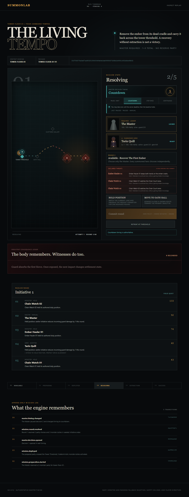

Run `pnpm validate:master-timing` to recompute the four-mode proof at
`docs/evidence/phase-6-master-timing.json`.

### Master fallback checkpoint

`/master-fallback` creates an `engine-v20` Floor 01 run with timing and unattended choice policy as
separate controls. **Directed** scores current legal actions against ordered priorities and scoped
player text; unsupported intent is visibly unclassified. **Seeded random** is reproducible from the
run, decision, and legal-action boundary. Health while retreat is legal, unclear direction,
irreversible action tags, or a configurable fallback streak can atomically force Wait. Every window
captures the exact doctrine snapshot, and every fallback records its packet, legal-action,
tie-break, direction, classification, score, source, selected action, explanation, and result hash.

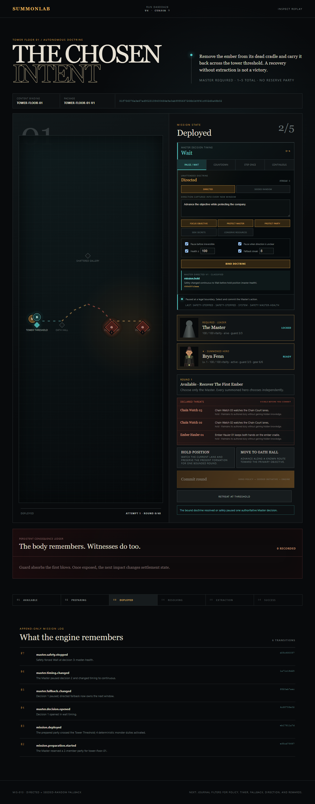

Run `pnpm validate:master-fallback` to recompute the policy and safety proof at
`docs/evidence/phase-6-master-fallback.json`.

### First-band story envelope

`/story-envelope` compiles Floors 01–05 into one content-addressed narrative spine: 25 required
beats, ten optional beats, five bounded patch slots, five immutable world laws, and the exact
1,010-point reward budget. Eligibility is derived only from completed causal history and an authored
proposal. Character expression is limited to living holders of the relevant fact; two deterministic
summons voice the same Floor 04 anchor differently while preserving it verbatim.

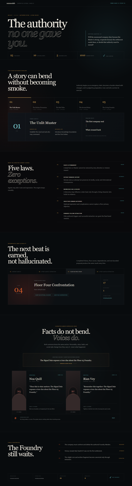

Run `pnpm validate:story-envelope` to recompute and compare the checked report at
`docs/evidence/phase-6-story-envelope.json`.

### Mortal Master checkpoint

`/last-command` makes the Master an embodied combatant rather than an invulnerable cursor. The
player chooses the Master's move, defense, inspection, recovery, or attack each round while the
summoned hero acts independently. Guard-breaking harm changes canonical Master health; periodic Red
Slag is telegraphed before commitment. A fatal impact atomically kills the Master, ends the attempt
and entire run, cancels unfinished hero routines, removes every legal action, and leaves the sealed
chronicle available for verified replay.

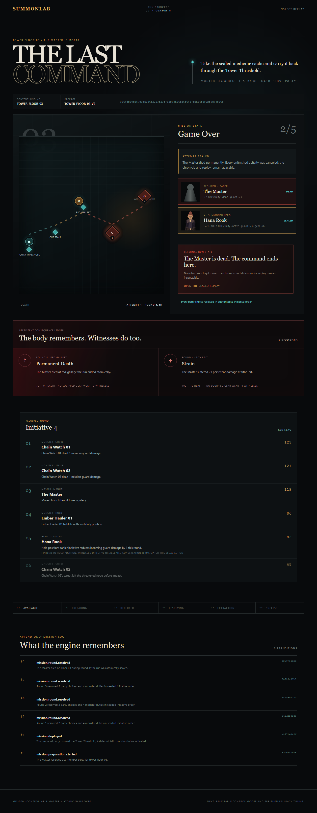

### Conversation and order checkpoint

Free text is now a witnessed social event rather than a hidden command channel. The Master can say,
ask, or give one bounded order; the hero answers in their own style and may accept, negotiate,
defer, or refuse. Every outcome exposes the authority, relationship, personality, alignment, needs,
and tone contributions behind it. Accepted and negotiated orders become visible preferences in the
next legal decision packet, while the engine remains the only code allowed to execute an action.

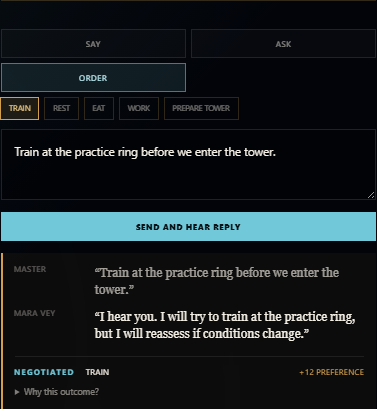

### Redacted decision trace

Every durable choice now has a development-only audit page. It shows what context reached the hero,
which memories were selected and why, the legal choices, exact request safety settings, available
token usage, retry/fallback history, every validation boundary, and the final engine receipt. Player
speech, directions, memory summaries, social evidence, and hero prose are replaced by typed hashes;
credentials and private reasoning content never enter the report.

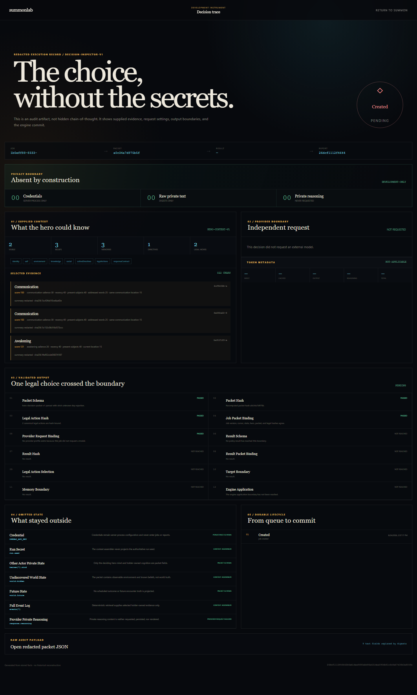

## Visual continuity checkpoint

New Forge recipes use `human-v3`: `human-v2` added deterministic mass, muscle tone, body-fat band,
limb proportion, and hand scale without changing `human-v1`; `human-v3` expands names through a
separate identity stream after the 100-seed sheet exposed obvious repetition. The two curated visual
fixtures remain explicitly pinned to immutable `human-v2` manifests. A separate visual profile—not
generated artwork—owns identity locks, expressions, equipment anchors, injury placement, and palette
swaps.

The local `/visual-lab` route compares Mara Vey and Remy Nahl across full-body anchors,
front/profile/back views, expressions, equipment, injury, a roster composition, and settlement scale.
Every bitmap has a versioned record with prompt provenance, dimensions, SHA-256, and explicit
recognition checks. `/forge/contact-sheet` renders 100 deterministic manifests and exports the audit
as JSON or print-ready PDF. Accept/revise decisions are append-only PostgreSQL records bound to the
exact asset hash; generated assets remain candidates until a human records acceptance.

`/visual-lab/summon-card` turns either exact anchor into a deterministic, inspectable image-edit
request. Provider execution is disabled by default and requires an explicit local flag, key, and
one-candidate cost acknowledgement. Reference bytes are hash-checked immediately before the call;
the returned PNG remains ephemeral and cannot write the catalog, approve itself, mutate a manifest,
or enter deterministic game state. The checked-in checkpoint uses a provider mock and makes no paid
request.

`/visual-lab/runtime-bundles` proves the delivery side with the first approved identity. Mara's
1.80 MB anchor exports into separate summon, dialogue, and roster WebP textures totaling 47.8 KB.
The checked-in manifest binds every file to source and identity hashes, enforces the 8 MB phone
budget, and loads the summon texture through an actual lazy PixiJS v8 bundle alias. Approval
candidates are visible in the ledger but produce no runtime files. The build gate measures 37.6 KB
of initial JavaScript and 296.9 KB with the renderer inspector fully loaded, both gzip and below the
700 KB ceiling.

`/visual-lab/recognition` stress-tests that approved identity through seven deterministic cases:
every Mara expression, all five camera tiers, equipment, gait, night color, and localized injury.
The 390×844/2× profile proves 1.33× or better texture-density margin, 47.8 KB encoded transfer, and a
5.51 MB decoded-RGBA proxy. The audit route is 44.5 KB gzip and measures live animation and
case-switch response. Its review console requires an explicit outcome for every claimed cue and
stores append-only case evidence against the exact audit hash. Recognition evidence remains
separate from asset approval, so the verdict deliberately stays human-pending until the seven cases
are reviewed.

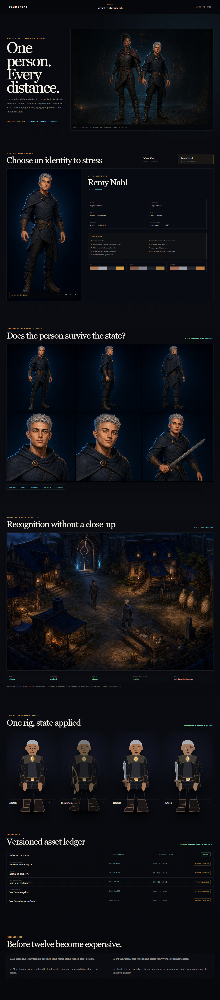

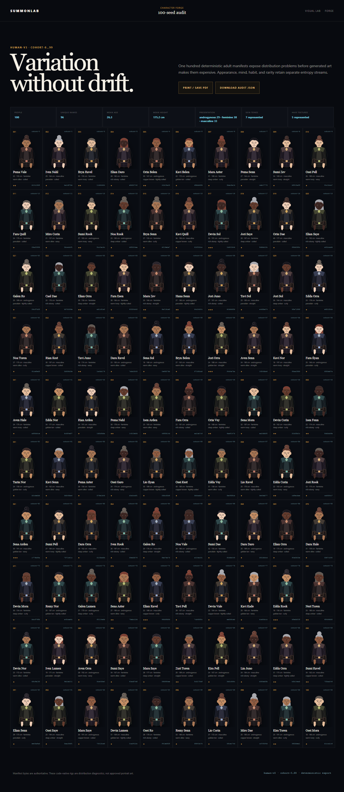

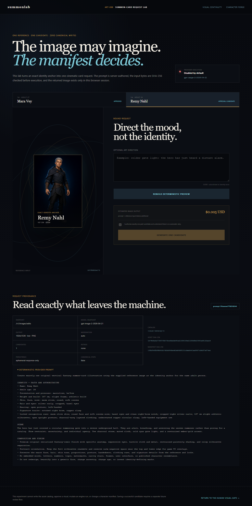

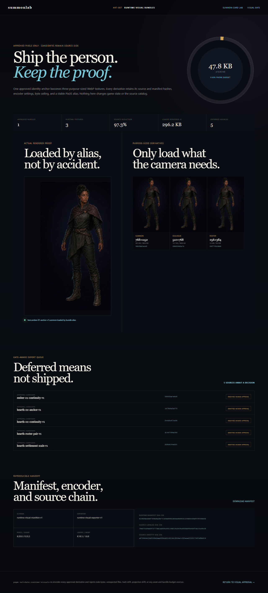

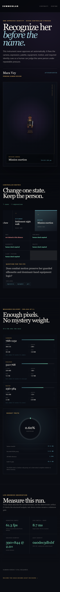

## Living settlement

`/settlement-lab` turns Hearth 01 into a versioned, clickable route graph before any canvas motion
can become game truth. The first definition has five buildings and interiors, 18 nodes, 17 authored
paths, travel time, capacity, interactions, simulation effects, and explicit system access. Select a
building or interior station to inspect the deterministic route from the summoning gate; the dormant
forge remains unreachable under Reserve and opens only in the clearly labeled All systems preview.

The scene lab is composition and content evidence, not run state. New runs use `engine-v5`, which
binds the topology by exact hash. `hero.start.travel` computes and persists the legal route and due
time while leaving the hero's authoritative location at the origin; only an injected-clock
`simulation.advance` event commits arrival. Animation remains a projection. Existing `engine-v1`
and `engine-v2` histories retain their original schemas and replay path.

The same route now opens with a hero-free, topology-aligned painted environment: gate north, kitchen
west, dormant workshop east, dormitory southwest, training southeast. The 1536×1024 source is
compressed into a content-addressed 296.2 KB WebP and combined with five code-owned presentation
layers for atmosphere, localized light, route projection, activity intent, and keyboard interaction.
The six-layer scene is an approval candidate—not engine state—and is checked by
`pnpm validate:settlement-scene`. The combined settlement route remains 41.8 KB gzip.

After authoritative arrival, the play route now becomes that painted settlement. A pure server
projection binds the visible dawn/day/dusk/night grade, physical occupancy, building power and
capacity, and idle/walk/work/sleep/eat/train poses to the exact engine cursor and state hash. Travel
can interpolate along the persisted route but never reaches one hundred percent before the arrival
event. Ordered SSE events cue a projection refresh; a visible page also refreshes the persisted
`4×` clock every 15 seconds. Reduced motion freezes effects without hiding the active state.

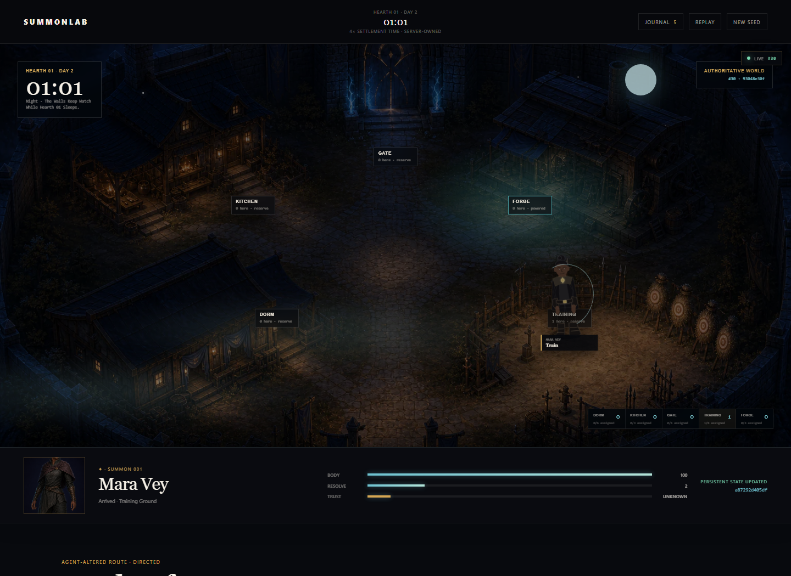

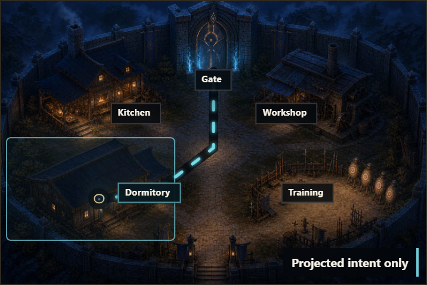

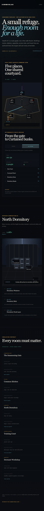

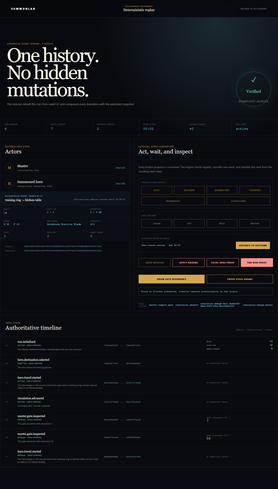

## Deterministic survival checkpoint

Every opening choice and settlement arrival now passes through a pure command → event → reducer
engine. PostgreSQL stores an idempotent command, an append-only event, and a hashed snapshot in one
transaction. A development inspector rebuilds the run from event 01, verifies every before/after
hash, exposes named entropy draws, and proves that two commands aimed at one version cannot both
commit. The same lab now schedules training, eating, rest, and repairs on an explicit game clock;
projects resources, experience, skills, needs, health, and durability into the journal; and proves
permanent hero death plus atomic Master game over. Existing `engine-v1` histories retain their
original schema and hashes while new summons use `engine-v9`. The replay lab can now start a verified
Hearth route, inspect its pending arrival and unchanged origin, and explicitly advance to the due
event.


## Living Foundry strategy checkpoint

`/foundry-trials` compares three complete Floor 05 doctrines executed by the authoritative engine.
Hammer Line trains and rotates a four-hero company through the armored direct route; Split Cooling
uses one holder's retained schematic to strip two armor layers; Full Quench risks a second wheel
operation to remove them all. The checked matrix contains eight successful seeds per strategy, only
legal commands, 24 exact strict replays, and no deaths. It is deliberately a viable-path regression
suite, not a statistical win-rate claim.

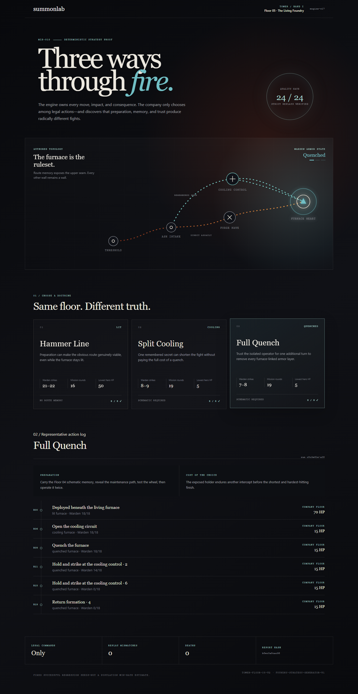

## Local development

The application is a pnpm TypeScript workspace pinned to Node `24.14.1` and pnpm `10.33.0`.

```powershell
Copy-Item .env.example .env
pnpm install
pnpm dev
```

`pnpm dev` starts Docker PostgreSQL, applies pending migrations, opens the SvelteKit web process on `http://localhost:5173`, and starts the worker health process on `http://localhost:4174/health`. Begin at `http://localhost:5173/forge`, compare the Floor 05 proofs at `http://localhost:5173/foundry-trials`, open the Iron Moon resource checkpoint at `http://localhost:5173/iron-moon`, or test persistent mission consequences at `http://localhost:5173/aftermath`. The launcher uses native Docker or Docker inside WSL on Windows. The web server binds to the private LAN by default for local playtesting.

If Docker is unavailable, use `pnpm dev:app`. Both processes stay runnable and report PostgreSQL as unavailable instead of inventing persistence. Run all local quality gates with `pnpm check`; browser smoke tests use `pnpm test:e2e` after installing Playwright Chromium once with `pnpm --filter @summonlab/web exec playwright install chromium`.

The default `POLICY_MODE=scripted` sends no provider requests. During a wait-mode summon, open
**What reaches this hero** and press **Queue scripted + apply** to run the durable job lifecycle and
commit one validated choice. The browser only observes the PostgreSQL-backed job; the worker owns
claiming, stale checks, deterministic fallback, and atomic engine application.
Once queued, select **Open redacted decision trace** to audit that job without exposing its raw
packet. Scripted jobs visibly report that no external model was requested. Model jobs additionally
show the persisted request profile and provider token metadata when available.

Before that choice, use **Hero agency** to say something, ask a question, or give a bounded order.
The hero replies from their social style and current circumstances; orders show an explicit
accepted, negotiated, deferred, or refused outcome with an inspectable score. Accepted and
negotiated orders influence the next legal choice, but free text never starts an action directly.

Model hero decisions remain opt-in. Set `POLICY_MODE=model` and `OPENAI_API_KEY` only in your local
`.env`, then restart `pnpm dev`. **Ask gpt-5-nano once** is a non-applying preview. **Queue model +
apply** is a separate explicitly acknowledged durable job with at most two provider attempts before
scripted fallback. Late results are rejected and replanned from fresh engine state.

## Project documents

- [Game design](docs/game-design.md) — the hundred-floor campaign, habits, clean-slate characters, missions, progression, synthesis, authority, and permadeath.
- [Architecture and platform](docs/architecture.md) — accelerated time, offline decision scheduling, independent model jobs, context ownership, persistence, replay, and cost controls.
- [Visual direction](docs/visual-direction.md) — tower, settlement, portal, character, habit, synthesis, and animation language.
- [Capable prototype plan](docs/prototype-plan.md) — the original story arc, hybrid Character Forge, camera strategy, playable scope, milestones, and exit criteria.
- [Full implementation plan](docs/implementation-plan.md) — the production stack, domain model, APIs, persistence, testing, phased backlog, quality gates, and feedback checkpoints.

## Inspiration

Summonlab uses the familiar language of hero summoning and rarity, but its central inspiration is the manga *Pick Me Up, Infinite Gacha*: a world where summoned heroes have interiority, risk, and a life beyond being pieces on a board.

This is an independent experimental project and is not affiliated with or endorsed by the manga, its creators, publishers, or any game franchise.
