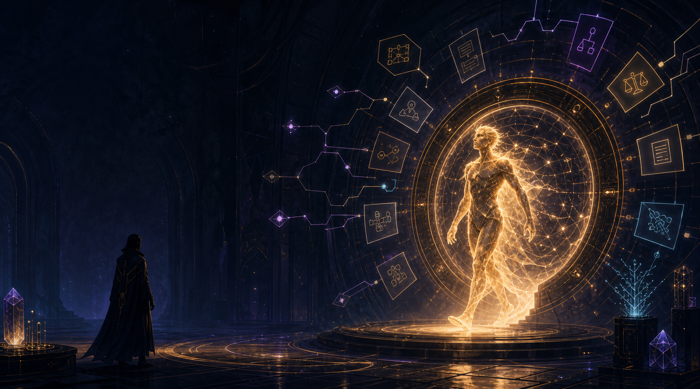
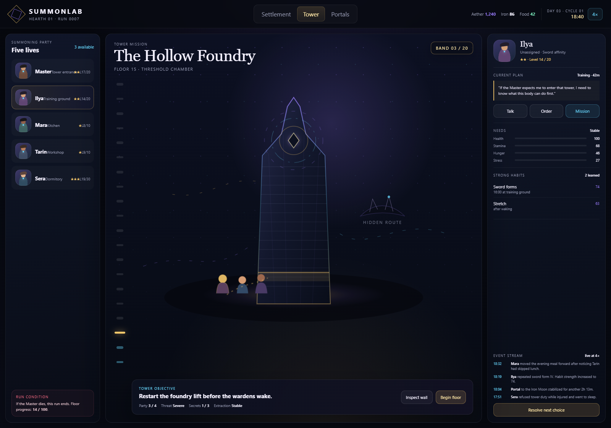
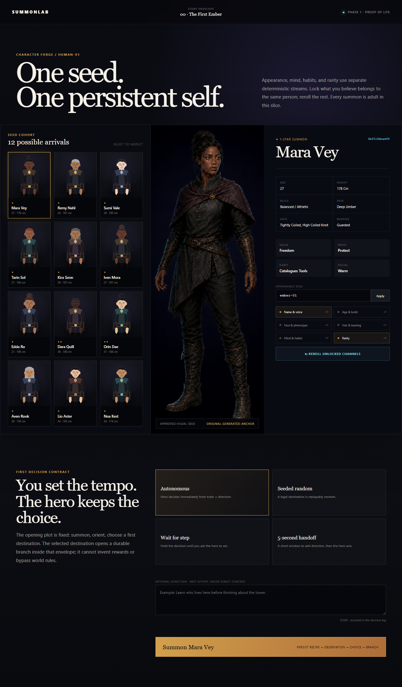
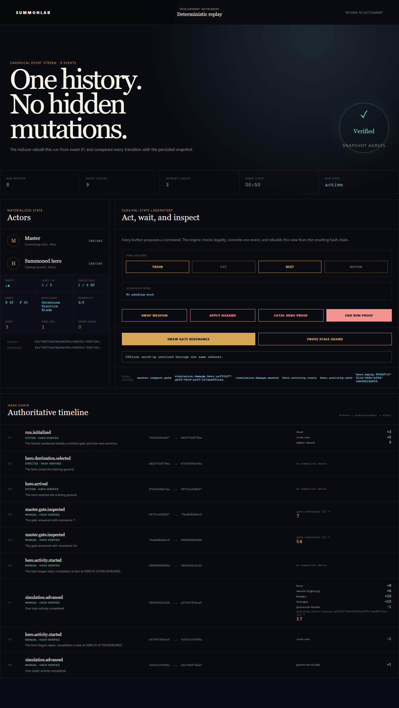

<div align="center">



# summonlab

**A hero-summoning game where every hero is an agent.**

Climb one hundred floors. Build a life between missions. Learn who your summons become.

_Status: Phases 0–2 are complete; the summon path and deterministic survival-state lab run locally._

</div>

## The game

The Master—the player's embodied character—awakens in a walled settlement built around an ancient summoning gate. Beyond the walls stands a one-hundred-floor tower. Other destinations exist only through unstable portals to resource-rich worlds.

The goal is clear: **reach floor 100 without the Master dying.** Hero death is permanent. If the Master dies, the run ends.

Summoned heroes arrive as clean slates. They have bodies, temperaments, affinities, and fragments of culture, but no memory of the settlement, the Master, or why they should recognize the Master's authority. They learn those things from what actually happens.

## Three connected loops

### Settlement loop

The settlement runs continuously on an accelerated server clock. The initial target is `4×` real time: one game day every six real hours.

Heroes eat, sleep, work, train, socialize, practice skills, idle, and form routines. The player can talk to available heroes, issue orders, send them to speak with someone, construct buildings, prepare missions, or ignore settlement management and train the Master instead.

### Mission loop

There are two mission families:

- **Tower missions** provide the objective. Difficulty rises every five floors, with larger tests and promotion resources every ten.
- **Portal missions** open temporary routes to other worlds for ore, ingredients, knowledge, equipment, and unusual encounters.

Combat heroes can climb. Non-combat heroes can cook, brew, craft, heal, research, maintain equipment, train others, or operate buildings. Roles remain choices rather than permanent castes.

### Master loop

The player can remain in the settlement, join tower and portal missions, or invest heavily in personal training. Strength is one source of recognized authority, but provision, competence, trust, fear, relationships, and demonstrated judgment also matter.

Only the Master can trigger construction, summoning, and synthesis. Heroes can suggest, operate, resist, negotiate, or react to those decisions.

## Habits make a life

Personality describes tendencies. Habits describe what a hero has actually learned to do in a particular situation.

Every hero develops cue-bound routines such as stretching after waking, training before dinner, visiting the workshop when anxious, or seeking a particular friend after a difficult mission. Buildings, schedules, needs, injuries, relationships, weather, orders, and available resources change which actions are possible and attractive.

Routine behavior does not require a model call every minute. Each hero makes at least one agent-authored daily plan, while a deterministic habit system carries out familiar actions until something meaningful interrupts them.

## How agency stays playable

<div align="center">



</div>

> **An agent may choose what happens next. It may never mutate game state directly.**

```text
world state + habits + remembered context
                  │
                  ▼
       legal choices / mission tools
                  │
                  ▼
          independent hero policy
                  │
                  ▼
       validated action or fallback
                  │
                  ▼
       deterministic engine + event log
```

The server owns the clock, state, context, memory, legality, costs, and consequences. The phone can be off while settlement decisions continue. Model responses are independent jobs assembled from the context Summonlab deliberately chooses to provide.

## Tower rules

- The tower has exactly 100 campaign floors.
- Each five-floor band introduces a new difficulty tier, environment, or rule pressure.
- Each tenth floor is a major gate, boss, or promotion checkpoint.
- The tower supplies the mission objective: eliminate, survive, protect, recover, reach, or discover.
- Hidden rooms, paths, and Easter eggs only appear when a hero tries a valid revealing action.
- Secrets are seeded and engine-owned; the model can discover them but cannot invent them into existence.

Floor 100 can end the campaign. An endless postgame mode can come later if the finite tower is fun.

## Heroes, stars, and synthesis

Heroes use a `1★–7★` progression:

- ordinary summons overwhelmingly produce `1★` or `2★` heroes;
- `3★` summons are special;
- a natural `4★` is an extreme anomaly;
- `5★–7★` are reached through promotion rather than normal summoning;
- each star raises the level cap by ten, ending at level 70 for `7★`;
- promotions unlock capacity, skill growth, and evolution choices without changing who the hero is.

Anyone can learn any skill, but aptitude, teacher quality, facilities, habits, physical constraints, and practice time determine how quickly.

Synthesis permanently consumes one hero to strengthen another. It is not a consequence-free duplicate system. Friends notice absences, witnesses remember, rumors travel through the social graph, and remaining heroes may become afraid, angry, compliant, ambitious, or distrustful.

A hero cannot permanently leave the roster on their own. Their terminal outcomes are death or synthesis.

## Clean-slate people

The first generator focuses on humans. Physiology stays stable unless a major promotion or evolution changes it. Temperament, values, drives, social style, habits, capabilities, loyalties, and beliefs can change through lived experience.

New summons do not automatically recognize authority. They may ask where they are, demand an explanation, distrust the Master, or refuse a dangerous order. Their knowledge graph begins with what they can observe and what others tell them.

Heritage, culture, gender, physicality, personality, capability, and rarity remain separate dimensions. Ethnicity or ancestry never implies intelligence, morality, temperament, or value.

## First playable slice

- one walled settlement with a gate, dormitory, training ground, workshop, and kitchen;
- the Master plus three clean-slate human summons;
- a continuous `4×` clock and one agent-authored daily plan per hero;
- habits for sleep, food, training, work, idling, and social contact;
- tower floors 1–5 with one hidden route;
- one temporary mining portal mission;
- one contested order and one authority conversation;
- one death-capable combat encounter;
- one synthesis decision with social propagation;
- a replay of contexts, choices, knowledge, and state transitions.

## Visual prototype



[Open the interactive prototype](prototype/index.html) to switch between the settlement, tower, and portal views, inspect heroes, change time speed, and resolve sample agent choices.

## Playable proof of life

The first runnable path now carries one deterministic adult hero through the entire opening beat:

```text
Character Forge → first-person summon → independent choice → settlement walk → event journal
```

The same recipe reproduces manifest bytes, SHA-256 identity hash, personality, habit, first policy
choice, and story branch. Four control modes demonstrate immediate autonomy, seeded randomness,
wait-for-step, and a five-second direction handoff without giving the hero direct access to state.



## Deterministic survival checkpoint

Every opening choice and settlement arrival now passes through a pure command → event → reducer
engine. PostgreSQL stores an idempotent command, an append-only event, and a hashed snapshot in one
transaction. A development inspector rebuilds the run from event 01, verifies every before/after
hash, exposes named entropy draws, and proves that two commands aimed at one version cannot both
commit. The same lab now schedules training, eating, rest, and repairs on an explicit game clock;
projects resources, experience, skills, needs, health, and durability into the journal; and proves
permanent hero death plus atomic Master game over. Existing `engine-v1` histories retain their
original schema and hashes while new summons use `engine-v2`.



## Local development

The application is a pnpm TypeScript workspace pinned to Node `24.14.1` and pnpm `10.33.0`.

```powershell
Copy-Item .env.example .env
pnpm install
pnpm dev
```

`pnpm dev` starts Docker PostgreSQL, applies pending migrations, opens the SvelteKit web process on `http://localhost:5173`, and starts the worker health process on `http://localhost:4174/health`. Begin at `http://localhost:5173/forge`. The launcher uses native Docker or Docker inside WSL on Windows. The web server binds to the private LAN by default for local playtesting.

If Docker is unavailable, use `pnpm dev:app`. Both processes stay runnable and report PostgreSQL as unavailable instead of inventing persistence. Run all local quality gates with `pnpm check`; browser smoke tests use `pnpm test:e2e` after installing Playwright Chromium once with `pnpm --filter @summonlab/web exec playwright install chromium`.

## Project documents

- [Game design](docs/game-design.md) — the hundred-floor campaign, habits, clean-slate characters, missions, progression, synthesis, authority, and permadeath.
- [Architecture and platform](docs/architecture.md) — accelerated time, offline decision scheduling, independent model jobs, context ownership, persistence, replay, and cost controls.
- [Visual direction](docs/visual-direction.md) — tower, settlement, portal, character, habit, synthesis, and animation language.
- [Capable prototype plan](docs/prototype-plan.md) — the original story arc, hybrid Character Forge, camera strategy, playable scope, milestones, and exit criteria.
- [Full implementation plan](docs/implementation-plan.md) — the production stack, domain model, APIs, persistence, testing, phased backlog, quality gates, and feedback checkpoints.

## Inspiration

Summonlab uses the familiar language of hero summoning and rarity, but its central inspiration is the manga *Pick Me Up, Infinite Gacha*: a world where summoned heroes have interiority, risk, and a life beyond being pieces on a board.

This is an independent experimental project and is not affiliated with or endorsed by the manga, its creators, publishers, or any game franchise.
