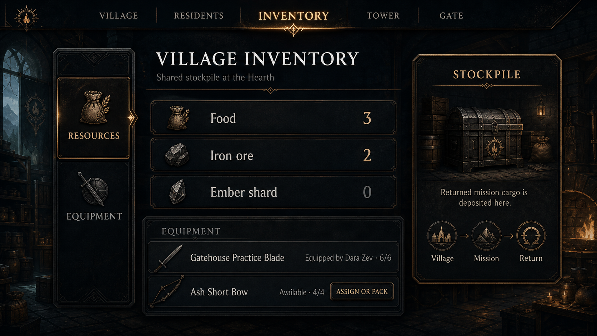

# Living Village client visual proposal

**Status:** Title gateway and tier-one Village locked; remaining system flows exploratory

**Date:** 2026-09-02

This packet turns the current client audit and the approved concept discussion into a durable phase-one
design proposal. It contains mockups and interaction guidance only. It does not modify runtime code,
gameplay contracts, or shared content catalogs.

## Decision status

### Freeze now

- the minimal title gateway and its square, architectural `Enter Village` button;
- the dark observatory palette, ember-gold structure, and cyan living-focus accent;
- a scene-first, centered Village composition on desktop;
- direct facility labels with fine leader lines;
- the cyan circle and arrow that connect a selected hero to the world;
- the five-destination phone navigation pattern and placement.
- the tier-one Village composition: Residence and Kitchen left, Training Grounds and Forge right, and
  the portal landmark centered at the rear.

### Continue designing

- the building upgrade language from the tier-one Village into the mature panorama;
- the exact Village Inventory organization and assignment interactions;
- the detailed suggested-packing and return-reconciliation sequence;
- whether Tower and Gate remain separate destinations;
- production feasibility, responsive collision handling, and final asset requirements.

The immediate goal is to freeze the foundation above, then use it to design the unresolved gameplay
surfaces without repeatedly reopening the entire art direction.

The title gateway is now locked. A future sign-in step may follow `Enter Village`, but it should inherit
this composition rather than turn the gateway into a conventional login form.

## Review order

1. [Current-state audit](./current-state-audit.md)
2. [Visual and interaction design](../../superpowers/specs/2026-09-02-living-village-client-visual-direction-design.md)
3. Mockups below

## Selected mockups

### Title gateway

### Living Village home

### Exploratory opening Village

The approved opening Village starts with a functioning tier-one Village: Residence and Kitchen on the left,
Training Grounds and Forge on the right, and a Portal Tower on the centerline. Exactly four visible
residents keep it intimate, while modest building footprints leave room for upgrades in place. All
buildings and labels remain inside a comfortable viewing safe area.

The [superseded sparse-site study](./mockups/opening-village-desktop-v1.png) remains as design history;
it felt too much like a construction yard and did not provide enough sense of starting in a village.
The [second candidate](./mockups/opening-village-desktop-v2.png) established the complete tier-one
facilities but placed Forge on the left and Kitchen on the right and pushed some content too close to
the frame edges.

### Lightweight building growth studies

These are loose visual guidance, not production tier contracts. They test a readable architectural
lineage from the intimate opening Village to the mature observatory settlement while keeping each
facility recognizable in place. The names are exploratory labels. Exact tier count, costs, capacity,
dimensions, and construction behavior remain undefined so interface work stays the priority.

### Shared Village Inventory

### Suggested mission packing

### Hero inspection

## Mockup boundary

These images communicate layout, hierarchy, atmosphere, and interaction intent. Generated faces,
mission labels, and item illustrations are placeholders, not additions to canonical content. Existing
contract-backed names and quantities are used where the proposal discusses current state. Any future
inventory implementation needs its own contract and catalog design review.
