# Living Village client visual proposal

**Status:** Title gateway, tier-one Village, and control model locked; Inventory redesign proposed

**Date:** 2026-09-02

This packet turns the current client audit and the approved concept discussion into a durable phase-one
design proposal. It contains mockups and interaction guidance only. It does not modify runtime code,
gameplay contracts, or shared content catalogs.

## Primary gameplay visual references

These two promoted images set the dominant quality bar for the inhabited Village, hero inspection,
mission preparation, responsive composition, portrait treatment, and engraved interaction language.
Their older `Tower` and `Gate` navigation labels are not current behavior; the approved global shell is
`Village`, `Residents`, `Inventory`, and `Missions`.

### Mature Village and hero inspection

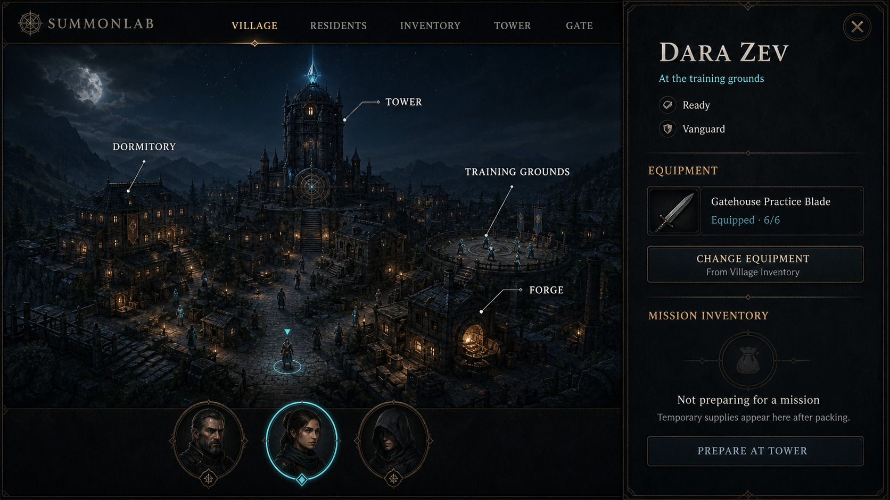

### Mission packing on phone

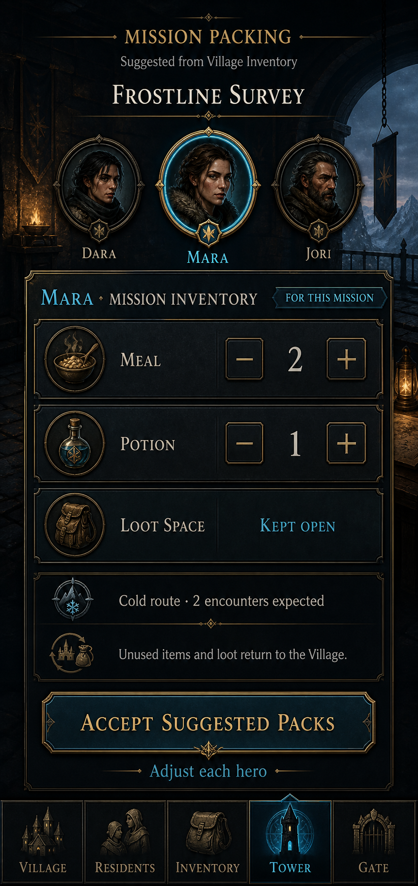

## Decision status

### Freeze now

- the minimal title gateway and its square, architectural `Enter Village` button;
- the dark observatory palette, ember-gold structure, and cyan living-focus accent;
- a scene-first, centered Village composition on desktop;
- direct facility labels with fine leader lines;
- the cyan circle and arrow that connect a selected hero to the world;
- the four global modes: `Village`, `Residents`, `Inventory`, and `Missions`;
- point-to-move for a selected resident, separate from facility and mode navigation;
- the phone bottom-navigation placement and icon-plus-label treatment;
- the tier-one Village composition: Residence and Kitchen left, Training Grounds and Forge right, and
  the portal landmark centered at the rear.

### Continue designing

- the exact gameplay thresholds behind the visual Village stages;
- final Village Inventory states and exact equipment-assignment feedback;
- the detailed suggested-packing and return-reconciliation sequence;
- production feasibility, responsive collision handling, and final asset requirements.

The immediate goal is to freeze the foundation above, then use it to design the unresolved gameplay
surfaces without repeatedly reopening the entire art direction.

The title gateway is now locked. A future sign-in step may follow `Enter Village`, but it should inherit
this composition rather than turn the gateway into a conventional login form.

## Review order

1. [Current-state audit](./current-state-audit.md)
2. [Visual and interaction design](../../superpowers/specs/2026-09-02-living-village-client-visual-direction-design.md)
3. Mockups below

## Supporting mockups

### Title gateway

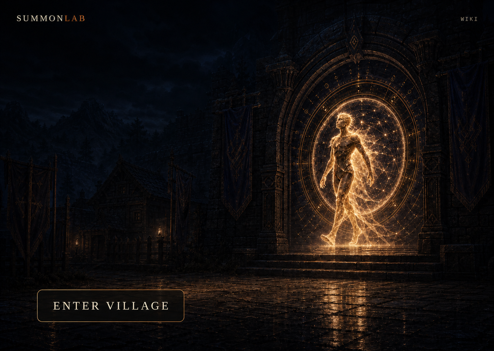

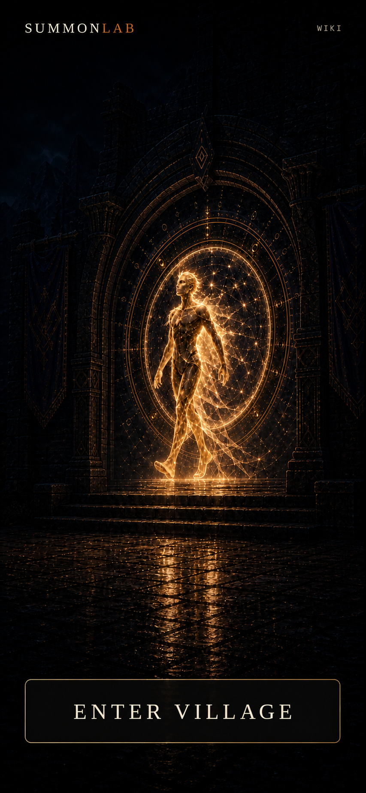

### Living Village home

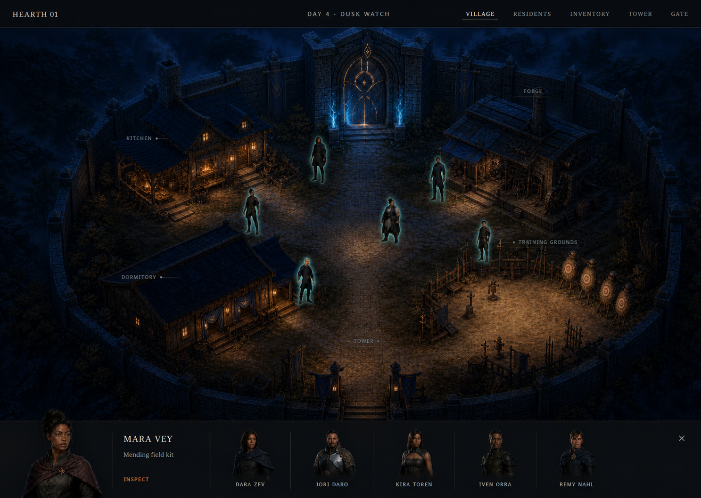

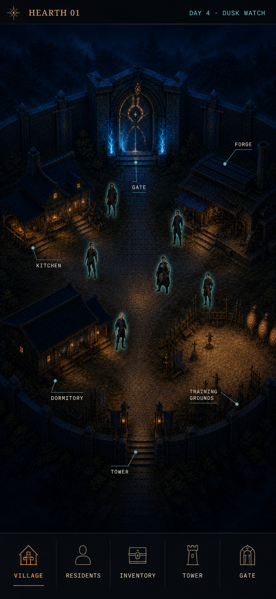

### Complete Village progression

These three complete desktop mockups preserve one camera, road pattern, facility layout, and interface
shell while the settlement grows in place. The stages describe visual maturity only; they do not create
a three-level gameplay contract. The shell uses the approved four-mode navigation:
`Village`, `Residents`, `Inventory`, and `Missions`.

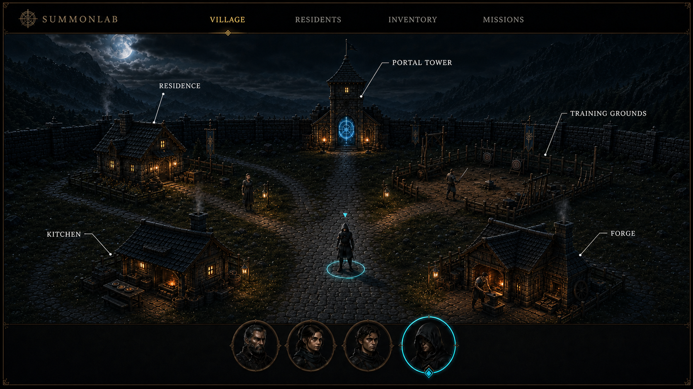

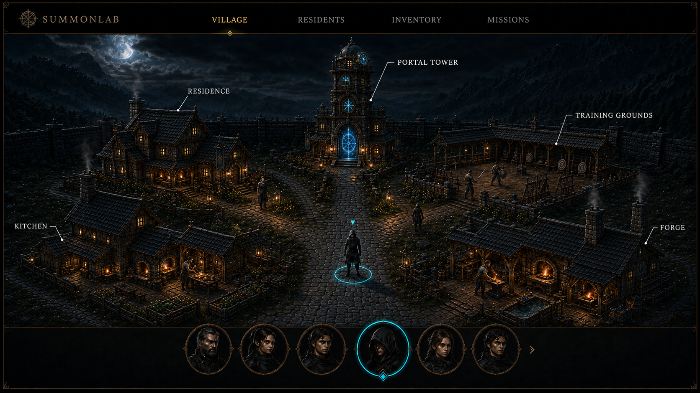

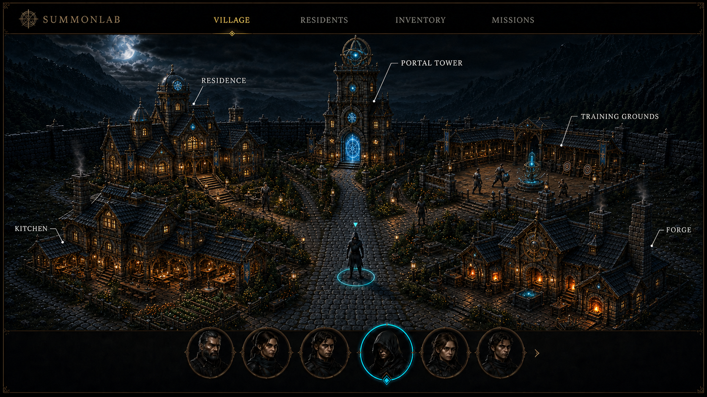

### Exploratory opening Village

The approved opening Village starts with a functioning tier-one Village: Residence and Kitchen on the left,
Training Grounds and Forge on the right, and a Portal Tower on the centerline. Exactly four visible
residents keep it intimate, while modest building footprints leave room for upgrades in place. All
buildings and labels remain inside a comfortable viewing safe area.

The [superseded sparse-site study](./mockups/opening-village-desktop-v1.png) remains as design history;
it felt too much like a construction yard and did not provide enough sense of starting in a village.
The [second candidate](./mockups/opening-village-desktop-v2.png) established the complete tier-one
facilities but placed Forge on the left and Kitchen on the right and pushed some content too close to
the frame edges.

### Lightweight building growth studies

These are loose visual guidance, not production tier contracts. They test a readable architectural
lineage from the intimate opening Village to the mature observatory settlement while keeping each
facility recognizable in place. The names are exploratory labels. Exact tier count, costs, capacity,
dimensions, and construction behavior remain undefined so interface work stays the priority.

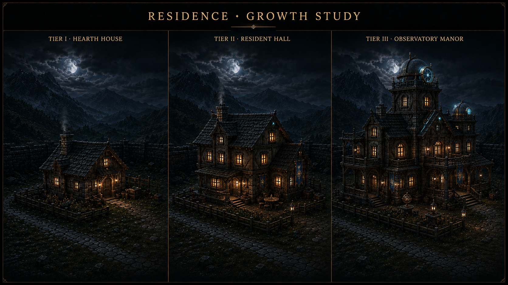

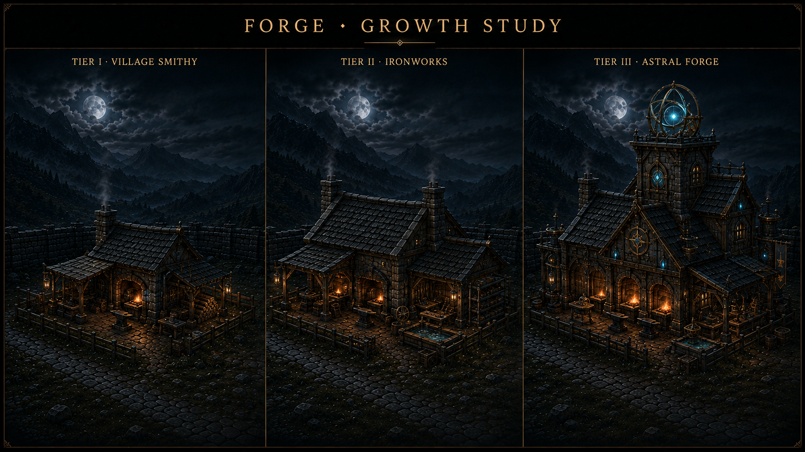

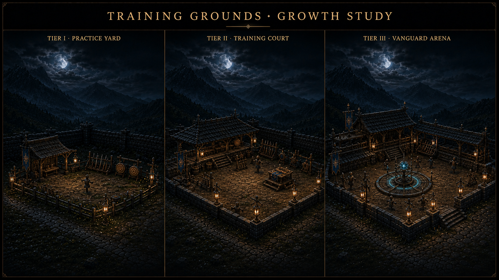

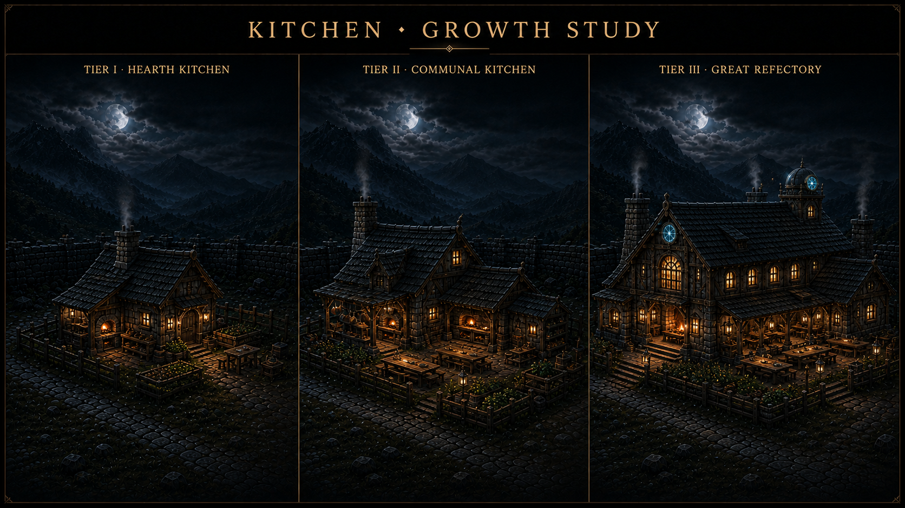

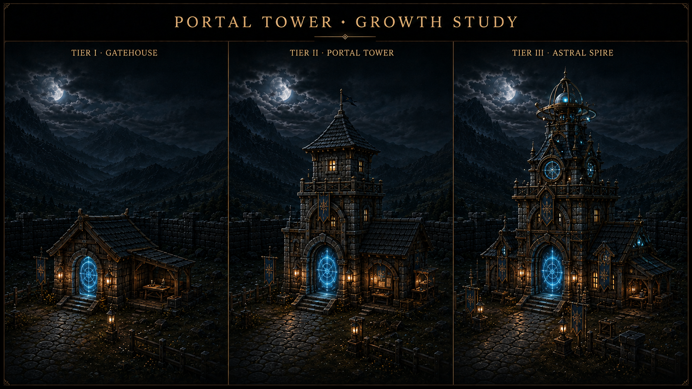

### Shared Village Inventory

The revised Inventory keeps the stockpile communal and visually dominant. Selecting available equipment
opens an explicit resident chooser; mission supplies remain in the `Missions` preparation flow instead
of sharing an ambiguous `Assign or Pack` action.

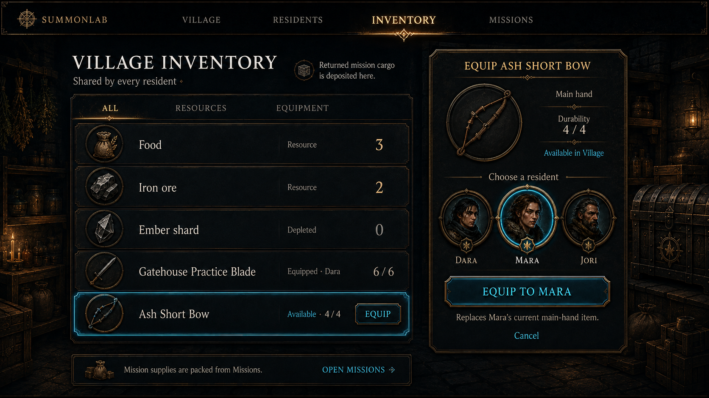

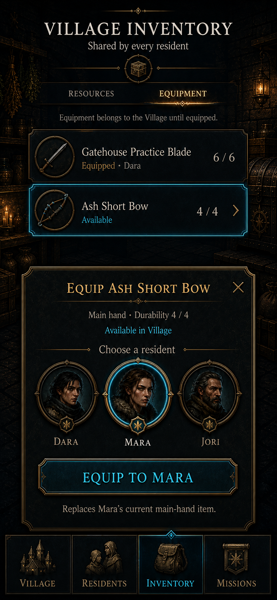

The [earlier desktop concept](./mockups/village-inventory-desktop.png) remains as design history. Its
five-mode shell and combined `Assign or Pack` action are superseded.

### Suggested mission packing

See the [promoted phone mission-packing reference](./mockups/mission-packing-phone.png) above.

### Hero inspection

See the [promoted mature Village and hero-inspection reference](./mockups/hero-inspection-desktop.png)
above.

## Mockup boundary

These images communicate layout, hierarchy, atmosphere, and interaction intent. Generated faces,
mission labels, and item illustrations are placeholders, not additions to canonical content. Existing
contract-backed names and quantities are used where the proposal discusses current state. Any future
inventory implementation needs its own contract and catalog design review.
