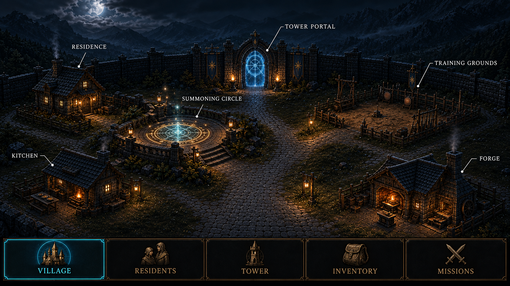

# Living Village client visual proposal

**Status:** Title gateway and tier-one Village foundation locked; five-mode threshold revision accepted

**Date:** 2026-09-09

This packet turns the current client audit and the approved concept discussion into a durable phase-one
design proposal. It contains mockups and interaction guidance only. It does not modify runtime code,
gameplay contracts, or shared content catalogs.

## Primary gameplay visual references

These two promoted images set the dominant quality bar for the inhabited Village, hero inspection,
mission preparation, responsive composition, portrait treatment, and engraved interaction language.
Their older `Tower` and `Gate` labels are superseded by the five-mode global shell: `Village`,
`Residents`, `Tower`, `Inventory`, and `Missions`.

## Accepted Village threshold revision

The rear-center landmark remains a standalone Tower Portal; it is not a physical tower. A separate
Summoning Circle sits on a raised side terrace off the central walking path. The Circle owns both
summoning and painless, irreversible synthesis: the sacrificed human hero becomes light and is
absorbed by the receiving hero. The Tower Portal owns floor travel only.

The `Tower` mode begins with floor choice. Choosing a conquered floor starts an idle repeat for
training and materials. Choosing the next unconquered floor prepares an active exploration and then
hands off to `/explore/[runId]`. Mission packing is part of that Tower preparation flow; `Missions`
remains the objective and story-journal surface.

### Mature Village and hero inspection

### Mission packing on phone

## Opening story storyboard

The proposed opening stays simple: the Master connects, summons three adults, answers their first
questions, assigns the sword, spear, and bow, survives the gate attack, and receives the first Tower
objective. The threat clock begins only after the player's first reply. The Master remains nonphysical
and makes the final equipment decisions even when heroes state preferences.

The four mockups and their interaction notes are collected in the
[opening story and onboarding storyboard](./opening-storyboard.md). The Tower holding a failing breach is
an exploratory story premise for review, not a runtime or shared-catalog change.

## Decision status

### Freeze now

- the minimal title gateway and its square, architectural `Enter Village` button;
- the dark observatory palette, ember-gold structure, and cyan living-focus accent;
- a scene-first, centered Village composition on desktop;
- direct facility labels with fine leader lines;
- the cyan circle and arrow that connect a selected hero to the world;
- the five global modes: `Village`, `Residents`, `Tower`, `Inventory`, and `Missions`;
- point-to-move for a selected resident, separate from facility and mode navigation;
- the phone bottom-navigation placement and icon-plus-label treatment;
- the tier-one Village composition: Residence and Kitchen left, Training Grounds and Forge right, a
  standalone Tower Portal centered at the rear, and a separate Summoning Circle on a side terrace.

### Continue designing

- the proposed Tower-and-breach opening premise and its exact canonical wording;
- the exact gameplay thresholds behind the visual Village stages;
- final Village Inventory states and exact equipment-assignment feedback;
- the detailed suggested-packing and return-reconciliation sequence;
- production feasibility, responsive collision handling, and final asset requirements.

The immediate goal is to freeze the foundation above, then use it to design the unresolved gameplay
surfaces without repeatedly reopening the entire art direction.

The title gateway is now locked. A future sign-in step may follow `Enter Village`, but it should inherit
this composition rather than turn the gateway into a conventional login form.

## Review order

1. [Current-state audit](./current-state-audit.md)
2. [Visual and interaction design](../../superpowers/specs/2026-09-02-living-village-client-visual-direction-design.md)
3. Mockups below

## Supporting mockups

### Title gateway

### Vertical portal study

These are review candidates, not replacements for the locked title gateway. Both reinterpret the
opening chamber's horizontal summoning seal as a traversable upright threshold and deliberately omit
baked-in interface panels so live controls can occupy the lower-left safe area without doubling the
frame.

The stone arch communicates permanence and passage most clearly. The rune frame is visually lighter
and may better suit a tier-one Village. Generation prompts and invariants are recorded in the
[vertical portal study notes](./portal-vertical-study.md).

### Living Village home

### Complete Village progression

These three complete desktop mockups preserve one camera, road pattern, facility layout, and interface
shell while the settlement grows in place. The stages describe visual maturity only; they do not create
a three-level gameplay contract. Their four-mode shell and combined portal landmark predate the
accepted five-mode threshold revision above.

### Opening Village threshold revision

The current direction starts with a functioning tier-one Village: Residence and Kitchen on the left,
Training Grounds and Forge on the right, a standalone Tower Portal on the rear centerline, and a
separate Summoning Circle on a raised side terrace. The five-item dock follows the engraved treatment
of the player-provided mission-packing reference.

The earlier opening candidate used a combined Portal Tower and the superseded navigation model. It
remains below as design history rather than the active direction.

The [superseded sparse-site study](./mockups/opening-village-desktop-v1.png) remains as design history;
it felt too much like a construction yard and did not provide enough sense of starting in a village.
The [second candidate](./mockups/opening-village-desktop-v2.png) established the complete tier-one
facilities but placed Forge on the left and Kitchen on the right and pushed some content too close to
the frame edges.

### Lightweight building growth studies

These are loose visual guidance, not production tier contracts. They test a readable architectural
lineage from the intimate opening Village to the mature observatory settlement while keeping each
facility recognizable in place. The names are exploratory labels. Exact tier count, costs, capacity,
dimensions, and construction behavior remain undefined so interface work stays the priority.

### Shared Village Inventory

The revised Inventory keeps the stockpile communal and visually dominant. Selecting available equipment
opens an explicit resident chooser; mission supplies remain in the `Missions` preparation flow instead
of sharing an ambiguous `Assign or Pack` action.

The [earlier desktop concept](./mockups/village-inventory-desktop.png) remains as design history. Its
five-mode shell and combined `Assign or Pack` action are superseded.

### Suggested mission packing

See the [promoted phone mission-packing reference](./mockups/mission-packing-phone.png) above.

### Hero inspection

See the [promoted mature Village and hero-inspection reference](./mockups/hero-inspection-desktop.png)
above.

## Mockup boundary

These images communicate layout, hierarchy, atmosphere, and interaction intent. Generated faces,
mission labels, and item illustrations are placeholders, not additions to canonical content. Existing
contract-backed names and quantities are used where the proposal discusses current state. Any future
inventory implementation needs its own contract and catalog design review.
