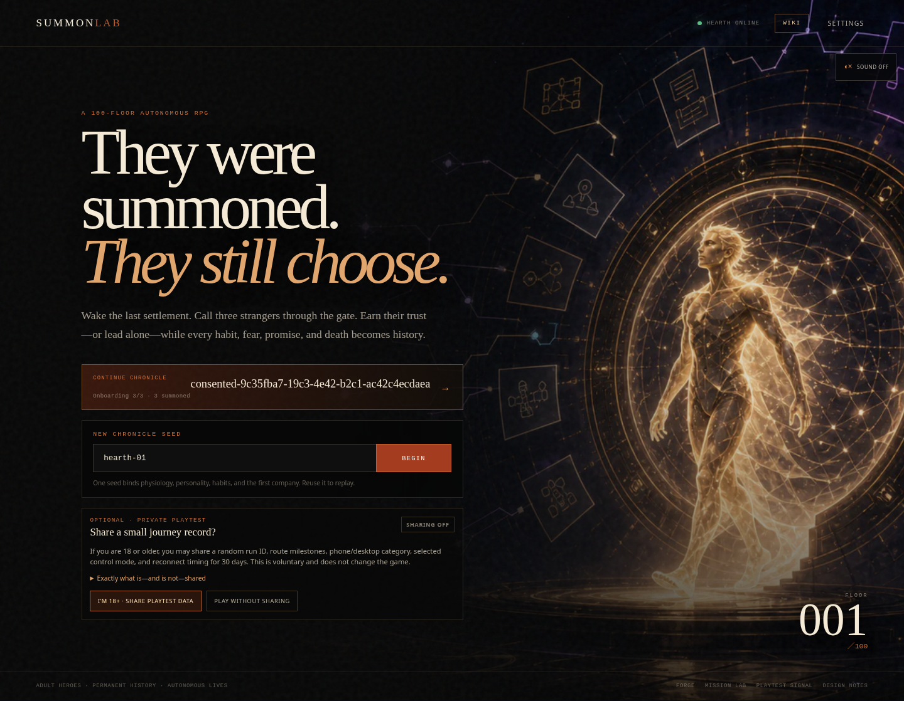
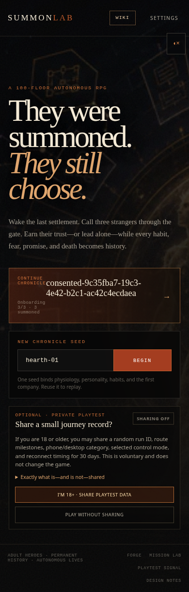
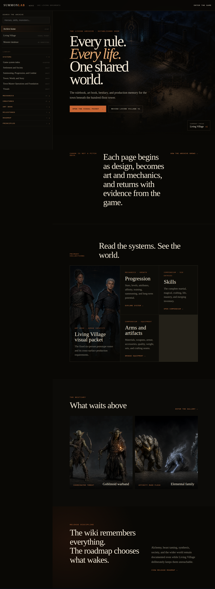
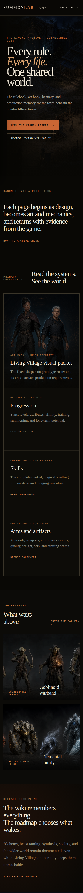
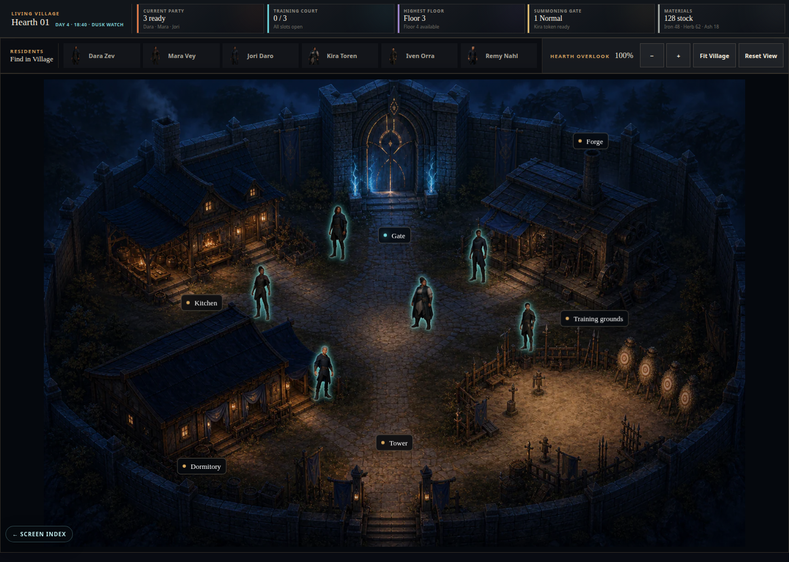
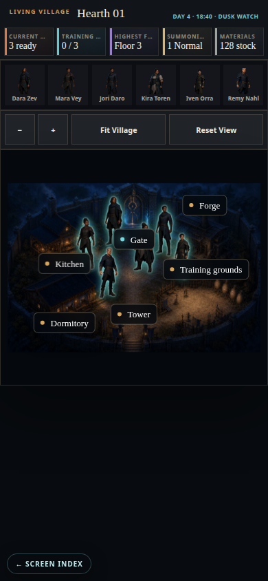
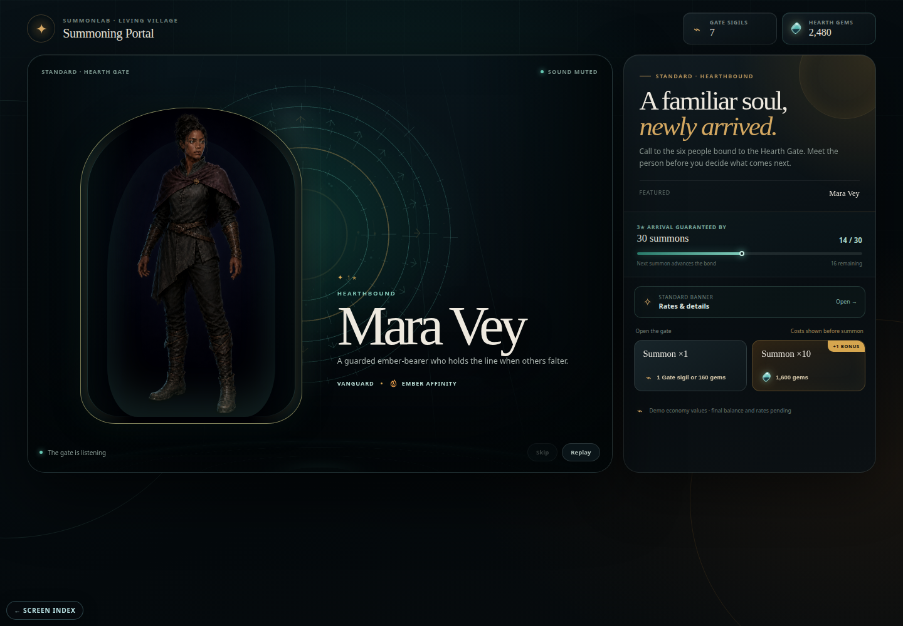
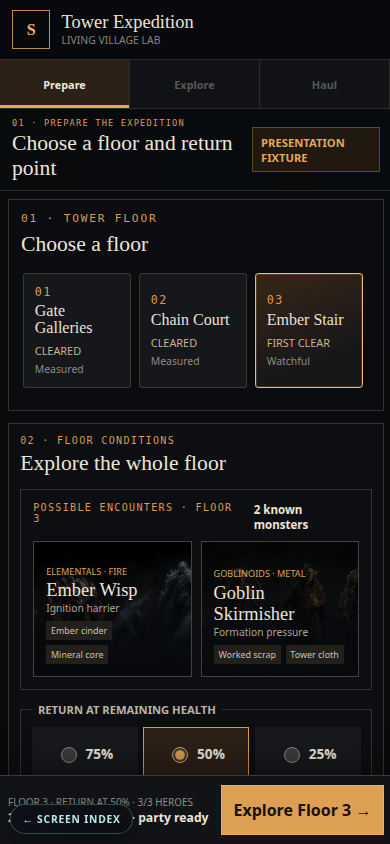
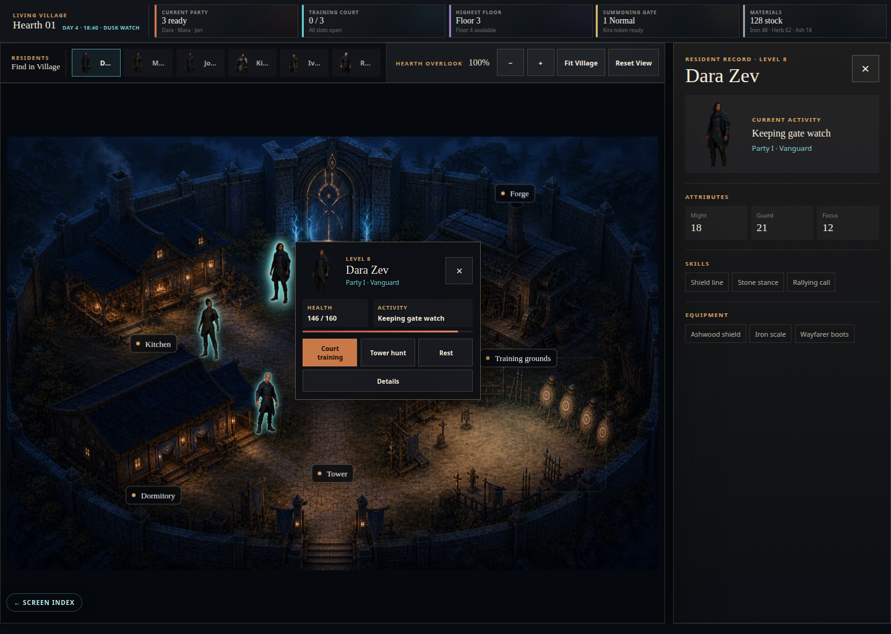

# Current client visual audit

**Audit date:** 2026-09-02

**Viewports:** desktop 1440×1000 and phone 390×844

**Method:** fresh browser walkthrough of the running SvelteKit client, including route navigation,
Village entry, resident selection, and detail-layer interactions. The screenshots in this packet are
the captured audit evidence.

## Executive finding

The client already has a persuasive world, but it presents four different interface dialects:

- the title page is a cinematic editorial landing page;
- the Wiki is a strong living field archive;
- the Village is an evocative scene constrained by utility chrome;
- Summon, Tower, and hero details behave like separate product prototypes.

The priority is therefore not a global navigation redesign. It is a clearer boundary between three
experiences: a minimal title gateway, an independent Wiki, and a coherent in-world Village shell.

## Screen audit

| Step | Surface | Health | What works | Primary issue | Recommendation |
| --- | --- | --- | --- | --- | --- |
| 1 | Title gateway | Warning | Strong cinematic illustration and immediate dark-fantasy tone | Seed controls, consent/status text, and development links compete with entry | Reduce the page to the mark, one `Enter Village` action, and a quiet corner `Wiki` link |
| 2 | Wiki home/article | Healthy | Distinct archival voice, good worldbuilding, legible long-form structure | Phone index and dense article navigation can consume too much of the reading viewport | Preserve the Wiki as a separate destination; tighten mobile index behavior and line length without importing Village navigation |
| 3 | Village home | Critical on phone | Memorable settlement scene and spatial building model | Utility chrome compresses the phone scene into a narrow band; the lower viewport feels empty and non-interactive | Make the scene the home surface; use direct facility pointers and a fixed thumb-reachable bottom bar on phone |
| 4 | Summon | Warning | Polished composition and a clear focal ritual | Its teal/gold rounded panel language feels detached from the sharper, darker Village vocabulary | Retain the ritual composition while adopting the Village shell, materials, type hierarchy, and motion timing |
| 5 | Tower | Warning | Functional expedition staging information | Reads as a test harness, especially on phone, and lacks a clear preparation sequence | Reframe as a staging room with mission selection, suggested packing, review, and departure |
| 6 | Hero quick view | Warning | Fast access to resident identity and readiness | Popover and drawer can coexist, creating competing layers and ambiguous dismissal | Use one inspection layer at a time and connect selection to the resident's position in the scene |
| 7 | Hero detail/equipment | Critical concept gap | Equipment state and durability are visible | Read-only item tags resemble a personal inventory and do not explain shared custody | Separate persistent Equipment from temporary Mission Inventory; route item assignment through Village Inventory |

## Evidence

### Title

### Wiki

### Village

### Adjacent gameplay surfaces

## Cross-cutting observations

### Hierarchy

The current client frequently gives system state, route controls, and world content comparable visual
weight. The proposed hierarchy is: world first, current intent second, status third, diagnostics only
when explicitly requested.

### Responsive behavior

Desktop has enough width for a persistent spatial scene and a contextual side sheet. Phone should not
compress that desktop composition. It needs a vertical scene, bottom navigation, compact sheets, and
progressive disclosure.

### Accessibility

The existing atmospheric palette sometimes depends on low-contrast small text. The next implementation
pass should verify text contrast, visible keyboard focus, minimum 44×44 touch targets, semantic button
labels, safe-area insets, and reduced-motion behavior. Gold should indicate structure or selection;
cyan should indicate living focus or active status, not carry meaning alone.

### Content boundaries

The Wiki should remain discoverable from the title gate and addressable directly by URL. Village
navigation should never wrap Wiki pages, and the game should surface only short contextual explanations
or field-note excerpts when the player needs them.
