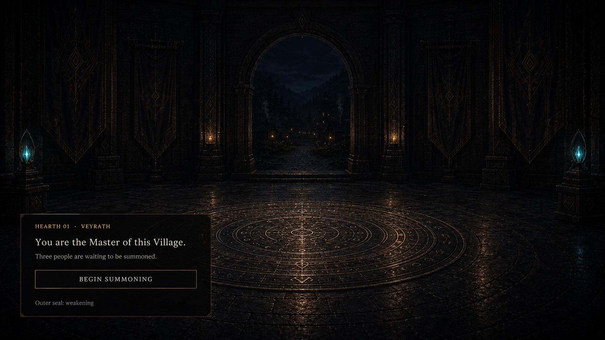
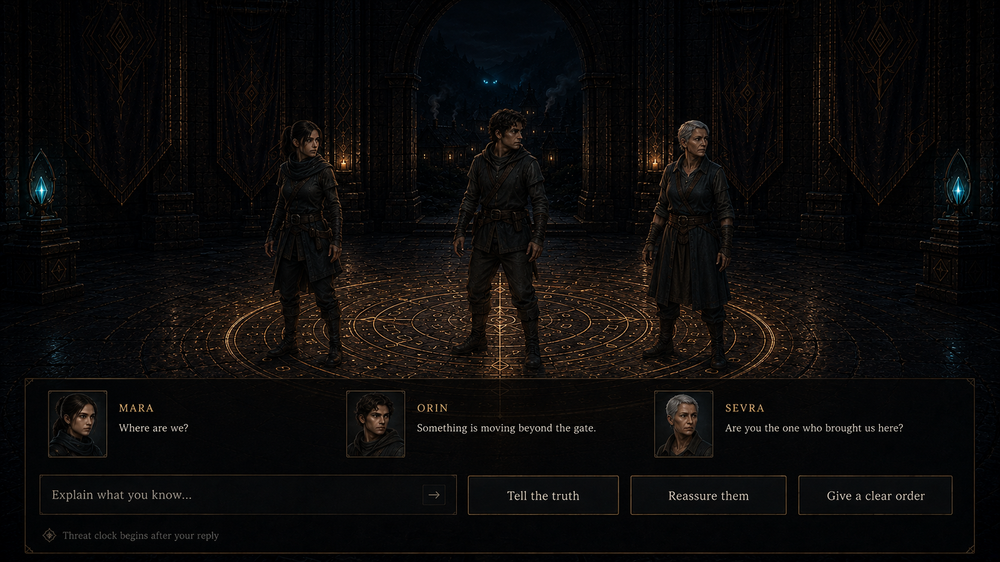
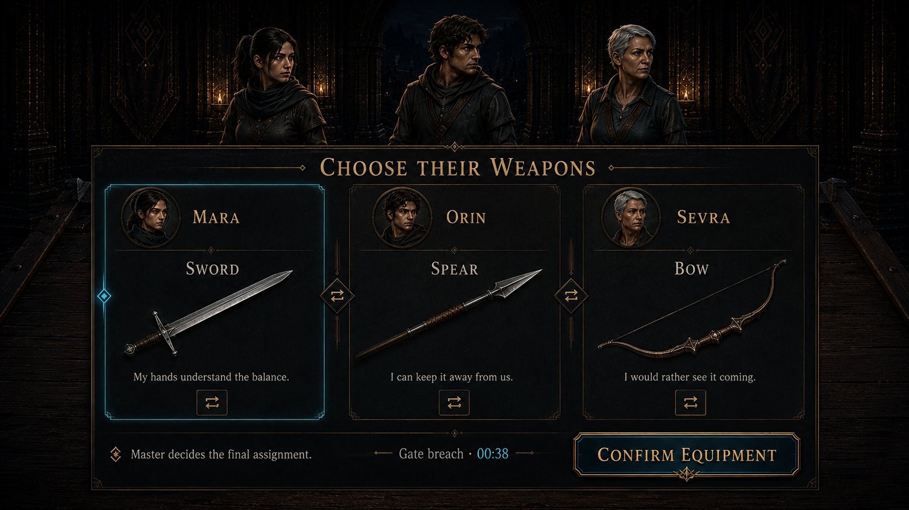
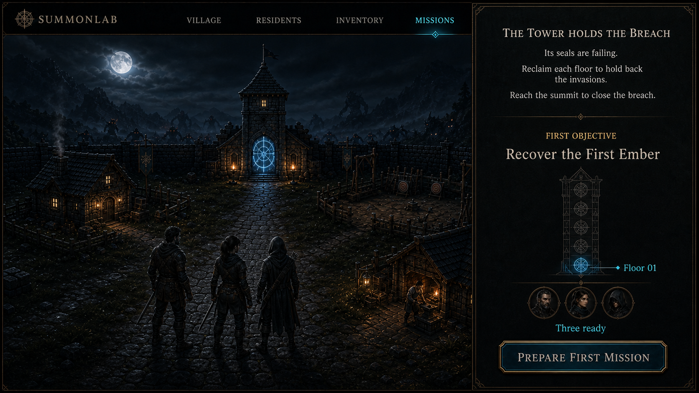

# Opening story and onboarding storyboard

**Status:** Visual story proposal with an isolated playable laboratory

**Date:** 2026-09-03

**Boundary:** Mockups and presentation logic only. This proposal does not change gameplay contracts,
runtime story envelopes, or shared content catalogs.

Playable route: `/living-village-lab/opening`. It exercises the four approved presentation beats with
local state, then enters the existing Living Village laboratory. The implied first defense is not a
combat prototype and does not call combat or campaign APIs.

## The simple start

The opening should not begin with a cinematic explanation. It gives the player one new role, one
irreversible act, and one immediate practical responsibility:

1. The Master connects to a newly assigned Village.
2. The Master summons three adults into it.
3. The three arrivals ask what is happening, and the Master answers in free text or with a short
   response shortcut.
4. Each person states a practical weapon preference; the Master makes the final sword, spear, and bow
   assignments.
5. The group survives a short attack at the gate.
6. The first mission briefing reveals the larger purpose of the Tower.

The summoning itself is the one controlled spectacle. Everything after it should feel immediate and
interactive. The drama comes from three believable people trying to act before they understand the
world, not from long narration.

The first screen uses the exploratory auto-name `Hearth 01 · Veyrath`. `Hearth 01` preserves the
creation sequence, while the magical nickname gives the Village a distinct identity. Both presentation
and editing rules remain proposals; this mockup does not add either value to a shared catalog.

## Four-screen storyboard

### 1. Master connection

The player learns only what is needed to act: they are the Master of this Village, three people are
waiting, and the outer seal is weakening. The Master remains a nonphysical presence and receives no
avatar.

### 2. Three arrivals

Exactly three adults arrive with empty hands. Their first lines expose three different concerns:
location, immediate danger, and the Master's responsibility. The player may type an explanation or use
one of three short response intents. The threat clock begins only after the player's first reply so the
opening does not punish reading or typing.

Normal runs should draw the trio from the generated population. A stable, curated seed may be used for
demos and visual review. Names, faces, and lines shown here are presentation placeholders.

### 3. First weapon decision

The three arrivals explain why a sword, spear, or bow feels workable to them. These are preferences, not
automatic ownership or hidden inventory. Every assignment has a visible non-drag control, and the Master
makes the final allocation. This makes personality relevant immediately without taking the decision away
from the player.

### 4. First Tower objective

After the gate defense, the interface gives one durable campaign sentence: **the Tower holds the
breach**. Its seals are failing; reclaiming floors slows the invasions, and reaching the summit offers a
path to close the breach. Floor 01 then has a concrete first objective: recover the First Ember.

This Tower-and-breach relationship is a story hypothesis for review. It is intentionally not written
into the runtime story envelope or content catalog in this phase.

## Perceived danger in the opening

Fear should respond to what each hero can perceive rather than behave like a random refusal roll. The
opening raises danger through an unknown place, unfamiliar companions, movement beyond the gate, and
unfamiliar weapons. It gives the player four immediate ways to lower it: explain, reassure, prepare, and
make a clear decision.

The resulting behavior may differ without inventing illegal actions. A hero might ask for a different
weapon, hesitate, stay close to another hero, strike late, or refuse an exposed position. The interface
should state the observable reason and preserve the Master's ability to issue a final order; whether a
hero obeys remains a later gameplay-contract decision.

## Motion direction

- The dormant seal wakes in one continuous inward-to-outward light sweep.
- The three heroes resolve into the world together, then move independently as they take in the room.
- Dialogue appears in speaking order without floating speech bubbles or camera cuts.
- Confirming equipment draws one brief cyan line from each portrait to its weapon.
- The Tower briefing transitions by letting the chamber arch become the Village view; the camera does
  not cut to an unrelated menu backdrop.
- Reduced-motion presentation replaces the light sweep and camera transition with short crossfades while
  preserving the same information order.
