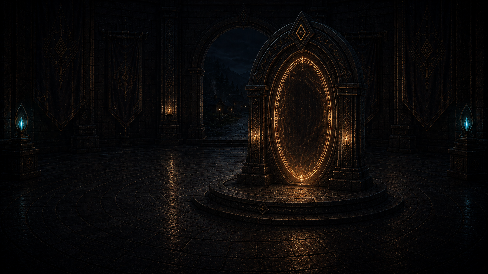
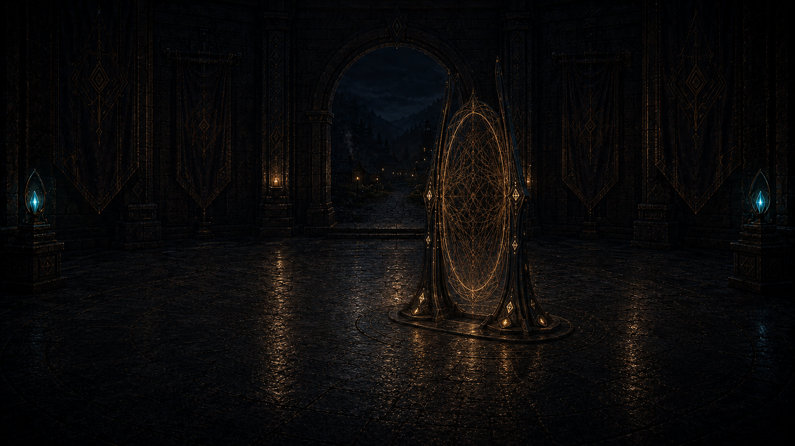

# Vertical portal study

**Status:** Two review candidates; neither is promoted or wired into the client

**Date:** 2026-09-03

**Source:** `mockups/opening-master-connection-desktop.png`

**Generation mode:** Built-in image generation, precise object edit

## Shared invariants

- Preserve the opening chamber, banners, rear doorway, distant tier-one Village, and blue side
  crystals.
- Keep the lower-left quadrant dark and uncluttered for a live interface surface.
- Replace the horizontal floor seal with a human-scaled, visibly traversable vertical portal.
- Remove embedded panels, buttons, labels, typography, logos, people, and watermarks.
- Use restrained amber light over near-black blue stone; avoid neon science-fiction treatment and
  endgame monument scale.

## Candidate A — stone arch

Replace the floor seal with a freestanding dark-stone arch and an upright oval field of restrained
amber-gold runes, slightly right of center on a shallow plinth. Keep the device ancient, quiet,
physically enterable, and plausible in a sparse level-one Village. Preserve the distant Village view
and add only a subtle warm reflection on the wet floor.

## Candidate B — rune frame

Replace the floor seal with two narrow dark-metal rune pylons supporting an upright oval membrane of
fine amber-gold geometric threads. Keep it human-scaled, lightly anchored, and less architectural than
the stone gate so it reads as a dormant Village artifact awakening. Preserve the rear Village view and
leave only a faint anchoring ring beneath the device.

## Recommendation

Use the stone arch when the portal must read instantly as a doorway. Use the rune frame if the opening
Village should feel materially younger and less established. Do not replace the title gateway until a
desktop-and-phone crop study confirms the selected silhouette leaves enough room for the wordmark,
Wiki link, and `Enter Village` action.
