# Enemy Normal-anchor review handoff

These are candidate-only review artifacts for the 150 canonical Normal anchors. They do not approve or promote any image.

Review order matters:

1. The independent blind reviewer opens each blind sheet first and records a verdict for every opaque token without consulting its map.
2. The owner reviews each labeled sheet for family continuity, T1–T5 escalation, combat readability, anatomy, composition, and finish.
3. The controller reconciles token verdicts through the map and records immutable receipts through the assigned reviewer identities.
4. Only mutually approved Normal anchors may activate their Fire, Earth, Wind, and Water assignments.

## Wave A1

Families: goblins, orcs, giants, trolls, dragons.

### Independent blind T3/T5 review

Review this image and record verdicts by opaque token before consulting the controller map.

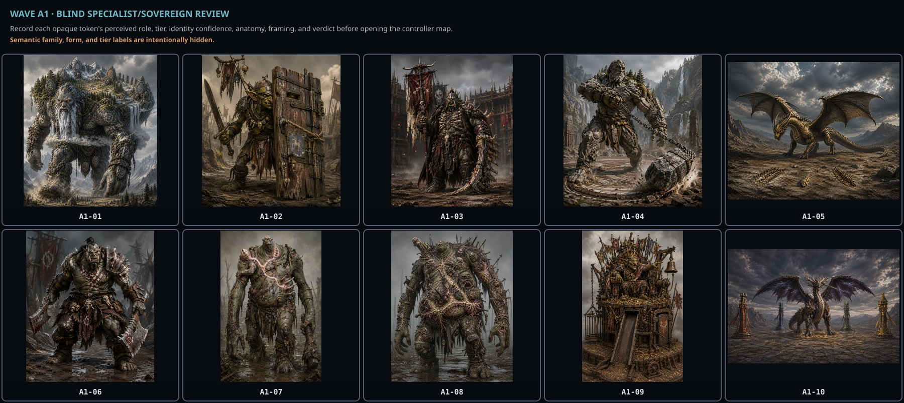

### Owner family-progression review

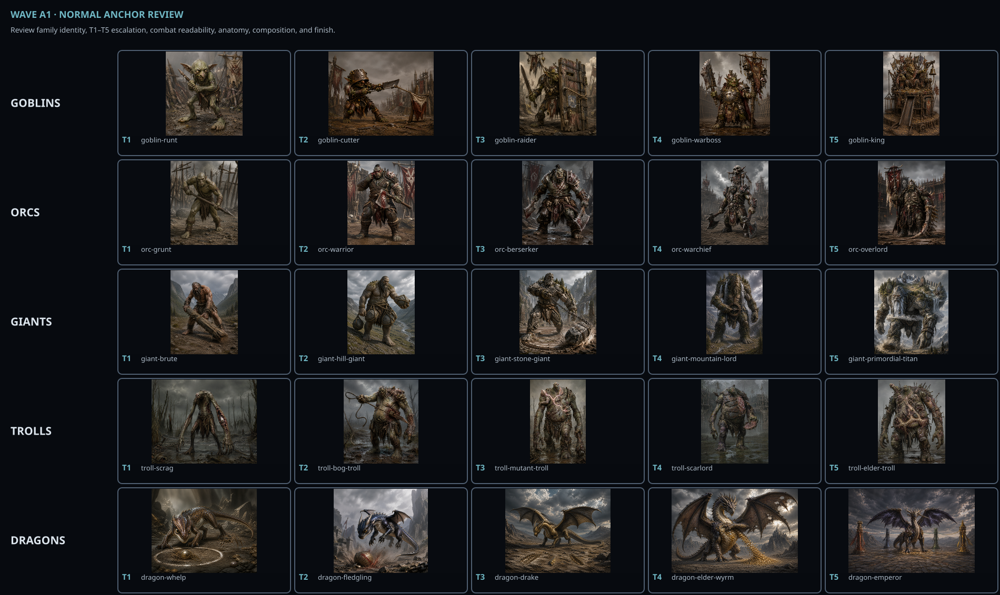

Controller-only reconciliation map: [wave-a1-blind-map.json](./wave-a1-blind-map.json).

## Wave A2

Families: skeletons, rotwalkers, wraiths, vampires, mummies.

### Independent blind T3/T5 review

Review this image and record verdicts by opaque token before consulting the controller map.

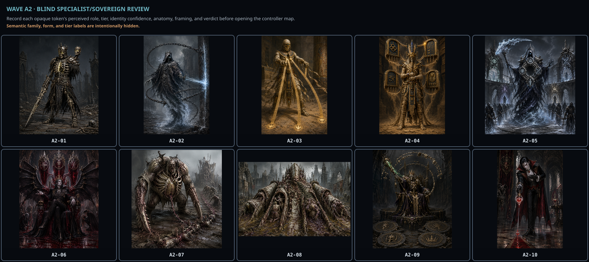

### Owner family-progression review

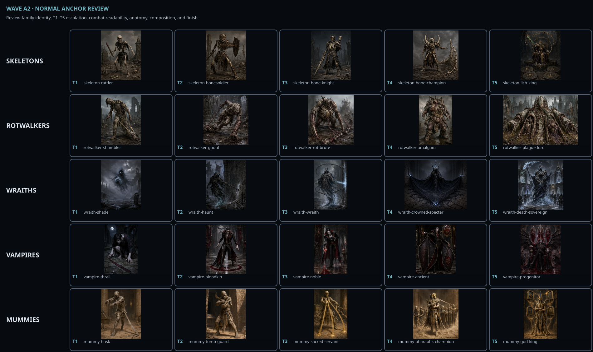

Controller-only reconciliation map: [wave-a2-blind-map.json](./wave-a2-blind-map.json).

## Wave A3

Families: demons, celestials, harpies, minotaurs, nagas.

### Independent blind T3/T5 review

Review this image and record verdicts by opaque token before consulting the controller map.

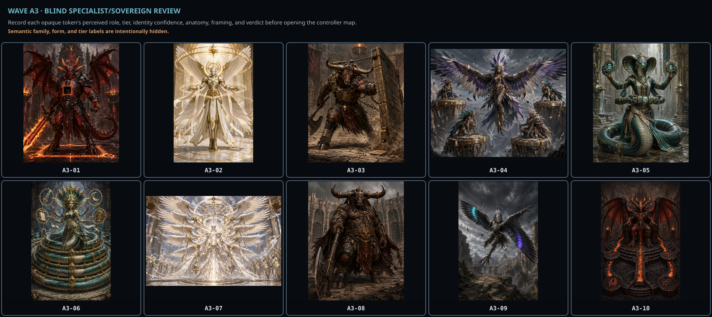

### Owner family-progression review

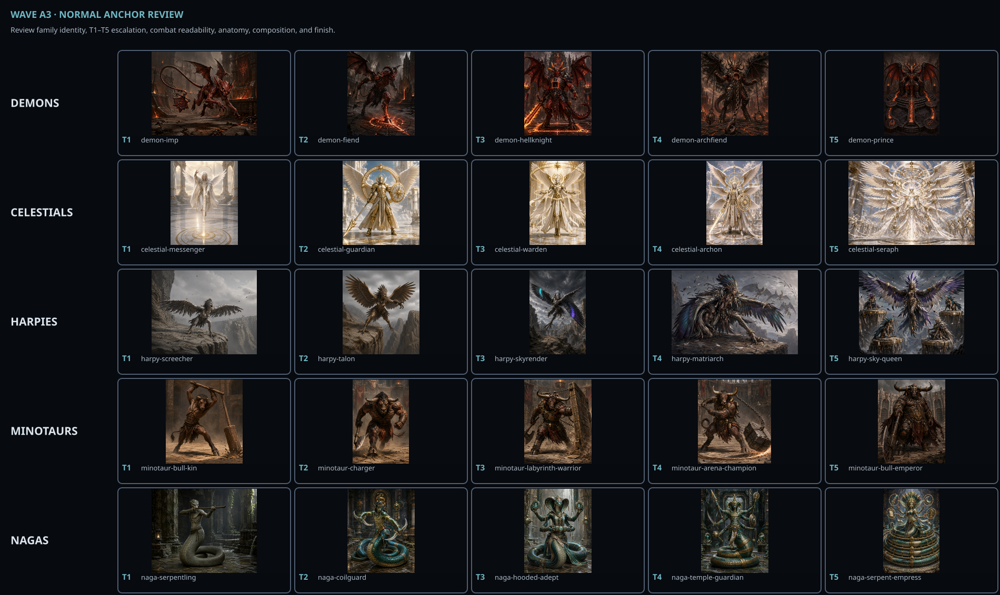

Controller-only reconciliation map: [wave-a3-blind-map.json](./wave-a3-blind-map.json).

## Wave A4

Families: lizardfolk, insectoids, arachnids, slimes, golems.

### Independent blind T3/T5 review

Review this image and record verdicts by opaque token before consulting the controller map.

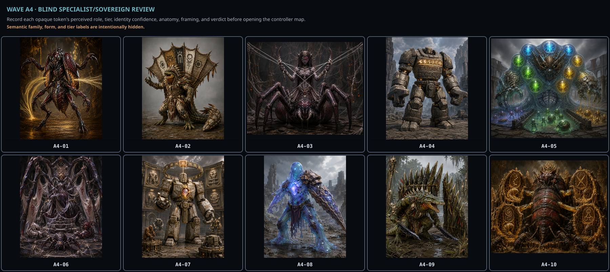

### Owner family-progression review

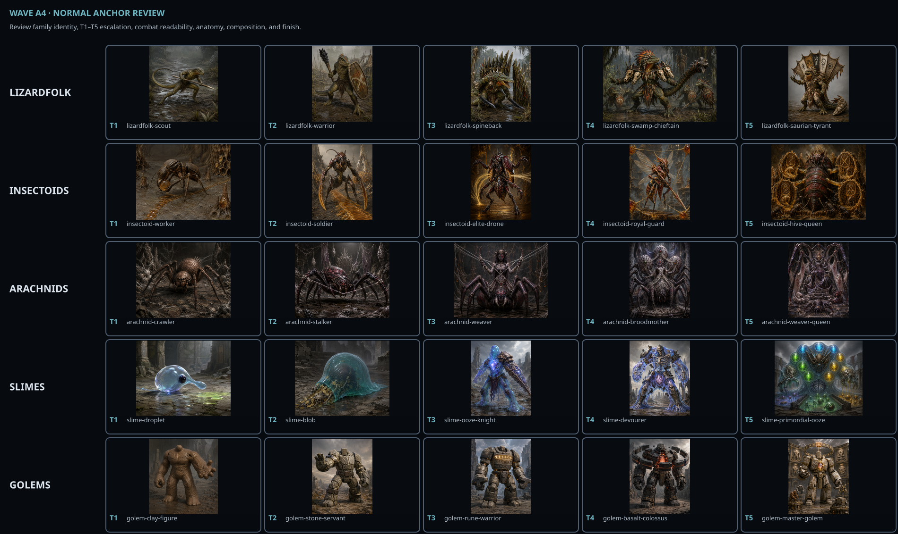

Controller-only reconciliation map: [wave-a4-blind-map.json](./wave-a4-blind-map.json).

## Wave A5

Families: elementals, treants, fungalfolk, deep-ones, werebeasts.

### Independent blind T3/T5 review

Review this image and record verdicts by opaque token before consulting the controller map.

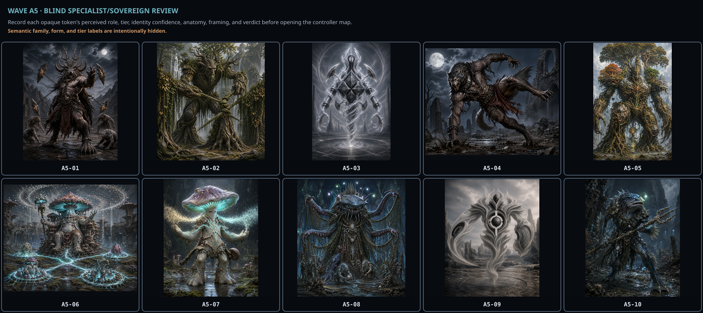

### Owner family-progression review

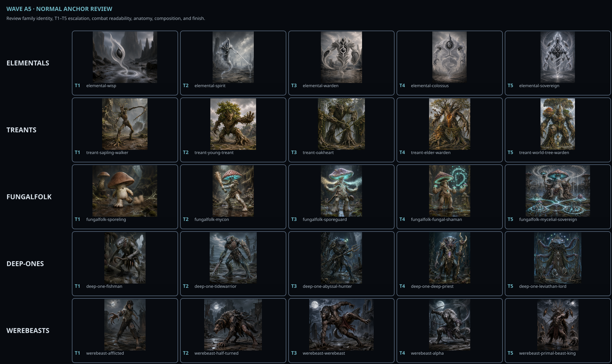

Controller-only reconciliation map: [wave-a5-blind-map.json](./wave-a5-blind-map.json).

## Wave A6

Families: gargoyles, djinn, fae, void-horrors, doppelgangers.

### Independent blind T3/T5 review

Review this image and record verdicts by opaque token before consulting the controller map.

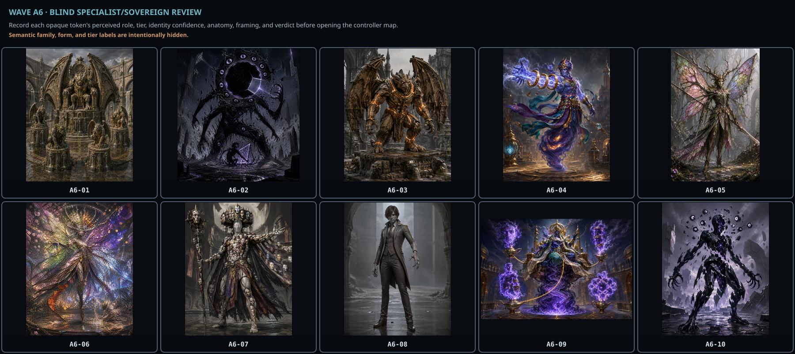

### Owner family-progression review

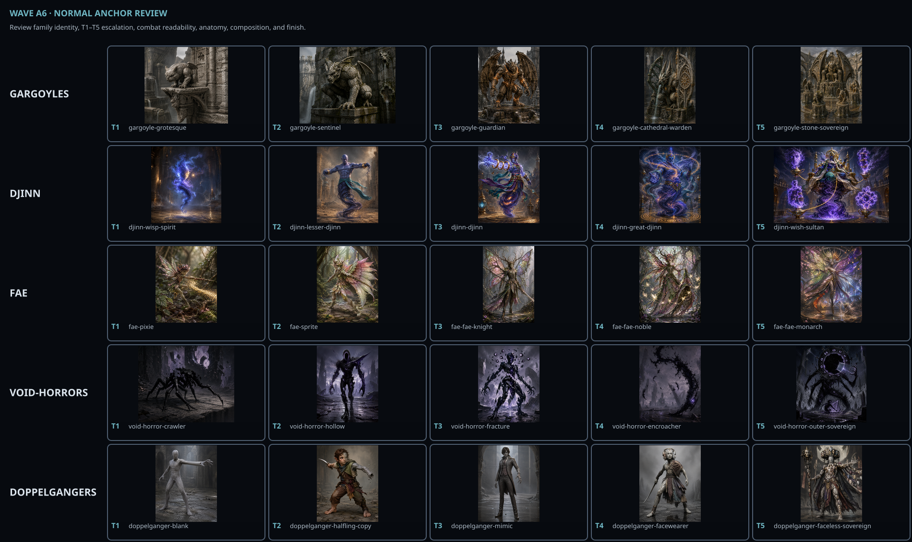

Controller-only reconciliation map: [wave-a6-blind-map.json](./wave-a6-blind-map.json).
