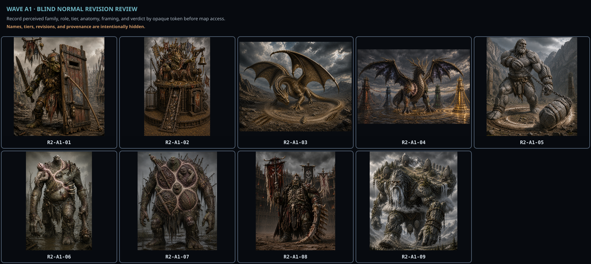
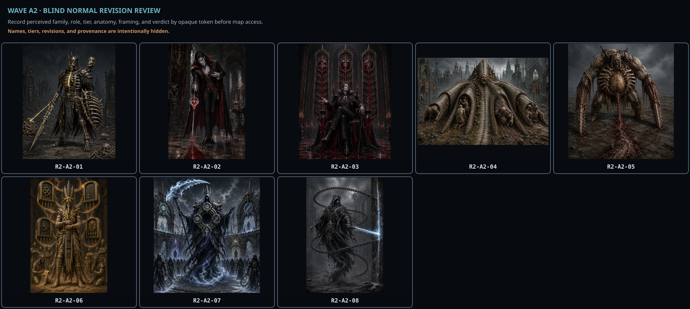
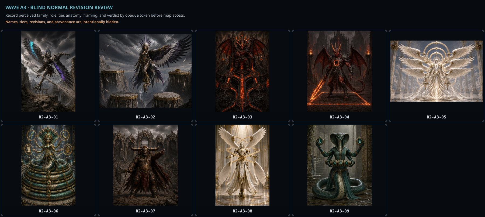
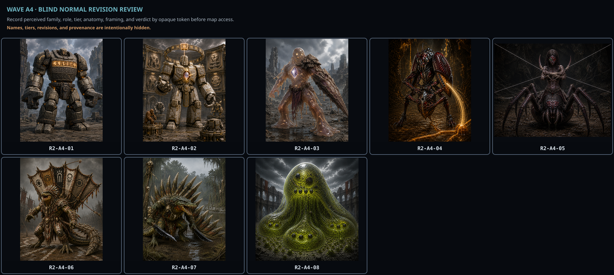
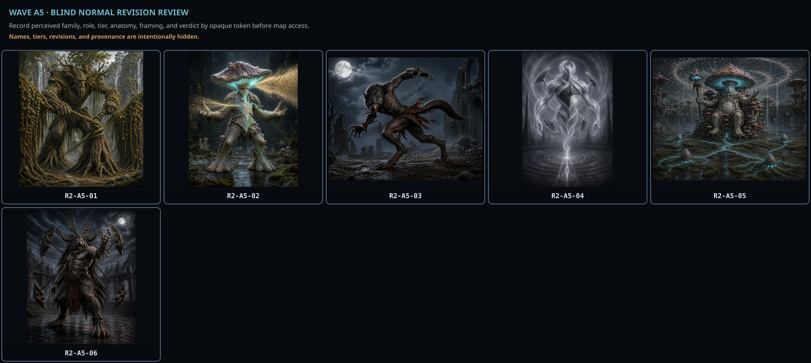
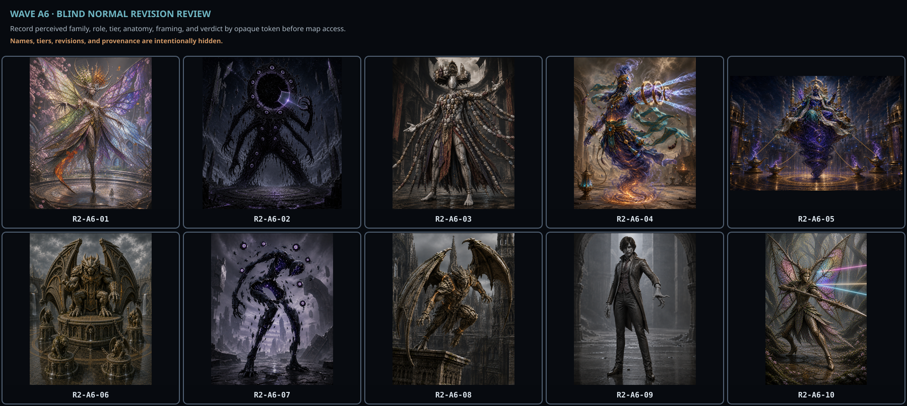

# Enemy Normal-anchor revision review handoff

This folder contains candidate-only evidence for 50 active revised Normal anchors. It does not approve or promote pixels.

Review order:

1. Independent reviewers assess the label-hidden sheets below without opening the maps or named gallery.
2. The owner reviews the [named revision gallery](./index.html) for identity, exact form/tier, combat role, anatomy, composition, finish, and affinity neutrality.
3. The controller reconciles opaque tokens through the maps and records separately assigned immutable review receipts.
4. Only mutually approved anchors may be activated.

## Wave A1

9 revised candidates. Blind reviewer: record verdicts by opaque token before consulting any map.

Controller-only reconciliation map: [wave-a1-blind-map.json](./wave-a1-blind-map.json).

## Wave A2

8 revised candidates. Blind reviewer: record verdicts by opaque token before consulting any map.

Controller-only reconciliation map: [wave-a2-blind-map.json](./wave-a2-blind-map.json).

## Wave A3

9 revised candidates. Blind reviewer: record verdicts by opaque token before consulting any map.

Controller-only reconciliation map: [wave-a3-blind-map.json](./wave-a3-blind-map.json).

## Wave A4

8 revised candidates. Blind reviewer: record verdicts by opaque token before consulting any map.

Controller-only reconciliation map: [wave-a4-blind-map.json](./wave-a4-blind-map.json).

## Wave A5

6 revised candidates. Blind reviewer: record verdicts by opaque token before consulting any map.

Controller-only reconciliation map: [wave-a5-blind-map.json](./wave-a5-blind-map.json).

## Wave A6

10 revised candidates. Blind reviewer: record verdicts by opaque token before consulting any map.

Controller-only reconciliation map: [wave-a6-blind-map.json](./wave-a6-blind-map.json).
