# Hero archive · page 1 of 31

[Collection guide and audit](hero-archive.md) · [Approved roster](heroes.md) · [Older status and alternate portraits](legacy-heroes.md)

Heroes 1–24 of 736, in name order. Select any thumbnail for the immutable original.

**01** · [02](hero-archive-02.md) · [03](hero-archive-03.md) · [04](hero-archive-04.md) · [05](hero-archive-05.md) · [06](hero-archive-06.md) · [07](hero-archive-07.md) · [08](hero-archive-08.md) · [09](hero-archive-09.md) · [10](hero-archive-10.md) · [11](hero-archive-11.md) · [12](hero-archive-12.md) · [13](hero-archive-13.md) · [14](hero-archive-14.md) · [15](hero-archive-15.md) · [16](hero-archive-16.md) · [17](hero-archive-17.md) · [18](hero-archive-18.md) · [19](hero-archive-19.md) · [20](hero-archive-20.md) · [21](hero-archive-21.md) · [22](hero-archive-22.md) · [23](hero-archive-23.md) · [24](hero-archive-24.md) · [25](hero-archive-25.md) · [26](hero-archive-26.md) · [27](hero-archive-27.md) · [28](hero-archive-28.md) · [29](hero-archive-29.md) · [30](hero-archive-30.md) · [31](hero-archive-31.md)

<table>
  <tr>
    <td align="center" width="25%"><a href="https://media.githubusercontent.com/media/jmoraispk/summonlab/ae01c4f5578d260335442534f11fda8b2a0ba615/assets/heroes/experiments/one-star-overnight-200-001/waves/wave-10/candidates/adan-tavek/summon-v2.png">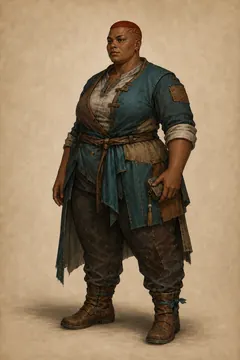</a> <strong>Adan Tavek</strong> Historical production candidate</td>
    <td align="center" width="25%"><a href="https://raw.githubusercontent.com/jmoraispk/summonlab/634d48644ec41d2a8ff3c9f839b8fec2b2830617/apps/web/static/runtime/summonable-heroes-v1/adar-belo/summon.11ed98e890d2.webp">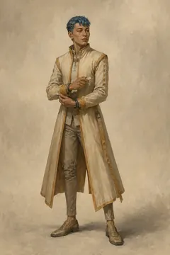</a> <strong>Adar Belo</strong> Approved summonable roster</td>
    <td align="center" width="25%"><a href="https://media.githubusercontent.com/media/jmoraispk/summonlab/ae01c4f5578d260335442534f11fda8b2a0ba615/assets/heroes/experiments/one-star-overnight-200-001/waves/wave-05/candidates/adar-corek/summon-v2.png">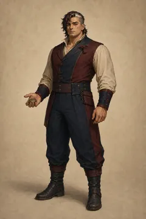</a> <strong>Adar Corek</strong> Historical production candidate</td>
    <td align="center" width="25%"><a href="https://media.githubusercontent.com/media/jmoraispk/summonlab/ae01c4f5578d260335442534f11fda8b2a0ba615/assets/heroes/experiments/one-star-overnight-200-001/waves/wave-07/candidates/adar-eshen/summon-v2.png">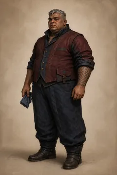</a> <strong>Adar Eshen</strong> Historical production candidate</td>
  </tr>
  <tr>
    <td align="center" width="25%"><a href="https://media.githubusercontent.com/media/jmoraispk/summonlab/ae01c4f5578d260335442534f11fda8b2a0ba615/assets/heroes/experiments/one-star-overnight-200-001/waves/wave-05/candidates/adar-zharel/summon-v2.png">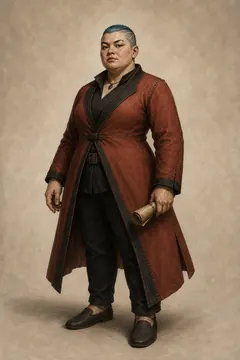</a> <strong>Adar Zharel</strong> Historical production candidate</td>
    <td align="center" width="25%"><a href="https://media.githubusercontent.com/media/jmoraispk/summonlab/ae01c4f5578d260335442534f11fda8b2a0ba615/assets/heroes/experiments/one-star-overnight-200-001/waves/wave-04/candidates/adel-halan/summon-v1.png">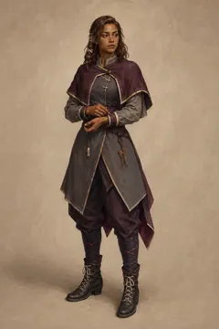</a> <strong>Adel Halan</strong> Historical production candidate</td>
    <td align="center" width="25%"><a href="https://media.githubusercontent.com/media/jmoraispk/summonlab/ae01c4f5578d260335442534f11fda8b2a0ba615/assets/heroes/experiments/one-star-overnight-200-001/waves/wave-09/candidates/aden-jorar/summon-v2.png">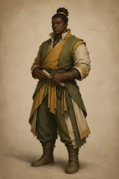</a> <strong>Aden Jorar</strong> Historical production candidate</td>
    <td align="center" width="25%"><a href="https://media.githubusercontent.com/media/jmoraispk/summonlab/ae01c4f5578d260335442534f11fda8b2a0ba615/assets/heroes/experiments/one-star-overnight-200-001/waves/wave-08/candidates/aden-quoreth/summon-v2.png">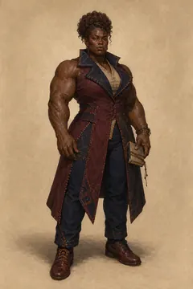</a> <strong>Aden Quoreth</strong> Historical production candidate</td>
  </tr>
  <tr>
    <td align="center" width="25%"><a href="https://media.githubusercontent.com/media/jmoraispk/summonlab/ae01c4f5578d260335442534f11fda8b2a0ba615/assets/heroes/experiments/one-star-overnight-200-001/waves/wave-07/candidates/adia-amarin/summon-v2.png">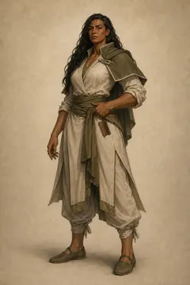</a> <strong>Adia Amarin</strong> Historical production candidate</td>
    <td align="center" width="25%"><a href="https://media.githubusercontent.com/media/jmoraispk/summonlab/ae01c4f5578d260335442534f11fda8b2a0ba615/assets/heroes/experiments/one-star-overnight-200-001/waves/wave-06/candidates/adia-esheth/summon-v1.png">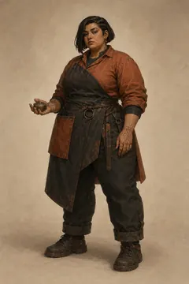</a> <strong>Adia Esheth</strong> Historical production candidate</td>
    <td align="center" width="25%"><a href="https://media.githubusercontent.com/media/jmoraispk/summonlab/ae01c4f5578d260335442534f11fda8b2a0ba615/assets/heroes/experiments/one-star-overnight-200-001/waves/wave-06/candidates/adia-zharo/summon-v1.png">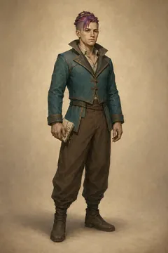</a> <strong>Adia Zharo</strong> Historical production candidate</td>
    <td align="center" width="25%"><a href="https://media.githubusercontent.com/media/jmoraispk/summonlab/ae01c4f5578d260335442534f11fda8b2a0ba615/assets/heroes/experiments/one-star-overnight-200-001/waves/wave-10/candidates/adin-amarel/summon-v1.png">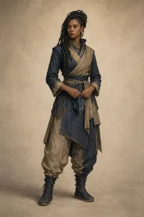</a> <strong>Adin Amarel</strong> Historical production candidate</td>
  </tr>
  <tr>
    <td align="center" width="25%"><a href="https://media.githubusercontent.com/media/jmoraispk/summonlab/ae01c4f5578d260335442534f11fda8b2a0ba615/assets/heroes/experiments/one-star-overnight-200-001/waves/wave-06/candidates/adon-eshar/summon-v2.png">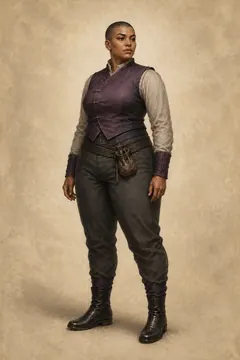</a> <strong>Adon Eshar</strong> Historical production candidate</td>
    <td align="center" width="25%"><a href="https://media.githubusercontent.com/media/jmoraispk/summonlab/ae01c4f5578d260335442534f11fda8b2a0ba615/assets/heroes/experiments/one-star-overnight-200-001/waves/wave-06/candidates/adon-quoreth/summon-v1.png">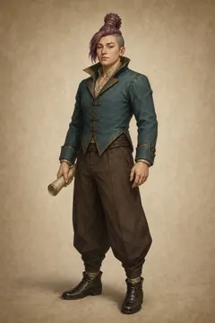</a> <strong>Adon Quoreth</strong> Historical production candidate</td>
    <td align="center" width="25%"><a href="https://media.githubusercontent.com/media/jmoraispk/summonlab/ae01c4f5578d260335442534f11fda8b2a0ba615/assets/heroes/experiments/one-star-overnight-200-001/waves/wave-04/candidates/adu-morar/summon-v1.png">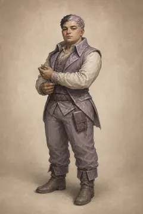</a> <strong>Adu Morar</strong> Historical production candidate</td>
    <td align="center" width="25%"><a href="https://media.githubusercontent.com/media/jmoraispk/summonlab/ae01c4f5578d260335442534f11fda8b2a0ba615/assets/heroes/experiments/one-star-overnight-200-001/waves/wave-10/candidates/adyn-corel/summon-v1.png">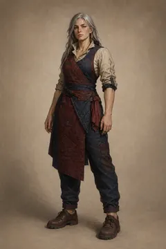</a> <strong>Adyn Corel</strong> Historical production candidate</td>
  </tr>
  <tr>
    <td align="center" width="25%"><a href="https://media.githubusercontent.com/media/jmoraispk/summonlab/ae01c4f5578d260335442534f11fda8b2a0ba615/assets/heroes/experiments/one-star-overnight-200-001/waves/wave-08/candidates/adyn-veshar/summon-v2.png">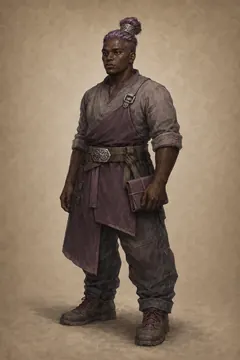</a> <strong>Adyn Veshar</strong> Historical production candidate</td>
    <td align="center" width="25%"><a href="https://media.githubusercontent.com/media/jmoraispk/summonlab/ae01c4f5578d260335442534f11fda8b2a0ba615/assets/heroes/experiments/one-star-overnight-200-001/waves/wave-06/candidates/aean-amarel/summon-v1.png">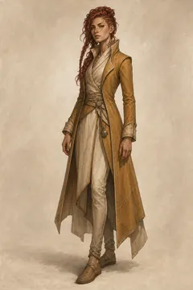</a> <strong>Aean Amarel</strong> Historical production candidate</td>
    <td align="center" width="25%"><a href="https://raw.githubusercontent.com/jmoraispk/summonlab/634d48644ec41d2a8ff3c9f839b8fec2b2830617/apps/web/static/runtime/summonable-heroes-v1/aean-morun/summon.e722dde919e6.webp">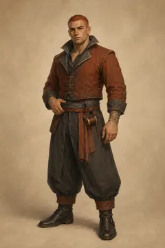</a> <strong>Aean Morun</strong> Approved summonable roster</td>
    <td align="center" width="25%"><a href="https://media.githubusercontent.com/media/jmoraispk/summonlab/ae01c4f5578d260335442534f11fda8b2a0ba615/assets/heroes/experiments/one-star-overnight-200-001/waves/wave-04/candidates/aear-corek/summon-v1.png">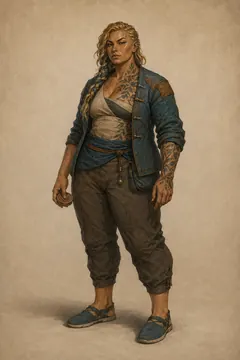</a> <strong>Aear Corek</strong> Historical production candidate</td>
  </tr>
  <tr>
    <td align="center" width="25%"><a href="https://raw.githubusercontent.com/jmoraispk/summonlab/634d48644ec41d2a8ff3c9f839b8fec2b2830617/apps/web/static/runtime/summonable-heroes-v1/aear-soro/summon.166b800dc912.webp">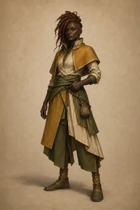</a> <strong>Aear Soro</strong> Approved summonable roster</td>
    <td align="center" width="25%"><a href="https://media.githubusercontent.com/media/jmoraispk/summonlab/ae01c4f5578d260335442534f11fda8b2a0ba615/assets/heroes/experiments/one-star-overnight-200-001/waves/wave-04/candidates/aeel-keshai/summon-v2.png">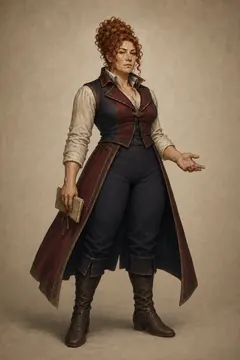</a> <strong>Aeel Keshai</strong> Historical production candidate</td>
    <td align="center" width="25%"><a href="https://media.githubusercontent.com/media/jmoraispk/summonlab/ae01c4f5578d260335442534f11fda8b2a0ba615/assets/heroes/experiments/one-star-overnight-200-001/waves/wave-07/candidates/aeel-quorel/summon-v2.png">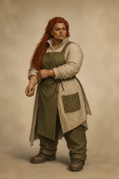</a> <strong>Aeel Quorel</strong> Historical production candidate</td>
    <td align="center" width="25%"><a href="https://media.githubusercontent.com/media/jmoraispk/summonlab/ae01c4f5578d260335442534f11fda8b2a0ba615/assets/heroes/experiments/one-star-overnight-200-001/waves/wave-04/candidates/aei-corai/summon-v2.png">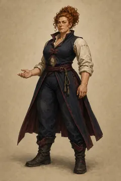</a> <strong>Aei Corai</strong> Historical production candidate</td>
  </tr>
</table>

**01** · [02](hero-archive-02.md) · [03](hero-archive-03.md) · [04](hero-archive-04.md) · [05](hero-archive-05.md) · [06](hero-archive-06.md) · [07](hero-archive-07.md) · [08](hero-archive-08.md) · [09](hero-archive-09.md) · [10](hero-archive-10.md) · [11](hero-archive-11.md) · [12](hero-archive-12.md) · [13](hero-archive-13.md) · [14](hero-archive-14.md) · [15](hero-archive-15.md) · [16](hero-archive-16.md) · [17](hero-archive-17.md) · [18](hero-archive-18.md) · [19](hero-archive-19.md) · [20](hero-archive-20.md) · [21](hero-archive-21.md) · [22](hero-archive-22.md) · [23](hero-archive-23.md) · [24](hero-archive-24.md) · [25](hero-archive-25.md) · [26](hero-archive-26.md) · [27](hero-archive-27.md) · [28](hero-archive-28.md) · [29](hero-archive-29.md) · [30](hero-archive-30.md) · [31](hero-archive-31.md)
