# Hero archive · page 2 of 31

[Collection guide and audit](hero-archive.md) · [Approved roster](heroes.md) · [Older status and alternate portraits](legacy-heroes.md)

Heroes 25–48 of 736, in name order. Select any thumbnail for the immutable original.

[01](hero-archive-01.md) · **02** · [03](hero-archive-03.md) · [04](hero-archive-04.md) · [05](hero-archive-05.md) · [06](hero-archive-06.md) · [07](hero-archive-07.md) · [08](hero-archive-08.md) · [09](hero-archive-09.md) · [10](hero-archive-10.md) · [11](hero-archive-11.md) · [12](hero-archive-12.md) · [13](hero-archive-13.md) · [14](hero-archive-14.md) · [15](hero-archive-15.md) · [16](hero-archive-16.md) · [17](hero-archive-17.md) · [18](hero-archive-18.md) · [19](hero-archive-19.md) · [20](hero-archive-20.md) · [21](hero-archive-21.md) · [22](hero-archive-22.md) · [23](hero-archive-23.md) · [24](hero-archive-24.md) · [25](hero-archive-25.md) · [26](hero-archive-26.md) · [27](hero-archive-27.md) · [28](hero-archive-28.md) · [29](hero-archive-29.md) · [30](hero-archive-30.md) · [31](hero-archive-31.md)

<table>
  <tr>
    <td align="center" width="25%"><a href="https://media.githubusercontent.com/media/jmoraispk/summonlab/ae01c4f5578d260335442534f11fda8b2a0ba615/assets/heroes/experiments/one-star-overnight-200-001/waves/wave-06/candidates/aei-iveren/summon-v1.png">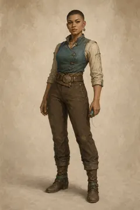</a> <strong>Aei Iveren</strong> Historical production candidate</td>
    <td align="center" width="25%"><a href="https://media.githubusercontent.com/media/jmoraispk/summonlab/ae01c4f5578d260335442534f11fda8b2a0ba615/assets/heroes/experiments/one-star-overnight-200-001/waves/wave-04/candidates/aei-pellai/summon-v2.png">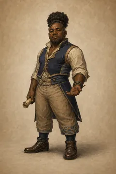</a> <strong>Aei Pellai</strong> Historical production candidate</td>
    <td align="center" width="25%"><a href="https://raw.githubusercontent.com/jmoraispk/summonlab/634d48644ec41d2a8ff3c9f839b8fec2b2830617/apps/web/static/runtime/summonable-heroes-v1/aei-quoran/summon.463cbb2e51d2.webp">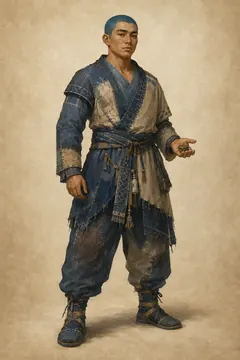</a> <strong>Aei Quoran</strong> Approved summonable roster</td>
    <td align="center" width="25%"><a href="https://media.githubusercontent.com/media/jmoraispk/summonlab/ae01c4f5578d260335442534f11fda8b2a0ba615/assets/heroes/experiments/one-star-overnight-200-001/waves/wave-05/candidates/aeia-pellun/summon-v2.png">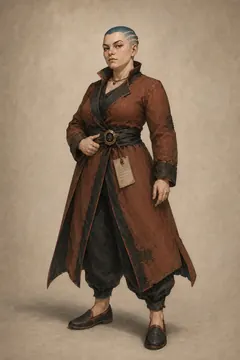</a> <strong>Aeia Pellun</strong> Historical production candidate</td>
  </tr>
  <tr>
    <td align="center" width="25%"><a href="https://media.githubusercontent.com/media/jmoraispk/summonlab/ae01c4f5578d260335442534f11fda8b2a0ba615/assets/heroes/experiments/one-star-overnight-200-001/waves/wave-06/candidates/aeo-amarin/summon-v2.png">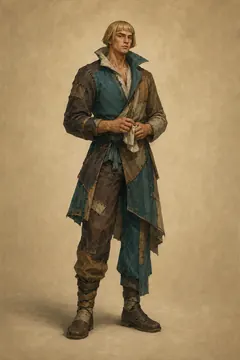</a> <strong>Aeo Amarin</strong> Historical production candidate</td>
    <td align="center" width="25%"><a href="https://media.githubusercontent.com/media/jmoraispk/summonlab/ae01c4f5578d260335442534f11fda8b2a0ba615/assets/heroes/experiments/one-star-overnight-200-001/waves/wave-10/candidates/aeo-eshen/summon-v1.png">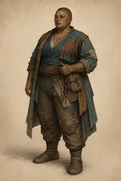</a> <strong>Aeo Eshen</strong> Historical production candidate</td>
    <td align="center" width="25%"><a href="https://raw.githubusercontent.com/jmoraispk/summonlab/634d48644ec41d2a8ff3c9f839b8fec2b2830617/apps/web/static/runtime/summonable-heroes-v1/aeo-keshen/summon.f24bc5ecab40.webp">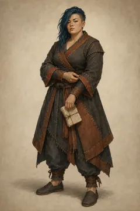</a> <strong>Aeo Keshen</strong> Approved summonable roster</td>
    <td align="center" width="25%"><a href="https://media.githubusercontent.com/media/jmoraispk/summonlab/ae01c4f5578d260335442534f11fda8b2a0ba615/assets/heroes/experiments/one-star-overnight-200-001/waves/wave-05/candidates/aeon-morel/summon-v1.png">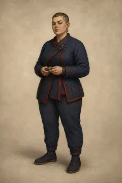</a> <strong>Aeon Morel</strong> Historical production candidate</td>
  </tr>
  <tr>
    <td align="center" width="25%"><a href="https://media.githubusercontent.com/media/jmoraispk/summonlab/ae01c4f5578d260335442534f11fda8b2a0ba615/assets/heroes/experiments/one-star-overnight-200-001/waves/wave-04/candidates/aeor-tavo/summon-v1.png">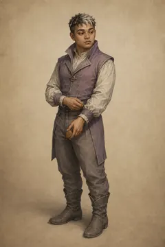</a> <strong>Aeor Tavo</strong> Historical production candidate</td>
    <td align="center" width="25%"><a href="https://media.githubusercontent.com/media/jmoraispk/summonlab/ae01c4f5578d260335442534f11fda8b2a0ba615/assets/heroes/experiments/one-star-overnight-200-001/waves/wave-04/candidates/aeu-amaror/summon-v1.png">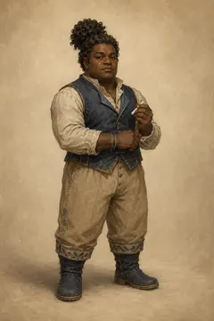</a> <strong>Aeu Amaror</strong> Historical production candidate</td>
    <td align="center" width="25%"><a href="https://media.githubusercontent.com/media/jmoraispk/summonlab/ae01c4f5578d260335442534f11fda8b2a0ba615/assets/heroes/experiments/one-star-overnight-200-001/waves/wave-06/candidates/aeu-zharen/summon-v1.png">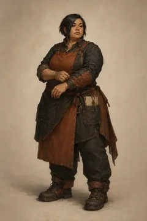</a> <strong>Aeu Zharen</strong> Historical production candidate</td>
    <td align="center" width="25%"><a href="https://raw.githubusercontent.com/jmoraispk/summonlab/634d48644ec41d2a8ff3c9f839b8fec2b2830617/apps/web/static/runtime/summonable-heroes-v1/aeyn-amara/summon.e7393333bbc6.webp">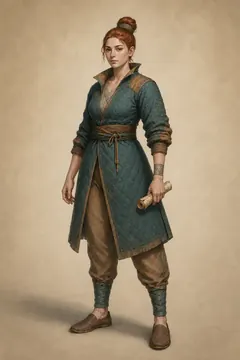</a> <strong>Aeyn Amara</strong> Approved summonable roster</td>
  </tr>
  <tr>
    <td align="center" width="25%"><a href="https://raw.githubusercontent.com/jmoraispk/summonlab/ae01c4f5578d260335442534f11fda8b2a0ba615/assets/heroes/experiments/one-star-mass-wave-001/summon/amara-kell.png">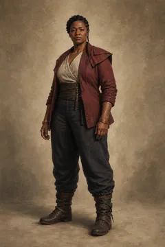</a> <strong>Amara Kell</strong> Retired review candidate</td>
    <td align="center" width="25%"><a href="https://raw.githubusercontent.com/jmoraispk/summonlab/634d48644ec41d2a8ff3c9f839b8fec2b2830617/apps/web/static/runtime/combat/realtime-study-v1/hero-saffron-braid-ready-v1.png">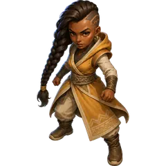</a> <strong>Asha</strong> owner-authorized prototype identity; outside summonable roster</td>
    <td align="center" width="25%"><a href="https://raw.githubusercontent.com/jmoraispk/summonlab/ae01c4f5578d260335442534f11fda8b2a0ba615/assets/heroes/experiments/native-star-visual-study-v1/candidates/5-star/ayana-zev.png">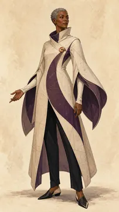</a> <strong>Ayana Zev</strong> Retired production candidate</td>
    <td align="center" width="25%"><a href="https://raw.githubusercontent.com/jmoraispk/summonlab/ae01c4f5578d260335442534f11fda8b2a0ba615/assets/heroes/experiments/one-star-mass-wave-001/summon/bato-rell.png">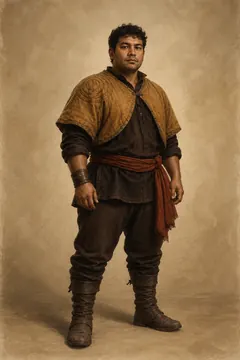</a> <strong>Bato Rell</strong> Retired review candidate</td>
  </tr>
  <tr>
    <td align="center" width="25%"><a href="https://raw.githubusercontent.com/jmoraispk/summonlab/ae01c4f5578d260335442534f11fda8b2a0ba615/assets/heroes/experiments/one-star-mass-wave-002/summon/bea-nahl.png">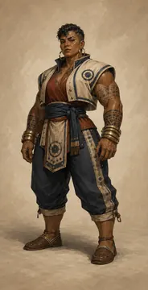</a> <strong>Bea Nahl</strong> Retired review candidate</td>
    <td align="center" width="25%"><a href="https://raw.githubusercontent.com/jmoraispk/summonlab/634d48644ec41d2a8ff3c9f839b8fec2b2830617/apps/web/static/runtime/summonable-heroes-v1/belan-falin/summon.3373009a5fbb.webp">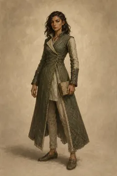</a> <strong>Belan Falin</strong> Approved summonable roster</td>
    <td align="center" width="25%"><a href="https://raw.githubusercontent.com/jmoraispk/summonlab/ae01c4f5578d260335442534f11fda8b2a0ba615/assets/heroes/experiments/one-star-overnight-200-001/waves/wave-03/candidates/belan-zharor/summon-v1.png">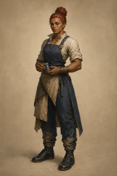</a> <strong>Belan Zharor</strong> Historical production candidate</td>
    <td align="center" width="25%"><a href="https://raw.githubusercontent.com/jmoraispk/summonlab/634d48644ec41d2a8ff3c9f839b8fec2b2830617/apps/web/static/runtime/summonable-heroes-v1/belar-amarek/summon.3f3daddd2400.webp">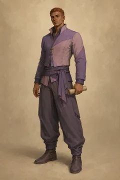</a> <strong>Belar Amarek</strong> Approved summonable roster</td>
  </tr>
  <tr>
    <td align="center" width="25%"><a href="https://raw.githubusercontent.com/jmoraispk/summonlab/634d48644ec41d2a8ff3c9f839b8fec2b2830617/apps/web/static/runtime/summonable-heroes-v1/belar-corin/summon.e4986383ab6a.webp">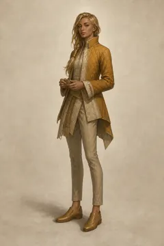</a> <strong>Belar Corin</strong> Approved summonable roster</td>
    <td align="center" width="25%"><a href="https://media.githubusercontent.com/media/jmoraispk/summonlab/ae01c4f5578d260335442534f11fda8b2a0ba615/assets/heroes/experiments/one-star-overnight-200-001/waves/wave-04/candidates/belar-nethek/summon-v1.png">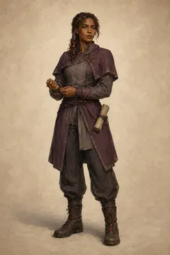</a> <strong>Belar Nethek</strong> Historical production candidate</td>
    <td align="center" width="25%"><a href="https://media.githubusercontent.com/media/jmoraispk/summonlab/ae01c4f5578d260335442534f11fda8b2a0ba615/assets/heroes/experiments/one-star-overnight-200-001/waves/wave-05/candidates/belar-quoren/summon-v2.png">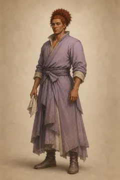</a> <strong>Belar Quoren</strong> Historical production candidate</td>
    <td align="center" width="25%"><a href="https://media.githubusercontent.com/media/jmoraispk/summonlab/ae01c4f5578d260335442534f11fda8b2a0ba615/assets/heroes/experiments/one-star-overnight-200-001/waves/wave-10/candidates/belen-pellen/summon-v2.png">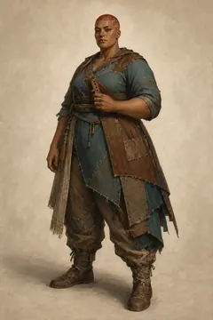</a> <strong>Belen Pellen</strong> Historical production candidate</td>
  </tr>
</table>

[01](hero-archive-01.md) · **02** · [03](hero-archive-03.md) · [04](hero-archive-04.md) · [05](hero-archive-05.md) · [06](hero-archive-06.md) · [07](hero-archive-07.md) · [08](hero-archive-08.md) · [09](hero-archive-09.md) · [10](hero-archive-10.md) · [11](hero-archive-11.md) · [12](hero-archive-12.md) · [13](hero-archive-13.md) · [14](hero-archive-14.md) · [15](hero-archive-15.md) · [16](hero-archive-16.md) · [17](hero-archive-17.md) · [18](hero-archive-18.md) · [19](hero-archive-19.md) · [20](hero-archive-20.md) · [21](hero-archive-21.md) · [22](hero-archive-22.md) · [23](hero-archive-23.md) · [24](hero-archive-24.md) · [25](hero-archive-25.md) · [26](hero-archive-26.md) · [27](hero-archive-27.md) · [28](hero-archive-28.md) · [29](hero-archive-29.md) · [30](hero-archive-30.md) · [31](hero-archive-31.md)
