# Hero archive · page 3 of 31

[Collection guide and audit](hero-archive.md) · [Approved roster](heroes.md) · [Older status and alternate portraits](legacy-heroes.md)

Heroes 49–72 of 736, in name order. Select any thumbnail for the immutable original.

[01](hero-archive-01.md) · [02](hero-archive-02.md) · **03** · [04](hero-archive-04.md) · [05](hero-archive-05.md) · [06](hero-archive-06.md) · [07](hero-archive-07.md) · [08](hero-archive-08.md) · [09](hero-archive-09.md) · [10](hero-archive-10.md) · [11](hero-archive-11.md) · [12](hero-archive-12.md) · [13](hero-archive-13.md) · [14](hero-archive-14.md) · [15](hero-archive-15.md) · [16](hero-archive-16.md) · [17](hero-archive-17.md) · [18](hero-archive-18.md) · [19](hero-archive-19.md) · [20](hero-archive-20.md) · [21](hero-archive-21.md) · [22](hero-archive-22.md) · [23](hero-archive-23.md) · [24](hero-archive-24.md) · [25](hero-archive-25.md) · [26](hero-archive-26.md) · [27](hero-archive-27.md) · [28](hero-archive-28.md) · [29](hero-archive-29.md) · [30](hero-archive-30.md) · [31](hero-archive-31.md)

<table>
  <tr>
    <td align="center" width="25%"><a href="https://raw.githubusercontent.com/jmoraispk/summonlab/634d48644ec41d2a8ff3c9f839b8fec2b2830617/apps/web/static/runtime/summonable-heroes-v1/belia-corin/summon.77fc8f45129b.webp">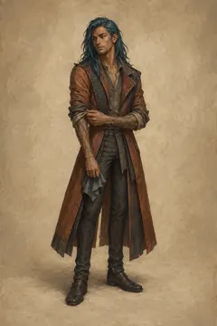</a> <strong>Belia Corin</strong> Approved summonable roster</td>
    <td align="center" width="25%"><a href="https://media.githubusercontent.com/media/jmoraispk/summonlab/ae01c4f5578d260335442534f11fda8b2a0ba615/assets/heroes/experiments/one-star-overnight-200-001/waves/wave-06/candidates/belia-keshel/summon-v2.png">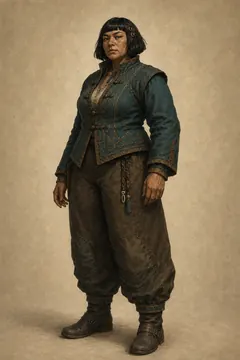</a> <strong>Belia Keshel</strong> Historical production candidate</td>
    <td align="center" width="25%"><a href="https://raw.githubusercontent.com/jmoraispk/summonlab/634d48644ec41d2a8ff3c9f839b8fec2b2830617/apps/web/static/runtime/summonable-heroes-v1/belin-quori/summon.ebe0e8afd84d.webp">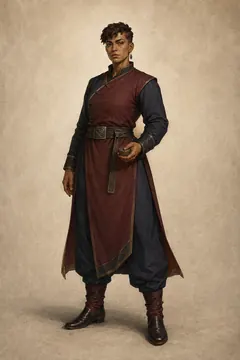</a> <strong>Belin Quori</strong> Approved summonable roster</td>
    <td align="center" width="25%"><a href="https://raw.githubusercontent.com/jmoraispk/summonlab/634d48644ec41d2a8ff3c9f839b8fec2b2830617/apps/web/static/runtime/summonable-heroes-v1/belis-eshan/summon.eabd5a4c87fe.webp">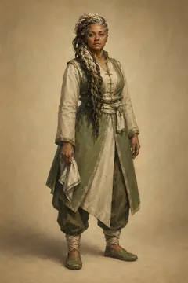</a> <strong>Belis Eshan</strong> Approved summonable roster</td>
  </tr>
  <tr>
    <td align="center" width="25%"><a href="https://raw.githubusercontent.com/jmoraispk/summonlab/634d48644ec41d2a8ff3c9f839b8fec2b2830617/apps/web/static/runtime/summonable-heroes-v1/belis-nethai/summon.57f47e3eee4b.webp">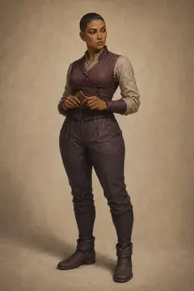</a> <strong>Belis Nethai</strong> Approved summonable roster</td>
    <td align="center" width="25%"><a href="https://media.githubusercontent.com/media/jmoraispk/summonlab/ae01c4f5578d260335442534f11fda8b2a0ba615/assets/heroes/experiments/one-star-overnight-200-001/waves/wave-07/candidates/belu-iverin/summon-v2.png">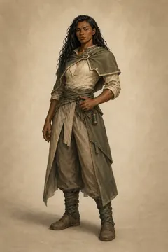</a> <strong>Belu Iverin</strong> Historical production candidate</td>
    <td align="center" width="25%"><a href="https://media.githubusercontent.com/media/jmoraispk/summonlab/ae01c4f5578d260335442534f11fda8b2a0ba615/assets/heroes/experiments/one-star-overnight-200-001/waves/wave-08/candidates/belu-nethun/summon-v1.png">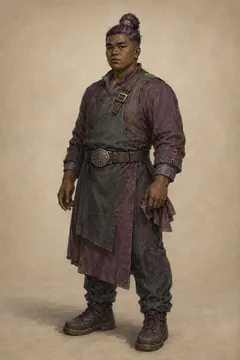</a> <strong>Belu Nethun</strong> Historical production candidate</td>
    <td align="center" width="25%"><a href="https://media.githubusercontent.com/media/jmoraispk/summonlab/ae01c4f5578d260335442534f11fda8b2a0ba615/assets/heroes/experiments/one-star-overnight-200-001/waves/wave-09/candidates/belu-quorin/summon-v1.png">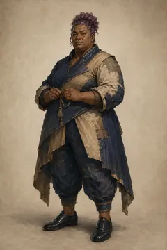</a> <strong>Belu Quorin</strong> Historical production candidate</td>
  </tr>
  <tr>
    <td align="center" width="25%"><a href="https://raw.githubusercontent.com/jmoraispk/summonlab/634d48644ec41d2a8ff3c9f839b8fec2b2830617/apps/web/static/runtime/summonable-heroes-v1/belu-uleno/summon.8e6032f6013d.webp">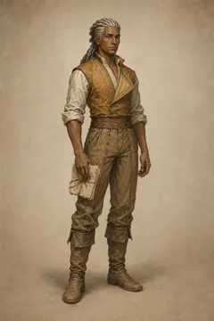</a> <strong>Belu Uleno</strong> Approved summonable roster</td>
    <td align="center" width="25%"><a href="https://raw.githubusercontent.com/jmoraispk/summonlab/634d48644ec41d2a8ff3c9f839b8fec2b2830617/apps/web/static/runtime/summonable-heroes-v1/belyn-reshor/summon.b88b7ab602bd.webp">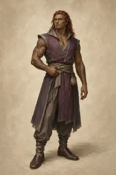</a> <strong>Belyn Reshor</strong> Approved summonable roster</td>
    <td align="center" width="25%"><a href="https://raw.githubusercontent.com/jmoraispk/summonlab/634d48644ec41d2a8ff3c9f839b8fec2b2830617/apps/web/static/runtime/summonable-heroes-v1/belyn-tava/summon.e958bf67964e.webp">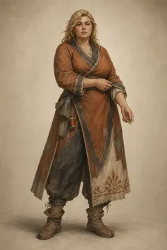</a> <strong>Belyn Tava</strong> Approved summonable roster</td>
    <td align="center" width="25%"><a href="https://media.githubusercontent.com/media/jmoraispk/summonlab/ae01c4f5578d260335442534f11fda8b2a0ba615/assets/heroes/experiments/one-star-overnight-200-001/waves/wave-05/candidates/brina-drenun/summon-v1.png">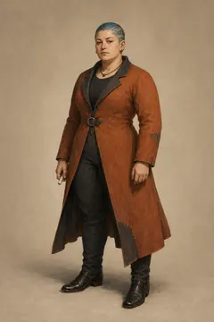</a> <strong>Brina Drenun</strong> Historical production candidate</td>
  </tr>
  <tr>
    <td align="center" width="25%"><a href="https://media.githubusercontent.com/media/jmoraispk/summonlab/ae01c4f5578d260335442534f11fda8b2a0ba615/assets/heroes/experiments/one-star-overnight-200-001/waves/wave-04/candidates/brinar-sori/summon-v2.png">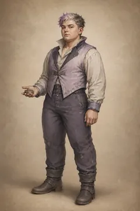</a> <strong>Brinar Sori</strong> Historical production candidate</td>
    <td align="center" width="25%"><a href="https://media.githubusercontent.com/media/jmoraispk/summonlab/ae01c4f5578d260335442534f11fda8b2a0ba615/assets/heroes/experiments/one-star-overnight-200-001/waves/wave-08/candidates/brinel-grelun/summon-v1.png">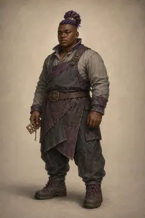</a> <strong>Brinel Grelun</strong> Historical production candidate</td>
    <td align="center" width="25%"><a href="https://media.githubusercontent.com/media/jmoraispk/summonlab/ae01c4f5578d260335442534f11fda8b2a0ba615/assets/heroes/experiments/one-star-overnight-200-001/waves/wave-08/candidates/brinel-keshun/summon-v2.png">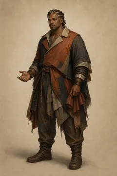</a> <strong>Brinel Keshun</strong> Historical production candidate</td>
    <td align="center" width="25%"><a href="https://media.githubusercontent.com/media/jmoraispk/summonlab/ae01c4f5578d260335442534f11fda8b2a0ba615/assets/heroes/experiments/one-star-overnight-200-001/waves/wave-05/candidates/brinen-jorai/summon-v1.png">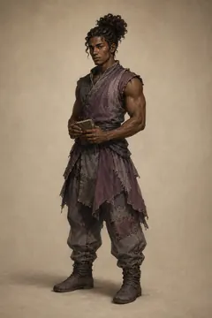</a> <strong>Brinen Jorai</strong> Historical production candidate</td>
  </tr>
  <tr>
    <td align="center" width="25%"><a href="https://raw.githubusercontent.com/jmoraispk/summonlab/634d48644ec41d2a8ff3c9f839b8fec2b2830617/apps/web/static/runtime/summonable-heroes-v1/brinen-joro/summon.a5e78f7f04dc.webp">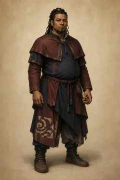</a> <strong>Brinen Joro</strong> Approved summonable roster</td>
    <td align="center" width="25%"><a href="https://raw.githubusercontent.com/jmoraispk/summonlab/634d48644ec41d2a8ff3c9f839b8fec2b2830617/apps/web/static/runtime/summonable-heroes-v1/brinen-lori/summon.faefe5192077.webp">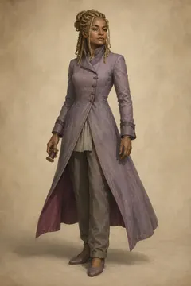</a> <strong>Brinen Lori</strong> Approved summonable roster</td>
    <td align="center" width="25%"><a href="https://media.githubusercontent.com/media/jmoraispk/summonlab/ae01c4f5578d260335442534f11fda8b2a0ba615/assets/heroes/experiments/one-star-overnight-200-001/waves/wave-05/candidates/brinen-sorel/summon-v1.png">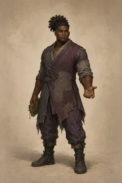</a> <strong>Brinen Sorel</strong> Historical production candidate</td>
    <td align="center" width="25%"><a href="https://media.githubusercontent.com/media/jmoraispk/summonlab/ae01c4f5578d260335442534f11fda8b2a0ba615/assets/heroes/experiments/one-star-overnight-200-001/waves/wave-06/candidates/brini-halin/summon-v2.png">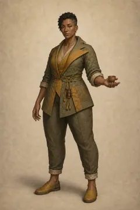</a> <strong>Brini Halin</strong> Historical production candidate</td>
  </tr>
  <tr>
    <td align="center" width="25%"><a href="https://raw.githubusercontent.com/jmoraispk/summonlab/ae01c4f5578d260335442534f11fda8b2a0ba615/assets/heroes/experiments/one-star-overnight-200-001/waves/wave-03/candidates/brinia-lora/summon-v2.png">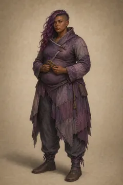</a> <strong>Brinia Lora</strong> Historical production candidate</td>
    <td align="center" width="25%"><a href="https://media.githubusercontent.com/media/jmoraispk/summonlab/ae01c4f5578d260335442534f11fda8b2a0ba615/assets/heroes/experiments/one-star-overnight-200-001/waves/wave-04/candidates/brinia-ulenai/summon-v1.png">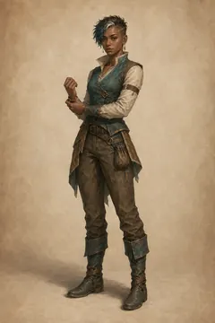</a> <strong>Brinia Ulenai</strong> Historical production candidate</td>
    <td align="center" width="25%"><a href="https://media.githubusercontent.com/media/jmoraispk/summonlab/ae01c4f5578d260335442534f11fda8b2a0ba615/assets/heroes/experiments/one-star-overnight-200-001/waves/wave-09/candidates/brinin-sorar/summon-v1.png">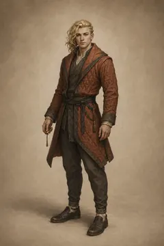</a> <strong>Brinin Sorar</strong> Historical production candidate</td>
    <td align="center" width="25%"><a href="https://raw.githubusercontent.com/jmoraispk/summonlab/634d48644ec41d2a8ff3c9f839b8fec2b2830617/apps/web/static/runtime/summonable-heroes-v1/brinis-drenin/summon.6491cbfbff71.webp">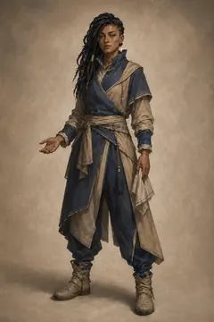</a> <strong>Brinis Drenin</strong> Approved summonable roster</td>
  </tr>
</table>

[01](hero-archive-01.md) · [02](hero-archive-02.md) · **03** · [04](hero-archive-04.md) · [05](hero-archive-05.md) · [06](hero-archive-06.md) · [07](hero-archive-07.md) · [08](hero-archive-08.md) · [09](hero-archive-09.md) · [10](hero-archive-10.md) · [11](hero-archive-11.md) · [12](hero-archive-12.md) · [13](hero-archive-13.md) · [14](hero-archive-14.md) · [15](hero-archive-15.md) · [16](hero-archive-16.md) · [17](hero-archive-17.md) · [18](hero-archive-18.md) · [19](hero-archive-19.md) · [20](hero-archive-20.md) · [21](hero-archive-21.md) · [22](hero-archive-22.md) · [23](hero-archive-23.md) · [24](hero-archive-24.md) · [25](hero-archive-25.md) · [26](hero-archive-26.md) · [27](hero-archive-27.md) · [28](hero-archive-28.md) · [29](hero-archive-29.md) · [30](hero-archive-30.md) · [31](hero-archive-31.md)
