# Hero archive · page 4 of 31

[Collection guide and audit](hero-archive.md) · [Approved roster](heroes.md) · [Older status and alternate portraits](legacy-heroes.md)

Heroes 73–96 of 736, in name order. Select any thumbnail for the immutable original.

[01](hero-archive-01.md) · [02](hero-archive-02.md) · [03](hero-archive-03.md) · **04** · [05](hero-archive-05.md) · [06](hero-archive-06.md) · [07](hero-archive-07.md) · [08](hero-archive-08.md) · [09](hero-archive-09.md) · [10](hero-archive-10.md) · [11](hero-archive-11.md) · [12](hero-archive-12.md) · [13](hero-archive-13.md) · [14](hero-archive-14.md) · [15](hero-archive-15.md) · [16](hero-archive-16.md) · [17](hero-archive-17.md) · [18](hero-archive-18.md) · [19](hero-archive-19.md) · [20](hero-archive-20.md) · [21](hero-archive-21.md) · [22](hero-archive-22.md) · [23](hero-archive-23.md) · [24](hero-archive-24.md) · [25](hero-archive-25.md) · [26](hero-archive-26.md) · [27](hero-archive-27.md) · [28](hero-archive-28.md) · [29](hero-archive-29.md) · [30](hero-archive-30.md) · [31](hero-archive-31.md)

<table>
  <tr>
    <td align="center" width="25%"><a href="https://raw.githubusercontent.com/jmoraispk/summonlab/634d48644ec41d2a8ff3c9f839b8fec2b2830617/apps/web/static/runtime/summonable-heroes-v1/brinis-morek/summon.7ce3cebcb150.webp">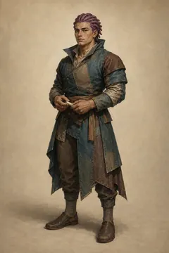</a> <strong>Brinis Morek</strong> Approved summonable roster</td>
    <td align="center" width="25%"><a href="https://raw.githubusercontent.com/jmoraispk/summonlab/634d48644ec41d2a8ff3c9f839b8fec2b2830617/apps/web/static/runtime/summonable-heroes-v1/brinis-tavel/summon.9043d68d1abb.webp">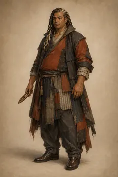</a> <strong>Brinis Tavel</strong> Approved summonable roster</td>
    <td align="center" width="25%"><a href="https://media.githubusercontent.com/media/jmoraispk/summonlab/ae01c4f5578d260335442534f11fda8b2a0ba615/assets/heroes/experiments/one-star-overnight-200-001/waves/wave-06/candidates/brinis-ulena/summon-v1.png">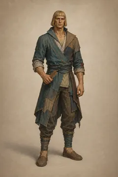</a> <strong>Brinis Ulena</strong> Historical production candidate</td>
    <td align="center" width="25%"><a href="https://media.githubusercontent.com/media/jmoraispk/summonlab/ae01c4f5578d260335442534f11fda8b2a0ba615/assets/heroes/experiments/one-star-overnight-200-001/waves/wave-05/candidates/brino-halun/summon-v1.png">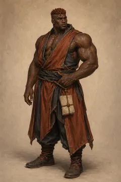</a> <strong>Brino Halun</strong> Historical production candidate</td>
  </tr>
  <tr>
    <td align="center" width="25%"><a href="https://media.githubusercontent.com/media/jmoraispk/summonlab/ae01c4f5578d260335442534f11fda8b2a0ba615/assets/heroes/experiments/one-star-overnight-200-001/waves/wave-10/candidates/brino-tavo/summon-v1.png">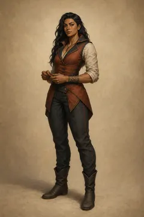</a> <strong>Brino Tavo</strong> Historical production candidate</td>
    <td align="center" width="25%"><a href="https://media.githubusercontent.com/media/jmoraispk/summonlab/ae01c4f5578d260335442534f11fda8b2a0ba615/assets/heroes/experiments/one-star-overnight-200-001/waves/wave-06/candidates/brinu-amareth/summon-v2.png">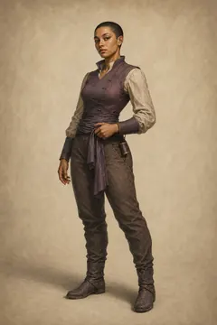</a> <strong>Brinu Amareth</strong> Historical production candidate</td>
    <td align="center" width="25%"><a href="https://media.githubusercontent.com/media/jmoraispk/summonlab/ae01c4f5578d260335442534f11fda8b2a0ba615/assets/heroes/experiments/one-star-overnight-200-001/waves/wave-05/candidates/brinyn-belan/summon-v2.png">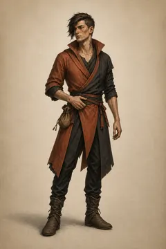</a> <strong>Brinyn Belan</strong> Historical production candidate</td>
    <td align="center" width="25%"><a href="https://media.githubusercontent.com/media/jmoraispk/summonlab/ae01c4f5578d260335442534f11fda8b2a0ba615/assets/heroes/experiments/one-star-overnight-200-001/waves/wave-04/candidates/brinyn-belek/summon-v2.png">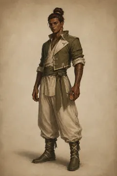</a> <strong>Brinyn Belek</strong> Historical production candidate</td>
  </tr>
  <tr>
    <td align="center" width="25%"><a href="https://media.githubusercontent.com/media/jmoraispk/summonlab/ae01c4f5578d260335442534f11fda8b2a0ba615/assets/heroes/experiments/one-star-overnight-200-001/waves/wave-07/candidates/brinyn-wyrai/summon-v2.png">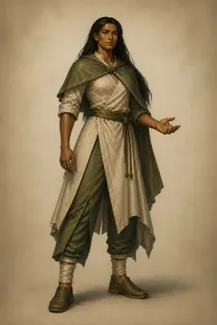</a> <strong>Brinyn Wyrai</strong> Historical production candidate</td>
    <td align="center" width="25%"><a href="https://media.githubusercontent.com/media/jmoraispk/summonlab/ae01c4f5578d260335442534f11fda8b2a0ba615/assets/heroes/experiments/one-star-overnight-200-001/waves/wave-08/candidates/brinyn-zhara/summon-v1.png">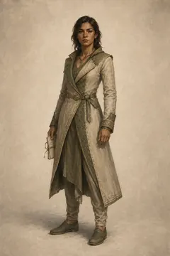</a> <strong>Brinyn Zhara</strong> Historical production candidate</td>
    <td align="center" width="25%"><a href="https://raw.githubusercontent.com/jmoraispk/summonlab/cc2a3427f27948f16fcf6b6226e1e069cd47b5af/assets/heroes/visuals/forge-v2/cohort/bryn-vale-anchor-v1.png">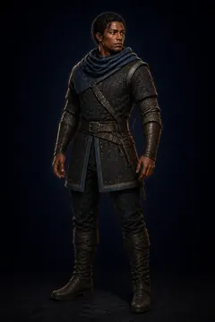</a> <strong>Bryn Vale</strong> Retired Pack 2 approval candidate</td>
    <td align="center" width="25%"><a href="https://raw.githubusercontent.com/jmoraispk/summonlab/cc2a3427f27948f16fcf6b6226e1e069cd47b5af/assets/heroes/visuals/forge-v2/cohort/cael-hale-anchor-v1.png">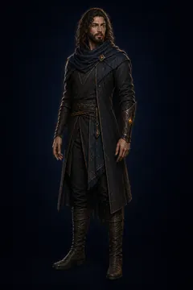</a> <strong>Cael Hale</strong> Retired Pack 2 approval candidate</td>
  </tr>
  <tr>
    <td align="center" width="25%"><a href="https://raw.githubusercontent.com/jmoraispk/summonlab/ae01c4f5578d260335442534f11fda8b2a0ba615/assets/heroes/experiments/native-star-visual-study-v1/candidates/5-star/cael-nahl.png">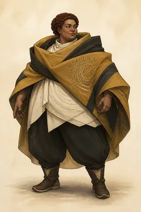</a> <strong>Cael Nahl</strong> Retired production candidate</td>
    <td align="center" width="25%"><a href="https://media.githubusercontent.com/media/jmoraispk/summonlab/ae01c4f5578d260335442534f11fda8b2a0ba615/assets/heroes/experiments/one-star-overnight-200-001/waves/wave-05/candidates/cala-amara/summon-v2.png">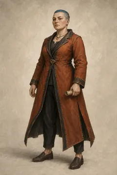</a> <strong>Cala Amara</strong> Historical production candidate</td>
    <td align="center" width="25%"><a href="https://media.githubusercontent.com/media/jmoraispk/summonlab/ae01c4f5578d260335442534f11fda8b2a0ba615/assets/heroes/experiments/one-star-overnight-200-001/waves/wave-05/candidates/cala-dreni/summon-v2.png">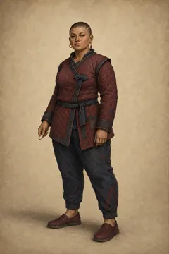</a> <strong>Cala Dreni</strong> Historical production candidate</td>
    <td align="center" width="25%"><a href="https://raw.githubusercontent.com/jmoraispk/summonlab/634d48644ec41d2a8ff3c9f839b8fec2b2830617/apps/web/static/runtime/summonable-heroes-v1/cala-uleni/summon.00b037db0328.webp">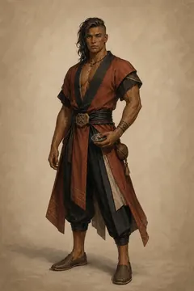</a> <strong>Cala Uleni</strong> Approved summonable roster</td>
  </tr>
  <tr>
    <td align="center" width="25%"><a href="https://media.githubusercontent.com/media/jmoraispk/summonlab/ae01c4f5578d260335442534f11fda8b2a0ba615/assets/heroes/experiments/one-star-overnight-200-001/waves/wave-05/candidates/calan-eshi/summon-v1.png">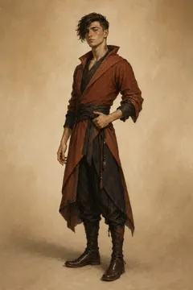</a> <strong>Calan Eshi</strong> Historical production candidate</td>
    <td align="center" width="25%"><a href="https://media.githubusercontent.com/media/jmoraispk/summonlab/ae01c4f5578d260335442534f11fda8b2a0ba615/assets/heroes/experiments/one-star-overnight-200-001/waves/wave-06/candidates/calan-resheth/summon-v1.png">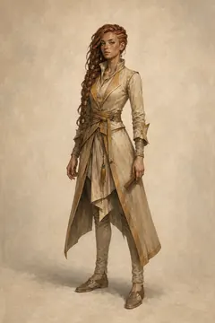</a> <strong>Calan Resheth</strong> Historical production candidate</td>
    <td align="center" width="25%"><a href="https://media.githubusercontent.com/media/jmoraispk/summonlab/ae01c4f5578d260335442534f11fda8b2a0ba615/assets/heroes/experiments/one-star-overnight-200-001/waves/wave-04/candidates/calar-quorek/summon-v2.png">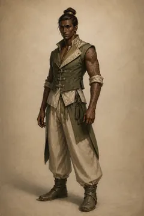</a> <strong>Calar Quorek</strong> Historical production candidate</td>
    <td align="center" width="25%"><a href="https://media.githubusercontent.com/media/jmoraispk/summonlab/ae01c4f5578d260335442534f11fda8b2a0ba615/assets/heroes/experiments/one-star-overnight-200-001/waves/wave-06/candidates/calel-eshi/summon-v2.png">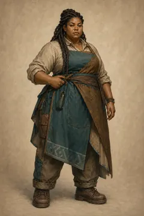</a> <strong>Calel Eshi</strong> Historical production candidate</td>
  </tr>
  <tr>
    <td align="center" width="25%"><a href="https://media.githubusercontent.com/media/jmoraispk/summonlab/ae01c4f5578d260335442534f11fda8b2a0ba615/assets/heroes/experiments/one-star-overnight-200-001/waves/wave-06/candidates/calel-vesha/summon-v1.png">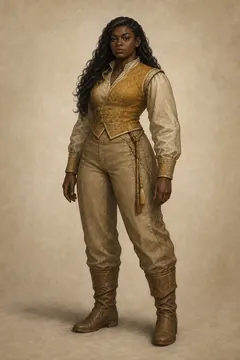</a> <strong>Calel Vesha</strong> Historical production candidate</td>
    <td align="center" width="25%"><a href="https://media.githubusercontent.com/media/jmoraispk/summonlab/ae01c4f5578d260335442534f11fda8b2a0ba615/assets/heroes/experiments/one-star-overnight-200-001/waves/wave-06/candidates/calen-keshin/summon-v1.png">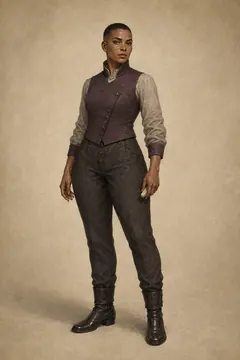</a> <strong>Calen Keshin</strong> Historical production candidate</td>
    <td align="center" width="25%"><a href="https://media.githubusercontent.com/media/jmoraispk/summonlab/ae01c4f5578d260335442534f11fda8b2a0ba615/assets/heroes/experiments/one-star-overnight-200-001/waves/wave-06/candidates/calen-loreth/summon-v2.png">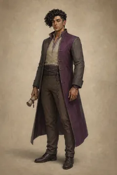</a> <strong>Calen Loreth</strong> Historical production candidate</td>
    <td align="center" width="25%"><a href="https://media.githubusercontent.com/media/jmoraispk/summonlab/ae01c4f5578d260335442534f11fda8b2a0ba615/assets/heroes/experiments/one-star-overnight-200-001/waves/wave-04/candidates/cali-belun/summon-v1.png">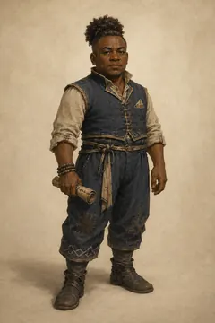</a> <strong>Cali Belun</strong> Historical production candidate</td>
  </tr>
</table>

[01](hero-archive-01.md) · [02](hero-archive-02.md) · [03](hero-archive-03.md) · **04** · [05](hero-archive-05.md) · [06](hero-archive-06.md) · [07](hero-archive-07.md) · [08](hero-archive-08.md) · [09](hero-archive-09.md) · [10](hero-archive-10.md) · [11](hero-archive-11.md) · [12](hero-archive-12.md) · [13](hero-archive-13.md) · [14](hero-archive-14.md) · [15](hero-archive-15.md) · [16](hero-archive-16.md) · [17](hero-archive-17.md) · [18](hero-archive-18.md) · [19](hero-archive-19.md) · [20](hero-archive-20.md) · [21](hero-archive-21.md) · [22](hero-archive-22.md) · [23](hero-archive-23.md) · [24](hero-archive-24.md) · [25](hero-archive-25.md) · [26](hero-archive-26.md) · [27](hero-archive-27.md) · [28](hero-archive-28.md) · [29](hero-archive-29.md) · [30](hero-archive-30.md) · [31](hero-archive-31.md)
