# Hero archive · page 5 of 31

[Collection guide and audit](hero-archive.md) · [Approved roster](heroes.md) · [Older status and alternate portraits](legacy-heroes.md)

Heroes 97–120 of 736, in name order. Select any thumbnail for the immutable original.

[01](hero-archive-01.md) · [02](hero-archive-02.md) · [03](hero-archive-03.md) · [04](hero-archive-04.md) · **05** · [06](hero-archive-06.md) · [07](hero-archive-07.md) · [08](hero-archive-08.md) · [09](hero-archive-09.md) · [10](hero-archive-10.md) · [11](hero-archive-11.md) · [12](hero-archive-12.md) · [13](hero-archive-13.md) · [14](hero-archive-14.md) · [15](hero-archive-15.md) · [16](hero-archive-16.md) · [17](hero-archive-17.md) · [18](hero-archive-18.md) · [19](hero-archive-19.md) · [20](hero-archive-20.md) · [21](hero-archive-21.md) · [22](hero-archive-22.md) · [23](hero-archive-23.md) · [24](hero-archive-24.md) · [25](hero-archive-25.md) · [26](hero-archive-26.md) · [27](hero-archive-27.md) · [28](hero-archive-28.md) · [29](hero-archive-29.md) · [30](hero-archive-30.md) · [31](hero-archive-31.md)

<table>
  <tr>
    <td align="center" width="25%"><a href="https://media.githubusercontent.com/media/jmoraispk/summonlab/ae01c4f5578d260335442534f11fda8b2a0ba615/assets/heroes/experiments/one-star-overnight-200-001/waves/wave-10/candidates/cali-morel/summon-v2.png">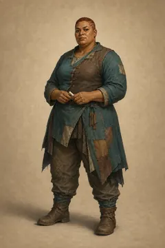</a> <strong>Cali Morel</strong> Historical production candidate</td>
    <td align="center" width="25%"><a href="https://media.githubusercontent.com/media/jmoraispk/summonlab/ae01c4f5578d260335442534f11fda8b2a0ba615/assets/heroes/experiments/one-star-overnight-200-001/waves/wave-08/candidates/cali-wyror/summon-v2.png">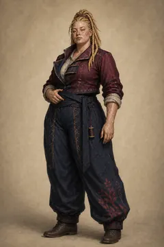</a> <strong>Cali Wyror</strong> Historical production candidate</td>
    <td align="center" width="25%"><a href="https://media.githubusercontent.com/media/jmoraispk/summonlab/ae01c4f5578d260335442534f11fda8b2a0ba615/assets/heroes/experiments/one-star-overnight-200-001/waves/wave-10/candidates/calia-halek/summon-v2.png">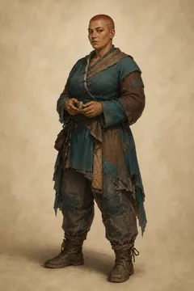</a> <strong>Calia Halek</strong> Historical production candidate</td>
    <td align="center" width="25%"><a href="https://media.githubusercontent.com/media/jmoraispk/summonlab/ae01c4f5578d260335442534f11fda8b2a0ba615/assets/heroes/experiments/one-star-overnight-200-001/waves/wave-05/candidates/calia-resho/summon-v2.png">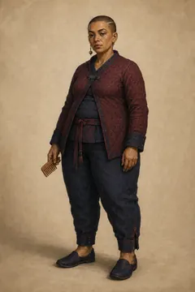</a> <strong>Calia Resho</strong> Historical production candidate</td>
  </tr>
  <tr>
    <td align="center" width="25%"><a href="https://media.githubusercontent.com/media/jmoraispk/summonlab/ae01c4f5578d260335442534f11fda8b2a0ba615/assets/heroes/experiments/one-star-overnight-200-001/waves/wave-09/candidates/calin-grelor/summon-v1.png">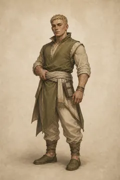</a> <strong>Calin Grelor</strong> Historical production candidate</td>
    <td align="center" width="25%"><a href="https://media.githubusercontent.com/media/jmoraispk/summonlab/ae01c4f5578d260335442534f11fda8b2a0ba615/assets/heroes/experiments/one-star-overnight-200-001/waves/wave-04/candidates/calin-pellel/summon-v1.png">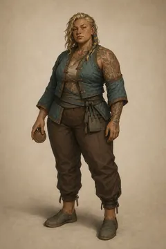</a> <strong>Calin Pellel</strong> Historical production candidate</td>
    <td align="center" width="25%"><a href="https://media.githubusercontent.com/media/jmoraispk/summonlab/ae01c4f5578d260335442534f11fda8b2a0ba615/assets/heroes/experiments/one-star-overnight-200-001/waves/wave-09/candidates/calis-coror/summon-v1.png">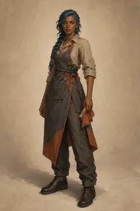</a> <strong>Calis Coror</strong> Historical production candidate</td>
    <td align="center" width="25%"><a href="https://raw.githubusercontent.com/jmoraispk/summonlab/634d48644ec41d2a8ff3c9f839b8fec2b2830617/apps/web/static/runtime/summonable-heroes-v1/calis-kesho/summon.74d2e5faccbe.webp">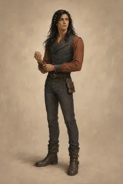</a> <strong>Calis Kesho</strong> Approved summonable roster</td>
  </tr>
  <tr>
    <td align="center" width="25%"><a href="https://media.githubusercontent.com/media/jmoraispk/summonlab/ae01c4f5578d260335442534f11fda8b2a0ba615/assets/heroes/experiments/one-star-overnight-200-001/waves/wave-09/candidates/calon-esho/summon-v1.png">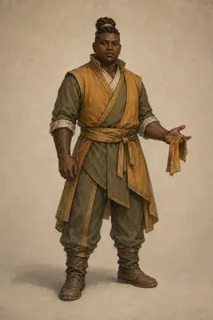</a> <strong>Calon Esho</strong> Historical production candidate</td>
    <td align="center" width="25%"><a href="https://media.githubusercontent.com/media/jmoraispk/summonlab/ae01c4f5578d260335442534f11fda8b2a0ba615/assets/heroes/experiments/one-star-overnight-200-001/waves/wave-07/candidates/calon-joren/summon-v2.png">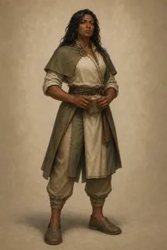</a> <strong>Calon Joren</strong> Historical production candidate</td>
    <td align="center" width="25%"><a href="https://raw.githubusercontent.com/jmoraispk/summonlab/ae01c4f5578d260335442534f11fda8b2a0ba615/assets/heroes/experiments/one-star-overnight-200-001/waves/wave-03/candidates/calon-sorin/summon-v1.png">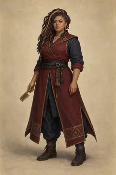</a> <strong>Calon Sorin</strong> Historical production candidate</td>
    <td align="center" width="25%"><a href="https://raw.githubusercontent.com/jmoraispk/summonlab/634d48644ec41d2a8ff3c9f839b8fec2b2830617/apps/web/static/runtime/summonable-heroes-v1/calon-vesha/summon.4000c94a5a47.webp">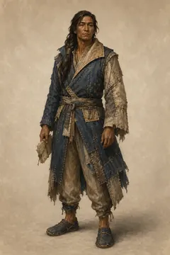</a> <strong>Calon Vesha</strong> Approved summonable roster</td>
  </tr>
  <tr>
    <td align="center" width="25%"><a href="https://media.githubusercontent.com/media/jmoraispk/summonlab/ae01c4f5578d260335442534f11fda8b2a0ba615/assets/heroes/experiments/one-star-overnight-200-001/waves/wave-06/candidates/calor-orar/summon-v2.png">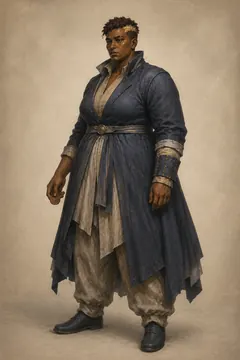</a> <strong>Calor Orar</strong> Historical production candidate</td>
    <td align="center" width="25%"><a href="https://media.githubusercontent.com/media/jmoraispk/summonlab/ae01c4f5578d260335442534f11fda8b2a0ba615/assets/heroes/experiments/one-star-overnight-200-001/waves/wave-04/candidates/calor-ulenan/summon-v1.png">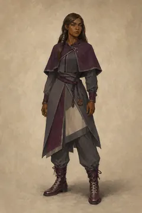</a> <strong>Calor Ulenan</strong> Historical production candidate</td>
    <td align="center" width="25%"><a href="https://media.githubusercontent.com/media/jmoraispk/summonlab/ae01c4f5578d260335442534f11fda8b2a0ba615/assets/heroes/experiments/one-star-overnight-200-001/waves/wave-04/candidates/calu-lorek/summon-v1.png">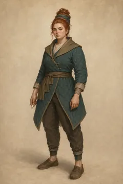</a> <strong>Calu Lorek</strong> Historical production candidate</td>
    <td align="center" width="25%"><a href="https://media.githubusercontent.com/media/jmoraispk/summonlab/ae01c4f5578d260335442534f11fda8b2a0ba615/assets/heroes/experiments/one-star-overnight-200-001/waves/wave-04/candidates/calu-ulenen/summon-v2.png">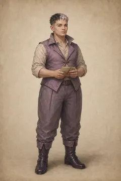</a> <strong>Calu Ulenen</strong> Historical production candidate</td>
  </tr>
  <tr>
    <td align="center" width="25%"><a href="https://media.githubusercontent.com/media/jmoraispk/summonlab/ae01c4f5578d260335442534f11fda8b2a0ba615/assets/heroes/experiments/one-star-overnight-200-001/waves/wave-04/candidates/cora-eshen/summon-v1.png">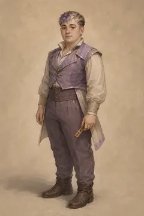</a> <strong>Cora Eshen</strong> Historical production candidate</td>
    <td align="center" width="25%"><a href="https://media.githubusercontent.com/media/jmoraispk/summonlab/ae01c4f5578d260335442534f11fda8b2a0ba615/assets/heroes/experiments/one-star-overnight-200-001/waves/wave-09/candidates/cora-tavan/summon-v1.png">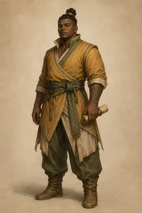</a> <strong>Cora Tavan</strong> Historical production candidate</td>
    <td align="center" width="25%"><a href="https://media.githubusercontent.com/media/jmoraispk/summonlab/ae01c4f5578d260335442534f11fda8b2a0ba615/assets/heroes/experiments/one-star-overnight-200-001/waves/wave-04/candidates/coran-jorun/summon-v2.png">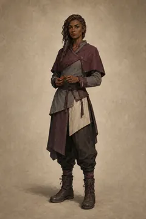</a> <strong>Coran Jorun</strong> Historical production candidate</td>
    <td align="center" width="25%"><a href="https://raw.githubusercontent.com/jmoraispk/summonlab/ae01c4f5578d260335442534f11fda8b2a0ba615/assets/heroes/experiments/one-star-overnight-200-001/waves/wave-03/candidates/corel-sori/summon-v1.png">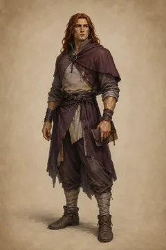</a> <strong>Corel Sori</strong> Historical production candidate</td>
  </tr>
  <tr>
    <td align="center" width="25%"><a href="https://media.githubusercontent.com/media/jmoraispk/summonlab/ae01c4f5578d260335442534f11fda8b2a0ba615/assets/heroes/experiments/one-star-overnight-200-001/waves/wave-05/candidates/coren-nethi/summon-v2.png">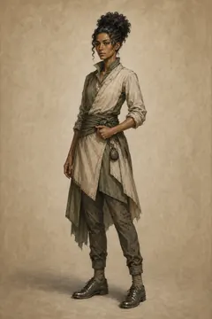</a> <strong>Coren Nethi</strong> Historical production candidate</td>
    <td align="center" width="25%"><a href="https://media.githubusercontent.com/media/jmoraispk/summonlab/ae01c4f5578d260335442534f11fda8b2a0ba615/assets/heroes/experiments/one-star-overnight-200-001/waves/wave-06/candidates/cori-zharor/summon-v2.png">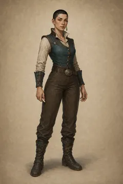</a> <strong>Cori Zharor</strong> Historical production candidate</td>
    <td align="center" width="25%"><a href="https://media.githubusercontent.com/media/jmoraispk/summonlab/ae01c4f5578d260335442534f11fda8b2a0ba615/assets/heroes/experiments/one-star-overnight-200-001/waves/wave-06/candidates/corin-belin/summon-v1.png">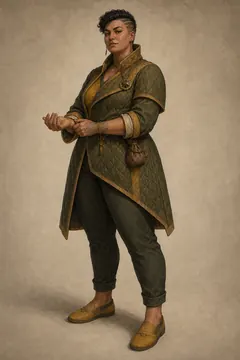</a> <strong>Corin Belin</strong> Historical production candidate</td>
    <td align="center" width="25%"><a href="https://media.githubusercontent.com/media/jmoraispk/summonlab/ae01c4f5578d260335442534f11fda8b2a0ba615/assets/heroes/experiments/one-star-overnight-200-001/waves/wave-10/candidates/corin-corel/summon-v2.png">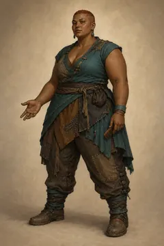</a> <strong>Corin Corel</strong> Historical production candidate</td>
  </tr>
</table>

[01](hero-archive-01.md) · [02](hero-archive-02.md) · [03](hero-archive-03.md) · [04](hero-archive-04.md) · **05** · [06](hero-archive-06.md) · [07](hero-archive-07.md) · [08](hero-archive-08.md) · [09](hero-archive-09.md) · [10](hero-archive-10.md) · [11](hero-archive-11.md) · [12](hero-archive-12.md) · [13](hero-archive-13.md) · [14](hero-archive-14.md) · [15](hero-archive-15.md) · [16](hero-archive-16.md) · [17](hero-archive-17.md) · [18](hero-archive-18.md) · [19](hero-archive-19.md) · [20](hero-archive-20.md) · [21](hero-archive-21.md) · [22](hero-archive-22.md) · [23](hero-archive-23.md) · [24](hero-archive-24.md) · [25](hero-archive-25.md) · [26](hero-archive-26.md) · [27](hero-archive-27.md) · [28](hero-archive-28.md) · [29](hero-archive-29.md) · [30](hero-archive-30.md) · [31](hero-archive-31.md)
