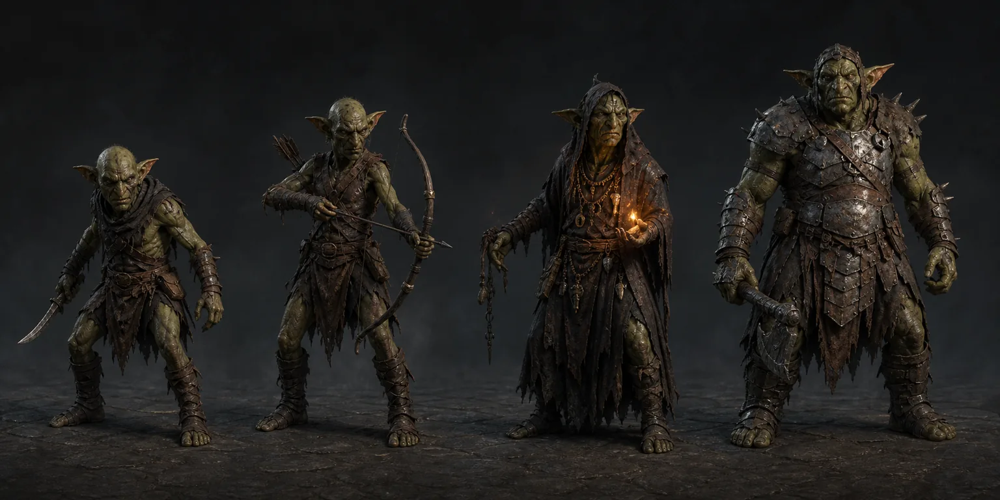
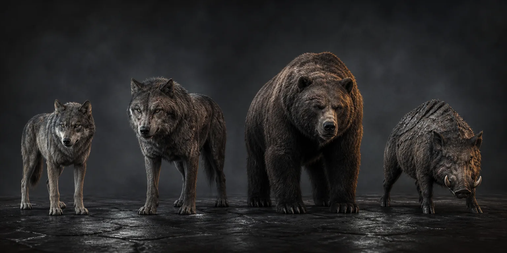
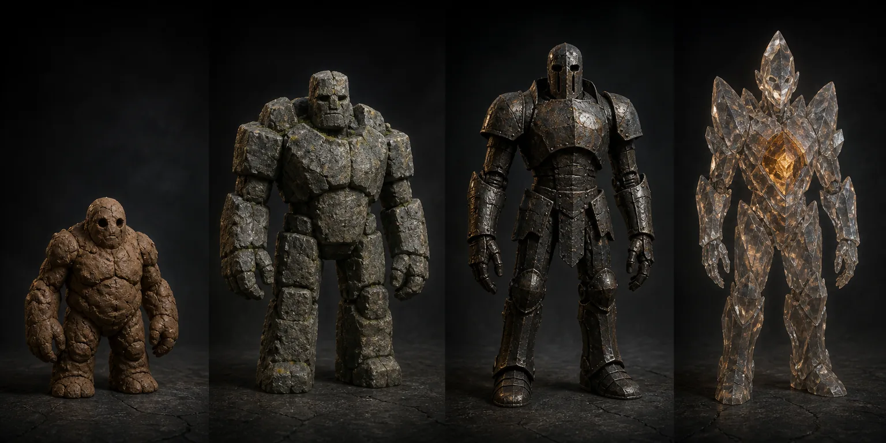
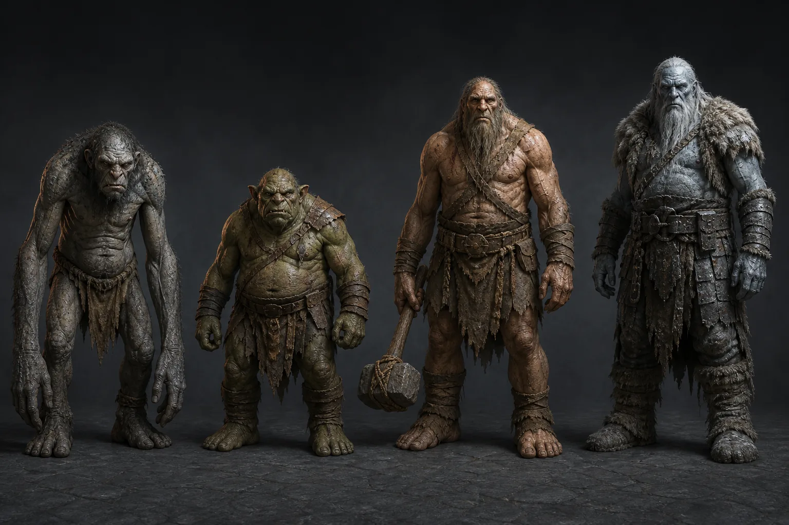
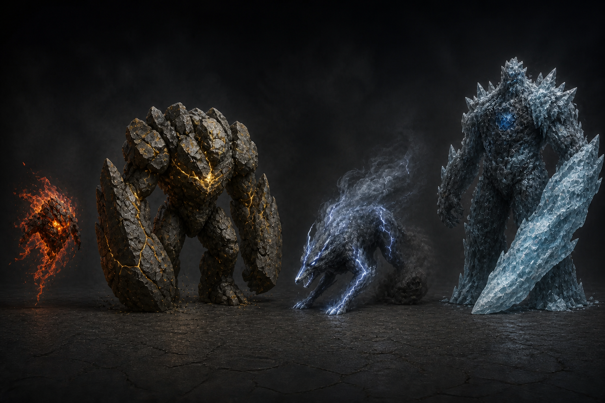
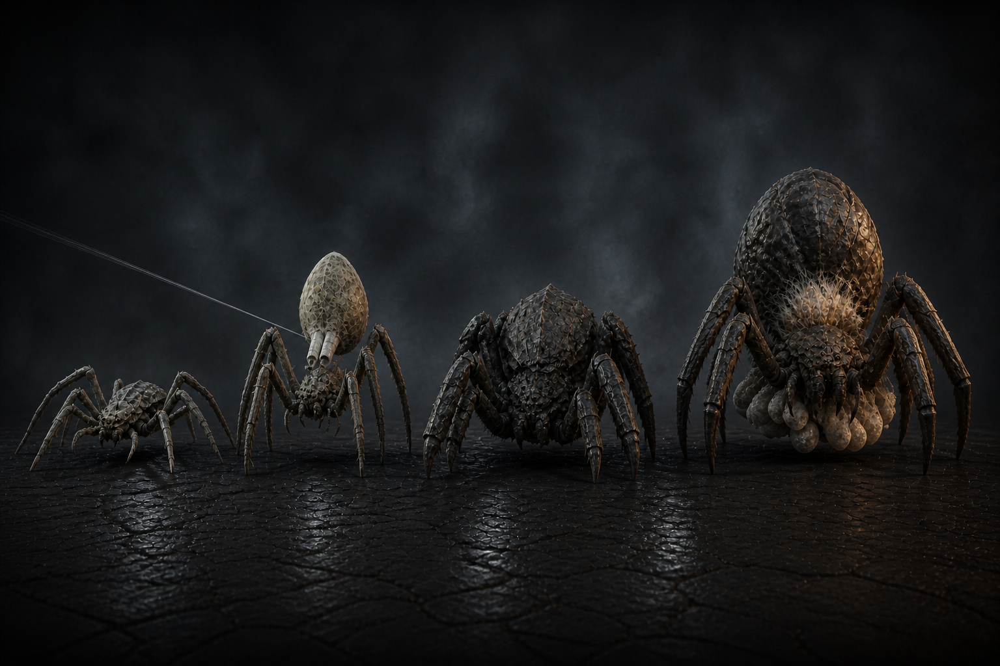
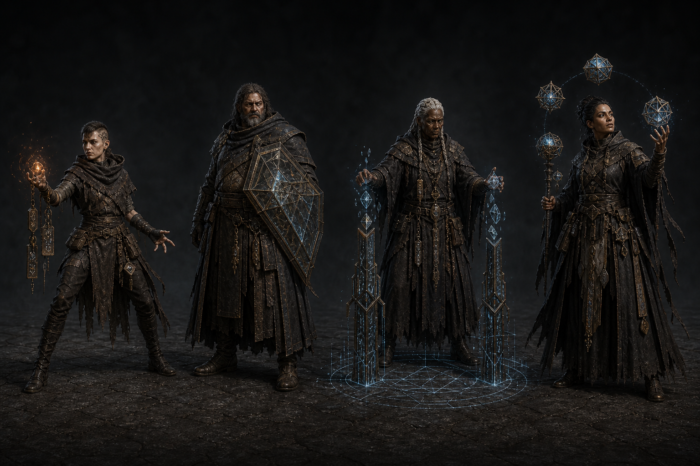
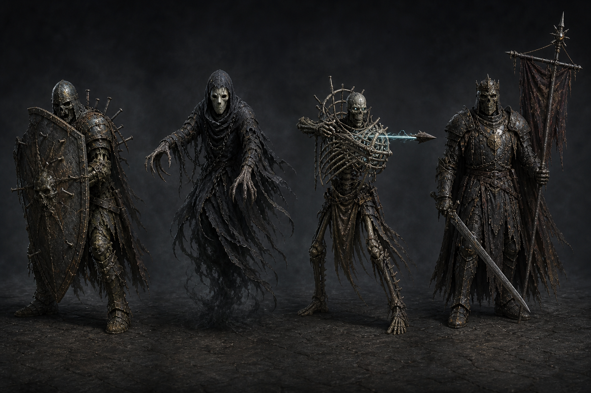
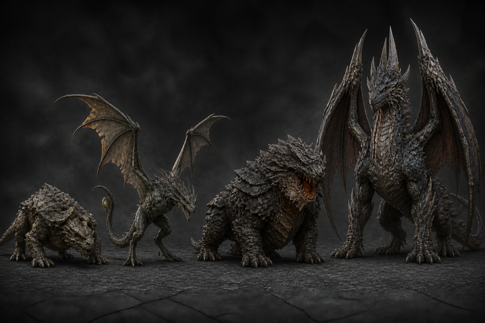
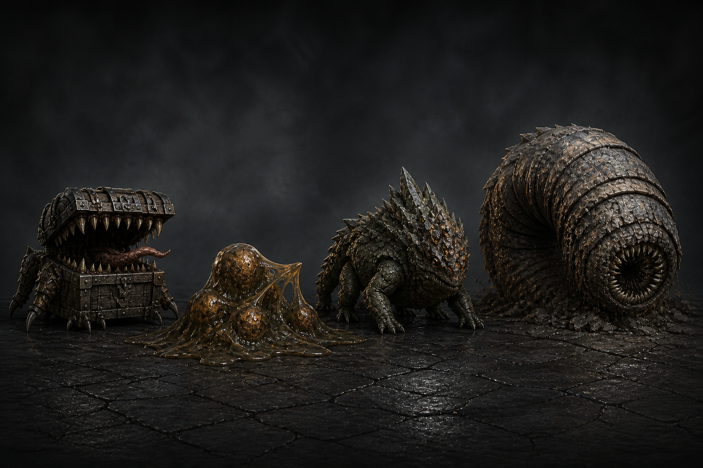

# Monster visual gallery

Wiki ID: `art.monster-gallery`

This page is the first art-book surface of the wiki. Every image below is a **review candidate**.
None is presented as an approved runtime rig or proof of individual continuity. Exact file status,
hashes, generation provenance, and prompts remain in the linked domain catalogs/records.

For canonical family and form identities rather than these historical plates, open the
[monster database](../creatures/monsters/README.md). It publishes 30 families, 150 T1–T5 forms, and
750 planned Normal/Fire/Earth/Wind/Water coordinates. The earlier forty classes and their 160 public
images survive only in the database's candidate-only reconciliation records; none is automatically
eligible as a canonical anchor.

## First progression families

### Goblinoid warband

Skirmisher, archer, hexweaver, and chieftain—the first coordinated system the player learns to read.



### Tower beasts

Grey wolf, dire wolf, cave bear, and tunnel boar—movement, pursuit, burst, and line-breaking pressure.



### Construct escalation

Clay golem, stone golem, iron sentinel, and crystal guardian—attrition, pattern, counter, and
reflection checks.



### Large threats

Ogoblin brute, cave troll, hill giant, and frost giant—boss-scale restraint, regeneration,
displacement, and environmental pressure.



The first-wave lineup is defined in `packages/content/src/enemy-roster.ts`. These plates predate the
checked Pack 2 monster catalog and still require explicit approval/promotion records.

## Character Pack 2 candidate families

### Elementals



This family is the strongest immediate test for the [affinity system](../mechanics/affinities/README.md):
the wiki must determine whether affinity is body, origin, resource, skill, environment, or several
layered concepts before individual runtime anchors are commissioned.

### Arachnids



The page must distinguish species, scale/life stage, brood role, anatomy, behavior, and affinity
before treating the four forms as one race.

### Arcane hostiles



Hex Adept, Ward Mage, Tower Summoner, and Tower Archmage are currently combat/faction duties. Their
shared clothing/order cannot be used to infer a biological race or common personality.

### Undead



Grave Sentinel, Tower Wraith, Bone Mage, and Death Knight require origin, autonomy, memory, and
personhood rules before “undead” becomes more than a visual/encounter family.

### Draconic creatures



Cave Drake, Venom Wyvern, Armored Elder Drake, and Giant Tower Dragon need an explicit species/life
cycle relationship and size contract.

### Dungeon predators



Mimic, slime colony, basilisk, and burrowing worm share a production plate and dungeon duty, not an
assumed origin or ancestry.

## Records and promotion boundary

- [Pack 2 visual catalog](../../../assets/enemies/review/pack-2/catalog.json)
- [Pack 2 generation record](../../../assets/enemies/review/pack-2/generation-record.md)
- [Pack 2 monster validation plan](../../character-pack-2-plan.md)
- [Shared art bible](../../art-bible.md)

For each future image, the associated creature page should eventually show:

```text
visual brief → candidate(s) → exact hash/provenance → human review
→ approved identity/family source → runtime variants → in-game evidence
```

The wiki can be beautiful at the candidate stage while remaining honest about what the game actually
ships.
