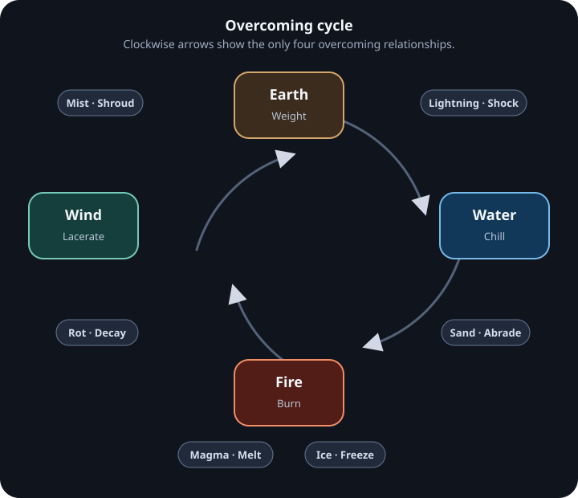
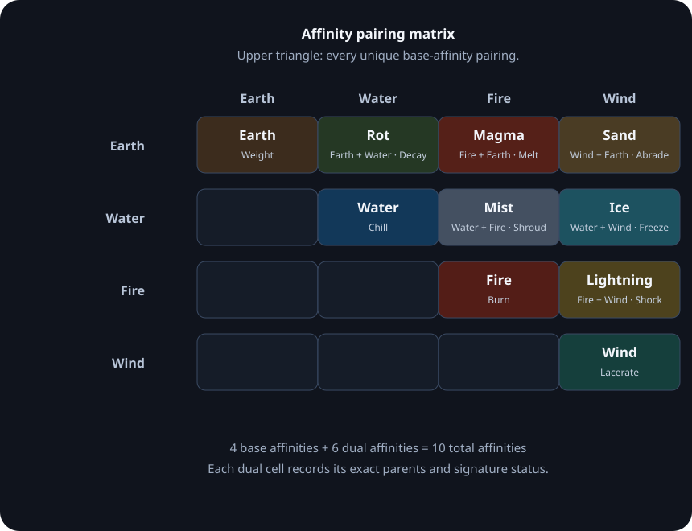

# Affinities

Wiki ID: `mechanics.progression.affinities`

Design status: **accepted supplied design with explicit tuning gaps**.

## 2.1 What an affinity is

**An affinity is a property of the hero, not of a skill.** It describes something about the body and spirit of the bearer — which is why it has its own progression track and its own ranks. A hero holds an affinity; skills merely provide slots that the hero fills from what they hold.

Skills may be *authored* around an element — a fire technique from a fire school — but such a skill still requires the hero to hold Fire in order to function at full strength. A hero cannot borrow an element they do not possess.

**Affinity rank** is the affinity track's only measure. It runs 0 through V, rises through use, element-aligned training, leyline nodes and absorbed monster cores, and governs proc chance, status potency, environmental interaction, and dual-affinity stability. It is never raised by hero level and it never appears on the attribute sheet.

This produces two independent multipliers on any single action. Attributes decide how hard, how fast, and how precisely it lands. Affinity rank decides what element it carries and whether that element does anything at all. A Fire caster with high Intellect and low affinity rank hits hard, with fire-colored damage that rarely burns; reverse the two and the strikes land softly, but everything catches.

**The single coupling to attributes.** On level-up, a hero receives a modest attribute bonus matching their affinity. Flavor, not structure — it nudges a build, it does not define one.

| Affinity | Attribute nudged | Reason |
|---|---|---|
| Fire | Might | Expansion, force |
| Earth | Vitality | Stability, endurance |
| Wind | Agility | Motion, displacement |
| Water | Spirit | Depth, patience, flow |

**Dexterity and Intellect are nudged by no affinity.** These are the two learned attributes — precision and comprehension — and neither is elemental. A scholar and a brute may hold the same element, and a hero cannot become more accurate by burning brighter. Leaving both outside the elemental system keeps skills the primary lever, which is the point.

Dual affinities do not nudge attributes at all. Their reward is elemental, not statistical.

## 2.2 The four affinities

Four base affinities. The set is chosen for legibility over tradition: each one is something a player can picture instantly, name without a glossary, and recognize on a monster at a glance.

| Affinity | Color | Character | Status | Behavior |
|---|---|---|---|---|
| **Fire** | Vermilion | Expansion, aggression, consumption | **Burn** | Damage over time; intensity stacks rather than duration |
| **Earth** | Ocher-brown | Stability, endurance, weight | **Weight** | Reduces poise and action speed; increases stagger taken |
| **Wind** | Pale green-gray | Motion, severance, displacement | **Lacerate** | Cutting damage scaling with the target's movement |
| **Water** | Deep blue | Flow, depth, patience | **Chill** | Reduces attack speed and mana regeneration; escalates toward torpor |

**On Chill.** Chill's escalation endpoint is *torpor* — action speed floored and mana regeneration halted — and not freezing. Freezing belongs to Ice, which is Water's child. A parent affinity should not pre-empt the signature effect of the dual it produces.

## 2.3 Unaligned, and off-cycle

**Unaligned** (also *Formless*) is the absence of affinity. It is the default state of every hero before awakening, the permanent state of every hero below three stars, and the state of most low-tier monsters. It is a genuine position on the board rather than a null value.

An unaligned combatant is **neutral in every direction**. No relationship applies to them, in either role:

- They deal no elemental damage and proc no status effects.
- They receive no bonus damage from an element that would otherwise overcome them.
- They suffer no penalty against an element that would otherwise resist them.

The trade is legibility for ceiling. An unaligned hero cannot be countered by element, which makes them the most predictable combatant on the field — genuinely valuable against unknown opposition or a mixed enemy composition. What they give up is the entire upper half of the system: no procs, no cycle advantage, no dual affinities, no Overwhelming, no Reversal, no Dominion.

Because the star gate in 2.11 makes low-star heroes permanently unaligned, this is not a transitional state that empties out over time. There will always be a substantial unaligned population, and it should be tuned as a real playstyle rather than as a tutorial phase.

**Off-cycle affinities** — **Void** and **Radiance** — are a different thing entirely, and should not be confused with unaligned. Off-cycle affinities have full elemental identity, procs and rank progression, but sit outside the wheel: they have no overcoming relationship with any affinity, in either direction. Nothing counters them and they counter nothing. Unaligned is neutrality by absence; off-cycle is neutrality by exemption, and it is far more dangerous, because the entire counter-system simply stops applying. Reserve them for endgame antagonists and never grant them as an ordinary hero affinity.

## 2.4 The cycle

One cycle, running in a single direction:

**Overcoming: Earth → Water → Fire → Wind → Earth.**

Earth dams Water. Water quenches Fire. Fire consumes Wind. Wind erodes Earth.

Every base affinity therefore sits in exactly three relationships: it **overcomes** one, is **overcome by** one, and is **neutral** toward the remaining one. The two neutral pairings are Fire with Earth, and Water with Wind.

**On Fire overcoming Wind.** Wind feeds a flame at small scale, which is exactly why the relationship runs this way at large scale: a fire big enough to matter generates and consumes its own gale. The gust that would smother a candle is swallowed by a firestorm. Wind does not extinguish Fire; it becomes part of it.

There is no second cycle. Nothing feeds anything, and no affinity strengthens another. An earlier draft carried a generating cycle alongside the overcoming one; it was removed because it required elements chosen for their relational tidiness rather than for feeling elemental, and the cost of keeping it was Wood and Metal.

## 2.5 Combat interactions

| Relationship | Damage | Proc chance | Status duration | Additional |
|---|---|---|---|---|
| Attacker **overcomes** defender | Increased | Increased | Extended | Defender's resistance to that status is reduced |
| Attacker **overcome by** defender | Reduced | Reduced | Shortened | Procs may fail outright |
| **Neutral** pairing | Unmodified | Unmodified | Unmodified | No relationship applies |
| Same affinity | Heavily reduced | Suppressed | — | Defender converts part of the damage into mana |
| Either party **unaligned** | Neutral | — | — | No relationship applies in either direction |
| Either party **off-cycle** | Neutral | Unmodified | Unmodified | Procs still land; no cycle interaction exists to modify them |

Same-affinity attacks remain the one case where attacking is actively counterproductive, and it is the sole teacher of element identification. It should be tuned to sting.

## 2.6 Advanced states

Two states, one rule. Both unlock at **Rank IV**, both are functions of the gap in affinity rank, and both apply only inside a pairing where the overcoming relationship already exists. Neither can occur across a neutral pairing, against an unaligned combatant, or between two combatants of similar rank.

> **The rule.** Where one party stands **two or more ranks above** the other, and that party is at **Rank IV or above**, the cycle stops behaving normally in their favor.

Which state results depends only on which side of the attack that party is standing on:

**Overwhelming** — the higher-ranked party is the *attacker*. Overcoming stops being an advantage and becomes a rout: damage scales up sharply, procs gain area components, and the status becomes unresistable.

**Reversal** — the higher-ranked party is the *defender*. The relationship inverts. A Water sovereign no longer loses to Earth; Earth begins losing to them. This is the moment a combatant visibly outgrows the rules, and it is exactly right for a tier-five boss.

### Resolution grid

Read only where the attacker's affinity overcomes the defender's. Everywhere else, 2.5 applies unchanged.

| Attacker ↓ / Defender → | I | II | III | IV | V |
|---|---|---|---|---|---|
| **I** Dormant | standard | standard | standard | **Reversal** | **Reversal** |
| **II** Awakened | standard | standard | standard | **Reversal** | **Reversal** |
| **III** Attuned | standard | standard | standard | standard | **Reversal** |
| **IV** Resonant | **Overwhelming** | **Overwhelming** | standard | standard | standard |
| **V** Sovereign | **Overwhelming** | **Overwhelming** | **Overwhelming** | standard | standard |

The grid is **anti-symmetric**: mirror it across the diagonal and every Overwhelming becomes a Reversal and vice versa. Five cells each. Neither state is the privileged one, and neither rank is favored over the other — the advantage simply follows whoever is further ahead.

Two consequences worth noting. Ranks III, IV and V can never be reversed by anything on the ladder, since no rank sits two above them from the defender's side of a normal engagement. And Rank III sits at the center of the grid, triggering nothing and suffering nothing except against a Rank V defender — which makes it the plateau where the cycle behaves exactly as written, and a good default for mid-game content.

## 2.7 Dominion

**Rank V only.** Not a cycle mechanic, and deliberately so — Rank IV owns the cycle-breaking states, so Rank V needs its own territory rather than a larger version of the same idea.

At Sovereign the element no longer requires an action to express. It becomes ambient:

- A field radiates from the hero and steadily applies their signature status to every enemy standing in it, whether or not the hero attacks.
- Allies inside the field gain resistance to that same status.
- Environmental interaction becomes continuous rather than triggered — a Fire sovereign's ground is always burning, a Water sovereign's is always flooding.

Dominion persists while the hero is conscious. It cannot be dispelled, only left. Two overlapping Dominions of opposing affinities contest, and the higher rank wins the contested ground; at equal rank both are suppressed where they overlap.

This is the mechanic that should make a tier-five boss encounter feel structurally different from a tier-four one: the arena itself belongs to the enemy before the fight starts.

## 2.8 Affinity and skills

Skills at grade B and above carry **affinity slots**. A hero may infuse a slot with any affinity they hold.

**Infusion is additive.** It never replaces or converts the skill's base behavior — it layers on top of it:

| Layer | Source | Present when |
|---|---|---|
| Base damage and effect | The skill itself | Always |
| Elemental rider damage | Infused affinity | Slot filled |
| Status proc chance | Infused affinity, scaled by affinity rank | Slot filled, Rank II or higher |
| Cycle relationship | Infused affinity | Slot filled |
| Environmental interaction | Infused affinity | Slot filled, Rank III or higher |

An infused skill is therefore always at least as good as an uninfused one, except in the specific case where the cycle turns against the hero — which is a positioning and target-selection problem, not a build mistake.

The practical effect is enormous content leverage. A single "Rising Slash" becomes burning, crushing, cutting or chilling depending on what is socketed, from one animation and one set of tuning values.

**Multi-slot skills** at A and S grade hold several affinities at once. Where those affinities form a valid pair *and* the hero has manifested that pair, the skill may proc the dual status instead of either parent — a strong incentive to pursue dual affinity.

## 2.9 Affinity ranks

Affinity progresses on its own track, independent of hero level.

| Rank | Name | Mechanical unlock | Visual signature |
|---|---|---|---|
| **0** | Unaligned | No affinity held. Neutral in all directions. | None |
| **I** | Dormant | Affinity known. No procs. Elemental rider damage only. | Faint color tint on skill effects |
| **II** | Awakened | Status procs unlock at base rate. First affinity slot usable. | Clear elemental color on all skills; light particle trail |
| **III** | Attuned | Second affinity slot. Environmental interaction — Fire ignites terrain, Wind scours it, Water floods it. A second affinity may now be held. | Persistent low aura; the element's material appears on the body |
| **IV** | Resonant | **Overwhelming and Reversal** both become available. Procs gain area components. Status effects begin spreading between targets. | Full standing aura; local weather shifts to match the element |
| **V** | Sovereign | **Dominion** — the element expresses without action. | The element manifests in the surroundings regardless of what the hero does |

These ranks map directly onto the monster tier ladder T1–T5.

Progress toward the next rank is tracked but unnamed — it is experience on the affinity track, not a stat, and it never appears on the sheet as a number the player allocates.

## 2.10 Dual affinities

Every pair of base affinities produces a **dual affinity**. Four bases, six pairs, six duals — complete and closed, with nothing left over and no arbitrary additions.

### Reactions — from clashing pairs

Produced by two affinities standing in an overcoming relationship. Something is happening, violently, and it does not settle. Harder to hold.

| Dual | From | Color | Character | Status |
|---|---|---|---|---|
| **Mist** | Water ✕ Fire | Near-white gray | Scalding vapor, obscurement, concealment | **Shroud** — accuracy loss; breaks target lock |
| **Lightning** | Fire ✕ Wind | Gold-violet | Discharge, instantaneity, the storm's own convection | **Shock** — interrupts casts; chains between nearby targets |
| **Sand** | Wind ✕ Earth | Tan-ocher | Erosion, abrasion, the scouring storm | **Abrade** — armor shred plus blind |
| **Rot** | Earth ✕ Water | Sickly green | Decay, disease, waterlogged ground | **Decay** — stacking degeneration that ignores armor |

### Materials — from neutral pairs

Produced by two affinities with no quarrel. These are stable states of matter rather than ongoing events, and they hold without strain.

| Dual | From | Color | Character | Status |
|---|---|---|---|---|
| **Magma** | Fire ✕ Earth | Molten red-black | Liquid stone; crust over a burning core | **Melt** — destroys armor; denies ground |
| **Ice** | Water ✕ Wind | Pale cyan | Contraction, stillness, brittleness | **Freeze** — hard stop; bonus stagger taken while frozen |

### Where a dual sits on the cycle

**A dual overcomes both of its parents.** The child surpasses what made it — magma is no longer fire or stone, and neither can touch it. **It is overcome by exactly one base affinity**, the one that would extinguish it, and is neutral toward the last.

| Dual | Overcomes | Overcome by | Neutral toward |
|---|---|---|---|
| **Mist** | Water, Fire | Wind — disperses it | Earth |
| **Lightning** | Fire, Wind | Earth — grounds it | Water |
| **Sand** | Wind, Earth | Water — settles and washes it away | Fire |
| **Rot** | Earth, Water | Fire — burns it out | Wind |
| **Magma** | Fire, Earth | Water — the sea quenches it | Wind |
| **Ice** | Water, Wind | Fire — melts it | Earth |

Every dual is therefore two-up, one-down, one-neutral, which makes it strictly stronger on the wheel than any base affinity. That is deliberate, and it is what the rarity in 2.11 pays for. The reaction-versus-material distinction lives in stability and status flavor, not in cycle position — both groups sit on the wheel identically.

Each weakness is authored for intuition rather than derived from a formula. There is no structural rule that picks Water over Wind as Magma's counter; it is simply the one a player will guess correctly the first time, which is worth more than a tidy derivation.

Duals do not combine further. There is no third tier.

## 2.11 Holding an affinity

### The star gate

Affinity is gated on **current star rating**, not on native rating. A hero raised from two stars to four becomes eligible on promotion.

| Stars | Eligibility |
|---|---|
| 1–2 | **None.** Permanently unaligned at this rating. |
| 3 | May awaken a single affinity |
| 4–7 | May awaken a single affinity, or — rarely — a dual |

This gives the unaligned state a permanent population rather than making it a phase every hero passes through, and it gives star promotion a reward that is not simply a larger number.

### Awakening

Awakening is rolled at **level-up** and at **star promotion**, on any hero at or above the gate. It is not purchasable, not craftable, and not guaranteed by any amount of play.

A single affinity is uncommon. A dual is *rare in the strict sense* — if an entire roster were raised to seven stars, only a small fraction would hold one. Star rating opens the door; it does not walk the hero through it.

Duals may also arrive through routes outside the roll: bloodline awakening, a completed trial at a paired leyline node, absorbing the core of a dual-affinity monster, or a one-per-hero narrative event.

### Stability

Both parent affinities must reach **Rank III** before the pair can be held at all.

Materials are stable once acquired. Reactions are not — they apply a persistent drain or backlash until both parents are high enough to hold them. A hero can carry Lightning long before they can carry it *comfortably*, which is a good place for tension.

### Manifestation

Holding both parents is not the same as wielding the dual. A hero who holds Fire and Wind does not throw lightning on the first day; they throw fire, and they throw wind.

**Below the manifestation threshold**, the hero simply carries two base affinities. Each attack draws on one parent, chosen by the player or by the skill's infused slot, and is evaluated on that parent's position in the cycle. This is already a strong position — two elements is more coverage than any single-affinity hero has — and it is where most dual-affinity heroes will spend most of their lives.

**At or above the threshold**, the dual becomes available as a third element the hero may draw on. Manifesting is a per-action choice, not a permanent state:

| | Element carried | Status proc | Cycle position |
|---|---|---|---|
| Unmanifested | One parent, chosen per action | That parent's status | That parent's position |
| Manifested | The dual | The dual's status | The dual's own position, per 2.10 |

The threshold is a function of both parents' ranks and of the time they have been held together. It is not a purchase and it is not a level — it is a mastery, and it should take real play to reach.

**Why this matters.** It converts dual affinity from a birth trait into an arc. Rolling the pair is the beginning of a story rather than the end of one, and the moment a hero first manifests should be as legible as any evolution in the skill track.

**Bookkeeping cost.** A dual-affinity hero tracks three values — one rank per parent, plus manifestation progress on the pair. This is the most complex object in the progression system and it should stay rare enough that the complexity is a reward rather than a chore.
