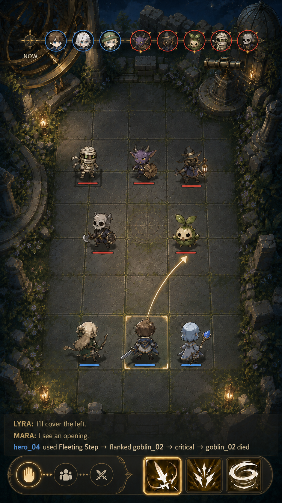
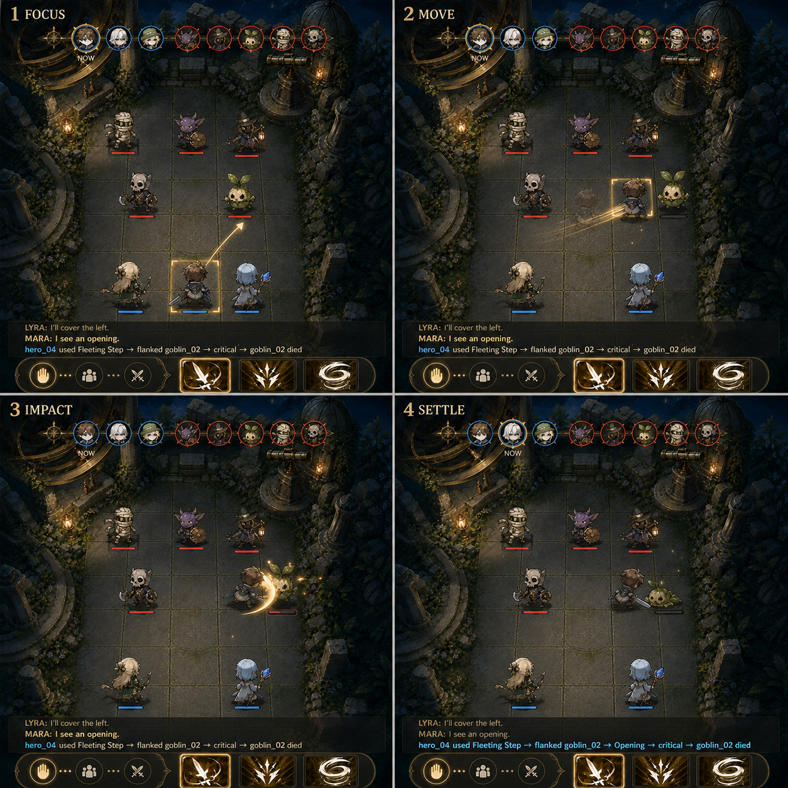

# Summoning, Progression, and Combat

Wiki ID: `system.summoning-progression-combat`

This system owns the core capability loop: acquire heroes, develop attributes and skills, prepare
equipment, resolve combat, and translate validated outcomes into growth and motivating rewards. Its
internal bounded contexts stay separate even though the player experiences them as one loop.

## Living Village

- one Normal summoning channel and enough introductory access to form one party;
- 1★ levels 1–10 with the accepted future cap table preserved in schema;
- four visible combat attributes and the explicit Unaligned affinity state; 1★ heroes cannot
  awaken an affinity;
- 8–12 runtime skills from the complete compendium;
- 12–20 runtime equipment definitions across weapon, armour, and accessory;
- direct attribute or owned-skill training;
- a versioned seeded combat request/receipt with explanatory trace;
- reward claims committed by their owning progression, inventory, and floor systems.
- a placeholder engagement table covering daily gems, mission benefits, and progress toward an
  occasional Special summon, with exact values still under review.

Normal player summoning draws from the finite `summonable-heroes-v1` catalog: 200 approved named
heroes, all native 1★, each with one exact summon portrait and one exact combat chibi. Campaign
selection is deterministic from its seed and samples without replacement. Laboratory and legacy
procedural generators remain available for authoring and compatibility, but they do not populate
the player summon result.

The release matrix decides whether the initial gem claim and Special access are active or only
represented by a placeholder. Advanced summoning, pity, promotion, complete mastery ladders,
merging, crafting, item sets, permanent injuries, death, and synthesis remain documented but
inactive.

Detailed source material:

- [Progression](../mechanics/progression/README.md)
- [Skills](../mechanics/skills/README.md)
- [Equipment](../mechanics/equipment/README.md)
- [Attributes](../mechanics/attributes.md)
- [Affinities](../mechanics/affinities/README.md)
- [Rewards and engagement](../mechanics/rewards-and-engagement.md)
- [Living Village release matrix](../roadmap/living-village-v1.md)

## Target mission structures and party requirements

Design status: **accepted direction; exact balance and unlock counts remain outside the current
milestone**

The complete game distinguishes these mission structures. They are different from the versioned
combat-resolution modes described below.

### Expeditions

Expeditions are open-world exploration. Enemy difficulty increases as the expedition reaches more
dangerous territory, but the player may return home voluntarily rather than committing to a fixed
sequence of battles. Species practice belongs to this mode: the player may select an unlocked
species to hunt, and a configured number of victories against that species unlocks the next species
in the authored progression. The exact victory counts, travel structure, and reward tuning require
a later combat-content pass.

### Tower Challenges

A Tower Challenge is a five-floor high-difficulty sequence. Every floor is substantially harder
than ordinary expedition combat and culminates in its authored boss class. A challenge requires a
party on every floor. The number of required parties is versioned by floor; the initial target may
use one party, while later floors may require multiple parties. All five battles in one challenge
attempt must be completed consecutively. Recovery, substitution, and state-carryover rules require
their own balance specification before implementation.

### Tower Exploration

Tower Exploration is practice for a particular challenge floor rather than a challenge clear. It
allows multiple independent parties to explore the same floor simultaneously. Each party owns its
own attempt, state, receipts, retreat decision, and rewards; one party's exploration cannot mutate
another party's combat state. Exploration evidence may prepare the player for the challenge, but it
does not satisfy the requirement to complete all five challenge battles in sequence.

These mission structures do not silently change the narrower Living Village prototype below. That
prototype continues to prove one-party reservation, repeated encounters, safety thresholds, and
receipt handoff until shared contracts promote the broader design.

## Versioned combat resolution

Foundation status: **`legacy-auto-v1` implemented in `engine-v25`; `agent-readiness-v1` reserved but
not live**.

Combat mode is release configuration owned by the operator. It is not a player preference and no
player API accepts it. Preparation stores a binding containing mode ID, mode-rules version,
aggregate combat-content hash, and timestamp on the attempt. Changing the configured default affects
future attempts only; the stored binding cannot change while an attempt is active.

`COMBAT_MODE` currently defaults to and accepts only `legacy-auto-v1`. The cross-phase contract also
recognizes `agent-readiness-v1`, but a stored readiness binding returns an explicit not-yet-live
result. The implementation work required to enable it is tracked in the
[agent-readiness combat plan](../../superpowers/plans/2026-09-06-agent-readiness-combat.md).

| Mode | Release status | Choice source | Time and randomness |
| --- | --- | --- | --- |
| `legacy-auto-v1` | beta-safe operator default | seeded automatic policy; no hero-model calls | frozen legacy rounds, sequential entropy, 48-round safety boundary |
| `agent-readiness-v1` | next plan; unavailable to releases and players | one intent provider call per ready hero | planned one-tick readiness cohorts and purpose-keyed randomness |

### Legacy automatic combat

For a new v25 attempt the player can press **Continue battle**. That command advances automatic
combat; the request cannot contain a combat mode, actor action, target, choices, or policy. A seeded
policy selects one legal action for every party actor, and the engine records the policy ID plus
packet, legal-action-set, and result hashes.

The runner isolates the frozen historical resolver behind a v24-shaped boundary. New four-attribute
heroes receive a mode-local compatibility projection with integer half-up scaling and clamping:

```text
legacy might   <- Might
legacy finesse <- Agility
legacy insight <- Spirit
legacy resolve <- Vitality
```

The projection never appears on the character sheet and never rewrites persisted v1 or v24 state.
Historical attempts continue using their original aptitudes, event bytes, entropy purposes, and
state hashes. A behavior change requires another explicit mode/rules version.

### Authority layers

Combat separates three responsibilities that must not silently collapse into one another:

| Layer | Responsibility | Mechanical authority |
| --- | --- | --- |
| Intent provider | choose one engine-enumerated legal action, target/destination, and allowed fallback | none beyond the validated selection |
| Combat Resolver | timing, arbitration, movement, hit, critical, damage, status, downing, and outcome | complete and deterministic |
| Narration | present already-resolved events | none |

The governing boundary is: **an intent provider is never the referee**. The legacy provider is a
seeded automatic policy; the future readiness provider may be a hero agent. Neither can construct an
effect, inspect hidden rolls, compute an outcome, or write state. Resolution alone emits the factual
event trace and proposed claims.

### Planned readiness stepping

The readiness mode is unshipped. Its accepted contract will advance a deterministic simulation to
the next tick on which one or more actors are ready, freeze one canonical snapshot for that cohort,
derive a filtered view and legal-action set for each actor, collect their choices concurrently, and
then apply one validated batch:

```text
advanceUntilDecision(state) -> DecisionWindow | CombatResult
applyChoiceBatch(state, validated choices) -> state + events
```

All actors in tick `T` choose against the same pre-action truth. They do not see another actor's
unresolved choice. Resolution orders collisions by exact readiness time, authored reaction priority,
then a stable purpose-keyed tie-break; each later choice is revalidated and follows its authored
fallback if an earlier move, flank, downing, or object claim invalidated it. No agent is re-queried
during arbitration, and API latency never changes simulation time.

### Power integrity and human realism

Design status: **accepted boundary; constants remain under review**

Level, attributes, equipment, skill mastery, and affinity establish an actor's underlying capability.
Stress, fear, pain, surprise, trust, imperfect information, and bad decisions affect how effectively
that capability is expressed; they do not silently erase it. A level-10 hero remains far more
capable than a level-3 goblin even while frightened, injured, or reluctant.

~~~text
underlying capability        current condition
level + attributes           injury + fatigue + stress
equipment + mastery          position + information + trust
          \                         /
           \                       /
            v                     v
          legal options -> chosen intent -> seeded resolution
                                  |
                                  v
                     authoritative, explained outcome
~~~

The expected outcome range must preserve meaningful power gaps. Human factors may cost tempo,
accuracy, Mana, positioning, confidence, or an opportunity; they should not turn every encounter
into flat randomness. An upset across a large power gap requires explicit, traceable stacked causes,
such as severe prior injury, an ambush, immobilization, environmental danger, incompatible equipment,
or several failed coordination decisions. Even then, the receipt must show why the stronger actor's
capability could not be brought to bear.

Fairness requirements follow from this boundary:

- personality never applies an invisible arbitrary penalty after an action is chosen;
- consequential fear or impairment is visible in projected state and changes legal or evaluated
  choices before resolution;
- the effect of condition is bounded relative to the established capability gap;
- safer recovery choices remain available when fiction and rules permit them;
- identical state, seed, and recorded choices reproduce the same outcome and explanation.

Human realism changes **how power is expressed**, not whether power exists.

The future readiness production shape is a deterministic stepped simulation around an external
provider boundary:

```text
simulate(CombatSpec, ProviderBinding) -> CombatResult
```

The master seed is an input. In `agent-readiness-v1`, individual rolls will derive from stable
purpose keys rather than the position-dependent stream retained by historical legacy combat:

```text
roll = hash(masterSeed, encounterIndex, tick, actorId, purpose, sequence)
```

Purposes include initiative, hit, critical, status, drop, and reward. Given the same frozen spec,
seed, and choices, replay must produce the same receipt and trace. Changing one choice may change
affected outcomes without reshuffling unrelated call sites.

### Planned common result and consequences

The readiness plan introduces a common outer combat result with final combat-local resources,
harm/recovery evidence, skill-practice evidence, loot/extraction claims, decisive events, bindings,
and replay hashes. Owning progression, inventory, expedition, and aftermath processes validate and
commit those idempotent claims; combat does not directly grant durable rewards.

That plan also makes Downed the zero-Health state. Safe victory or extraction removes Downed from a
recovered hero and restores only the minimum safe Health needed to leave the state. A failed
extraction may make an unrecovered hero permanently lost only through an explicit, traceable engine
rule. These readiness/common-result consequences are accepted design, not shipped v25 legacy
behavior.

### Balance evidence boundary

The committed combat-balance evidence validates immutable rules and content hashes across levels
10, 40, 70, and 99 with 10,000 seeded trials per matchup. The 7,499-basis-point general-armour cap,
four-attribute resource/scaling rules, named resistance cap, and versioned skill/equipment catalogs
are production foundation.

The harness's peer hit/evasion equation, relative-Agility conversion, attack cadence and variance,
affinity matchup application, general armour-point fixture values, and magical-active substitute are
explicitly hash-bound **benchmark candidates**. They prove that a coherent tuning set can pass the
promotion gates; they do not become runtime mechanics merely because the evidence passes.

### Explanatory trace

The event log is a product surface, replay input, future narration input, and the player's account
of why the party won or lost. A useful trace exposes:

- initiative and action order;
- the chosen skill or basic action and target;
- important Health and Mana deltas;
- skill base, attribute scale, equipment term, affinity relationship, critical result, mitigation,
  and status contribution;
- telegraphs before their resolution;
- one decisive cause supported by exact event IDs.

The player-facing form is a live, chat-like combat feed with two explicitly different message types:

- **Resolved event:** an engine-authored factual line, such as `hero_04 used Fleeting Step → flanked
  goblin_02 → Opening → critical → goblin_02 died`.
- **Character voice:** an optional short statement of public intent or personality grounded in the
  actor's legal choice and visible state. It is not private reasoning and has no mechanical authority.

Messages arrive in authoritative event order and retain links to their source event IDs so the same
feed can be reconstructed during replay. Narration may color a resolved event, but cannot predict,
replace, or revise resolution.

On phone, the collapsed feed shows the latest three messages above the command bar and expands to
the complete history. Desktop places the same feed beside the battlefield, using the additional
horizontal space without changing its message order or contents.

The compact live view gives the newest message full emphasis and fades the preceding two messages
progressively. Expanded history restores uniform readable contrast, and event order remains explicit
without depending on opacity alone.

Character-voice messages use a concise colored name prefix rather than a portrait thumbnail. This
keeps the feed visually light, avoids repeating the initiative portraits, and leaves mechanical event
lines easy to scan.

The supplied damage expression currently defines shape, not accepted constants:

```text
damage = SkillBase
       x (1 + AttributeScale)
       x (1 + EquipmentBonus)
       x AffinityMultiplier
       x CriticalMultiplier
       x (1 - Mitigation)
```

The broader design includes tick-driven readiness, ten total affinities (four base and six dual),
status applications, threat, authored Break mechanics, group formations, consumables,
kill-sensitive drops, gathering, and permanent consequences. The accepted family consolidation
keeps form tier, numerical level, and affinity rank as separate axes; any restriction on low-tier
affinity use must be authored explicitly. Engine-v25 ships the four-attribute and automatic-mode
foundation only. Production armour magnitudes, magical active skills, readiness intent, permanent
injury/death, free-roaming gathering, and model narration remain unshipped.

### Accepted combat presentation direction



This image is the accepted visual baseline for the first phone combat slice, including camera angle,
battlefield density, tile alignment, timeline restraint, three-line name-only feed, and command-bar
proportions.



The accepted first action cadence is `focus -> move -> impact -> settle`. The moving actor visibly
claims the destination tile before impact; the final board, health, timeline, and feed state settle
before the next action begins.

The runnable **/living-village-lab/combat** pilot exercises that cadence with proxy silhouettes and
an explicitly non-canonical `combat-motion-proxy-v1` receipt. It is the review surface for camera,
anchors, timing, controls, and responsive composition; production mission state remains engine-owned.

The [combat animation implementation plan](../../evidence/living-village-combat-animation-implementation-plan.md)
defines the recommended board, playback, PixiJS, asset-pack, and identity-bound chibi sequence.

The combat view is a steep top-down 2.5D battlefield with flat chibi combatants, stable feet anchors,
soft elliptical shadows, and environmental layers that create depth without requiring a full 3D
renderer. The battlefield remains the primary surface on both phone and desktop. Every combatant's
feet anchor and shadow are centered on one tactical tile. Selection outlines follow that tile's exact
projected edges.

Turn clarity uses an explicit portrait rail rather than an ambiguous row of portraits. It shows the
ready actor at the `Now` origin and later projected actors in engine-owned order. Relative-time labels
are not printed beside every portrait by default; exact projected timing remains available on
inspection and to assistive technology. The ready-actor treatment must remain legible without
depending on color or animation.

On phone, the rail is horizontal and fixed to the top edge of the battlefield. It remains visually
thin and scene-transparent rather than reserving an opaque header band; only a localized contrast
veil may sit behind the portraits. Future actors move left toward `Now`. Desktop may reposition the
same rail in its wider shell, but it preserves the same order and direction.

Environmental interaction is part of combat, beginning with encounter advantage such as catching
an enemy by surprise. Environment, perception, approach, and resulting legal modifiers remain
authoritative engine facts. PixiJS visualizes projected terrain and affordances; it does not decide
whether surprise or another modifier applies.

### Future authenticity: courage, coordination, and imperfect action

Design status: **flexibility note, not a Living Village rule**

Heroes should eventually feel like people rather than perfectly obedient combat pieces. Backstory,
bonds, witnessed events, injury, stress, trust, and role preference may influence which
engine-enumerated legal action an intent provider chooses. Plausible choices include advancing,
holding, taking a guarded approach, asking for support, falling back, refusing a dangerous order,
or protecting another hero. A character-voice line may make that public intent legible without
exposing private model reasoning.

~~~text
backstory + bonds + witnessed events
                 |
                 v
       stress + trust + role preference
                 |
                 v
      engine-enumerated legal options
                 |
                 v
       agent choice + public dialogue
                 |
                 v
 authoritative outcome -> new shared memories
~~~

The engine remains the referee. Fear, hesitation, bad footing, interruption, dropped equipment, and
other consequential complications must be represented in authoritative state or seeded resolution,
not invented by animation or narration after the fact. Risks should be observable enough to learn
from, bounded in frequency, and paired with recovery possibilities; personality must not become an
opaque punishment roll.

Party members may also coordinate equipment and roles. They can propose, contest, and accept who
should carry a sword, spear, or bow based on training, temperament, injury, and history, while the
actual transfer and equip operations remain validated engine commands. This makes disagreement,
trust, compromise, rescue, and later growth available as story-producing mechanics.

A normal new game summons three heroes from the approved 200-hero pool rather than forcing a
canonical opening party. The campaign seed makes the selection reproducible, while selection
without replacement prevents duplicate identity within the opening company.
A curated trio remains useful for demos, trailers, visual validation, and deterministic tests, where
known identities make comparison and presentation reliable. Random opening heroes still need a
validated combination of usable starter roles and equipment; randomness must not create an
unplayable first encounter.

Useful realism gaps in conventional progression combat include incomplete information, fear and
tunnel vision, misunderstood signals, unfamiliar or ill-fitting equipment, fatigue and pain,
unstable footing, overlapping actions, enemies that flee or protect one another, morale cascades,
and emotional consequences after victory. These should create comprehensible decision pressure and
memorable recoveries rather than a dense layer of undirected randomness.

### Opening handoff and first danger

Design status: **story and onboarding direction; timing and copy remain under review**

The game has two experiential phases. The opening briefly hand-holds a new player through the
premise and first relationship; ongoing play then expands into bounded hero autonomy.

The proposed opening sequence is:

1. give the player one very short explanation of the village and their role;
2. summon three random heroes with no autobiographical memories and no understanding of where they
   are;
3. open a shared conversation in which the player may type or use another supported input to explain
   the situation; all three heroes can hear and answer one another;
4. present three serviceable starter weapons—initially a sword, spear, and bow—and let the group
   discuss or decide their allocation through validated inventory actions;
5. reveal nearby monsters after a short preparation window and transition into the first combat.

The conversation is the tutorial rather than optional flavor. Each hero may eventually have an
authored default first-contact line, but the player can answer briefly or remain longer. The opening
must not require a fixed real-time minute, force lengthy exposition, or claim the heroes remember a
past they do not have. Their generated traits and immediate emotional state can shape fear,
curiosity, skepticism, and weapon preference without changing the shared facts of arrival.

Randomness applies to normal play. A demo build may deliberately select known heroes whose art,
roles, and behavior already produce a reliable introduction. Both paths use the same conversation,
equipment, and encounter contracts.

## Living Village Tower exploration presentation

Implementation status: **isolated presentation prototype**

`living-village-species-hunt-presentation-v0` proves how repeated encounter receipts can be
coordinated without making its constants canonical combat or economy math. An exploration freezes
one unlocked floor and its known species pool, one three-hero party snapshot, one remaining-Health
threshold, and one seed. The player does not order a species hunt. The seeded fixture derives one
species from the floor pool for each encounter, then records that species in the encounter receipt.
An outer route-local coordinator carries Health, Mana, and material claims forward and decides
whether another encounter may begin.

The threshold is checked after an encounter. It cannot prevent that encounter from crossing the
selected `75%`, `50%`, or `25%` line. Before starting another encounter, the prototype separately
checks whether its visible upper-bound damage estimate could reduce any hero to zero Health.

Automatic return uses one stable primary-reason precedence:

1. encounter defeat;
2. any hero at or below the selected remaining-Health threshold;
3. material inventory capacity reached;
4. bounded encounter cap reached;
5. next encounter projected unsafe.

Additional simultaneously true reasons remain visible, but the report names one exact primary
code. Its haul binds per-species kill counts, per-hero level XP claims, recorded practical skill
uses, every material and quantity, remaining Health/Mana, encounter receipt IDs, and a stable haul
hash. Combat and exploration presentation propose claims; Progression, Inventory, Floor, and
Training remain responsible for validating and committing them.

First-clear and repeat hunts remain distinct. A first clear may propose one authored item and the
next-floor unlock. A repeat hunt may propose level XP, practical-use evidence, and collected
materials, but never repeats the first-clear item or unlock.

### Draft provenance

These sources are owner-supplied design input, not repository-worker instructions, executable
contracts, or accepted final tuning:

| Source | SHA-256 |
| --- | --- |
| `combat_system.md` | `928c8187e6e267a024967c7a0b784715c5771bd4f1b946a6baf3f5d3bb2c031b` |
| `combat_system_slides.pptx` | `42fcd228f5671a7ada8006fd6b4e1db3ddb41225922d3d4d0bb6853d21aeea06` |

Promotion from this presentation fixture requires owner acceptance, versioned shared contracts,
content bindings, balance constants, and replay evidence beyond the isolated lab route.
