# Can Summonlab's 2D art become usable 3D game assets?

Time-boxed feasibility experiment, 2026-11-16. Target: polished first-person web game in Three.js,
using glTF/GLB, at 60 fps on a mid-range laptop.

## Short answer

- **Static assets: yes.** Both local routes turn the approved art into recognizable, well-silhouetted GLBs in
  30–170 seconds. After gltf-transform, every result fits the proposed budgets with room to spare:
  - monsters: 180–243 KB at 15k triangles, against a 2 MB limit
  - shield: 45–62 KB at 3k triangles, against a 300 KB limit
- **Animation: not solved by these tools.** Neither local generator rigs anything. I built a working local
  Blender rig path: landmarks, bone-heat skinning, and walk/attack clips. It moves, but it only gets to
  prototype quality. The poses baked into the source art are the main blocker.
- **Licensing blocks shipping either local route as installed:**
  - TRELLIS's GLB bake path uses two non-commercial libraries.
  - Hunyuan3D-2's license excludes the EU, UK and South Korea.
  - See [License findings](#license-findings).
- **Hosted routes were not run.** No API key was present. Per your direction, local went first. Hosted
  Meshy/Tripo are the obvious next test, specifically for their auto-rig and animation, which is where the
  local route falls short.

## Subjects and source preparation

| Subject | Source (approved, highest resolution) | Kind |
| --- | --- | --- |
| Goblin Runt (T1) | `assets/enemies/experiments/family-affinity-v1/candidates/goblins/goblin-runt/normal-v1.png` (1199×1312; matches the runtime `monster-wiki-v1` image) | humanoid |
| Bristle Hog (Boar T1) | `assets/enemies/approved/fauna-family-v1/sources/boars/boar-bristle-hog/normal.png` (1402×1122) | quadruped |
| Iron Shield (rank E) | `assets/equipment/approved/material-equipment-v1/items/e/iron/shield.png` (1024×1024) | prop |
| Goblin Raider (T3, stretch) | `.../goblin-raider/normal-v2.png` (1199×1312) | humanoid with a large door-shield |
| Clay Figure (Golem T1, control) | `assets/enemies/experiments/family-affinity-v1/candidates/golems/golem-clay-figure/normal-v1.png` (1199×1312) | humanoid in a neutral standing pose with nothing in hand; added later as a control for the pose problem |

Every creature source is a full scene with a busy battlefield background. `scripts/prepare_sources.py` uses
BiRefNet (via rembg) to cut each subject out, then:

1. drops small debris blobs,
2. crops,
3. pads to 1024² on transparent and on neutral gray.

All four cutouts were clean on the first try. The raider keeps its back-banner pole, which is correct. The
original and clean images are kept locally in `work/sources/`. Side-by-side previews are in
`previews/sources/`.

## Routes tested

| Route | What it is | Hardware and time |
| --- | --- | --- |
| **TRELLIS** (`microsoft/TRELLIS-image-large`, local) | Structured 3D latent → mesh + Gaussians, then a texture bake from Gaussian renders | Quadro RTX 8000 (Turing; xformers, since flash-attn doesn't support sm_75). 25–29 s per model plus a one-time ~100 s load. 10.6 GB peak VRAM. |
| **Hunyuan3D-2** (shape `dit-v2-0` + paint `v2-0`, local) | DiT shape generation, then multiview texture painting with a de-lighting pass | Same GPU. 138–172 s per model (shape ~77 s, paint 43–82 s) plus a one-time load. 14.6 GB peak VRAM. |
| Meshy / Tripo / Rodin (hosted) | Not run: no API key in the environment | Pricing and terms researched; see below |

Installs live outside the repo in `~/.local/opt/image-to-3d/`, as isolated uv environments
(`scripts/install-trellis.sh`, `scripts/install-hunyuan3d.sh`). They take about 25 GB, weights included.

## Results

Fidelity and texture are scored 1–5 by eye against the source art. Triangles and sizes are measured from the
GLBs (`scripts/optimize.mjs`). "Raw" is the tool's own GLB export. For Hunyuan, raw means after its
documented reduce-to-40k-faces step that precedes painting. The unreduced Hunyuan shapes were 0.6–0.8 M
faces.

| Subject | Tool | Fidelity | Silhouette | Texture | Raw tris / size / tex | Optimized tris / size | Time | Cost | Rigging result |
| --- | --- | :-: | :-: | :-: | --- | --- | --- | --- | --- |
| Goblin Runt | TRELLIS | 4 | 5 | 4 — crisp skin, face and rag detail; baked shading, dark | 18,093 / 1.8 MB / 1024² | 14,999 / 192 KB ✅ | 29 s | local GPU | Bone heat works after welding (7 stray verts). Walk and attack play. Spear is fused to the hands and bends with the forearms. |
| Goblin Runt | Hunyuan3D-2 | 4 | 5 | 3 — smoother and glossier; "dripping" loincloth artifacts | 40,000 / 4.2 MB / 2048² | 15,000 / 200 KB ✅ | 138 s | local GPU | Bone heat works directly (single watertight shell). Same fused-spear problem. |
| Bristle Hog | TRELLIS | 3.5 | 4 | 3 — dark; bristles become spiky clumps | 17,137 / 1.8 MB / 1024² | 14,999 / 180 KB ✅ | 26 s | local GPU | Bone heat fails on the bristle spikes, so I used a voxel proxy plus weight transfer. Coarse weights stretch the tusk during attack and walk. |
| Bristle Hog | Hunyuan3D-2 | 3.5 | 4 | 3 — clean hide, but recolored orange-brown; less wrinkle detail | 40,000 / 4.5 MB / 2048² | 15,000 / 243 KB ✅ | 139 s | local GPU | Bone heat works directly. Ears stretch slightly at the end of the attack lunge. |
| Iron Shield | TRELLIS | 2 | 5 | 2 — lost most of the iron cross bands; front reads nearly black | 12,918 / 1.5 MB / 1024² | 3,000 / 46 KB ✅ | 25 s | local GPU | n/a |
| Iron Shield | Hunyuan3D-2 | 4 | 5 | 4 — boss, cross bands and rivets all present. **Back face is a mirrored copy of the front.** | 40,000 / 4.5 MB / 2048² | 3,000 / 62 KB ✅ | 172 s | local GPU | n/a |
| Goblin Raider | TRELLIS | 3 | 4 | 2 — door, sword and banner all present but very dark and muddy | 25,027 / 1.9 MB / 1024² | 14,999 / 189 KB ✅ | 28 s | local GPU | not attempted (stretch) |
| Goblin Raider | Hunyuan3D-2 | 3 | 4 | 3 — clean door slab; helmet tinted orange; back of the body invented | 40,000 / 4.3 MB / 2048² | 15,000 / 218 KB ✅ | 144 s | local GPU | not attempted (stretch) |
| Clay Figure (control) | TRELLIS | 3.5 | 5 | 2 — shape and rune right, but the clay shifts to dark red | 19,589 / 1.5 MB / 1024² | 14,999 / 120 KB ✅ | 30 s | local GPU | Welded to 1 shell; bone heat works directly with 0 stray vertices. Walk and arm-slam play cleanly. |
| Clay Figure (control) | Hunyuan3D-2 | 4.5 | 5 | 4 — right clay color, smoother than the source's pitted surface | 40,000 / 3.4 MB / 2048² | 15,000 / 138 KB ✅ | 127 s | local GPU | Single watertight shell; bone heat works directly with 0 stray vertices. Walk and arm-slam play cleanly. |

Rigged and animated GLBs, also through the same budget pipeline:

| Model | Size | Triangles | Clips |
| --- | --- | --- | --- |
| TRELLIS goblin | 321 KB | 15k | walk, attack |
| TRELLIS boar | 307 KB | 15k | walk, attack |
| Hunyuan goblin | 358 KB | 15k | walk, attack |
| Hunyuan boar | 418 KB | 15k | walk, attack |
| TRELLIS golem | 229 KB | 15k | walk, attack |
| Hunyuan golem | 259 KB | 15k | walk, attack |

Optimization pipeline: dedup, flatten, join, weld, meshopt simplify, prune, WebP textures (1024² for
monsters, 512² for props), quantization, and `EXT_meshopt_compression`.

### Screenshots: source beside turntables (optimized GLB, game lighting)

| Goblin Runt | Bristle Hog |
| --- | --- |
| 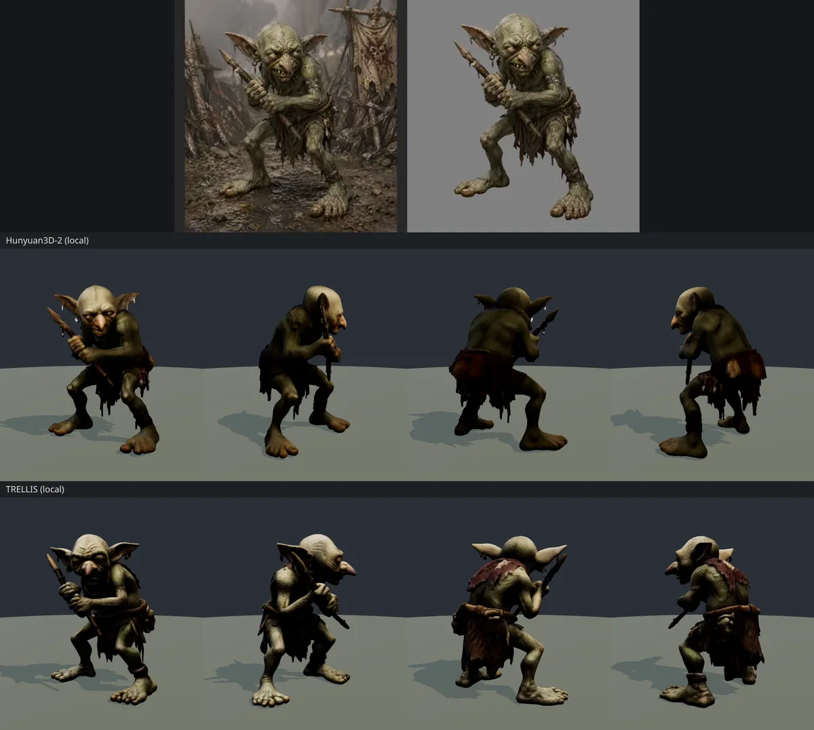 | 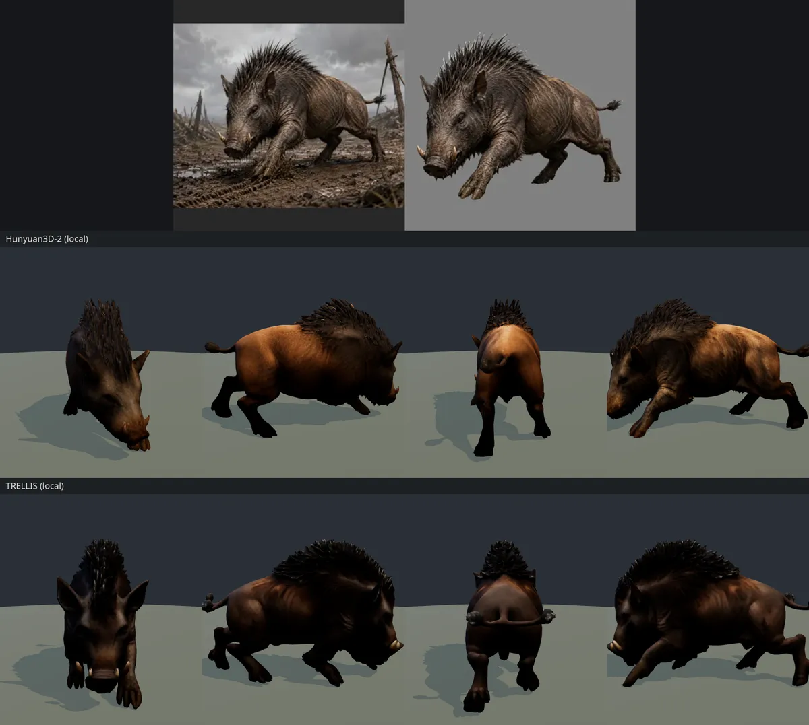 |

| Iron Shield | Goblin Raider (stretch) |
| --- | --- |
| 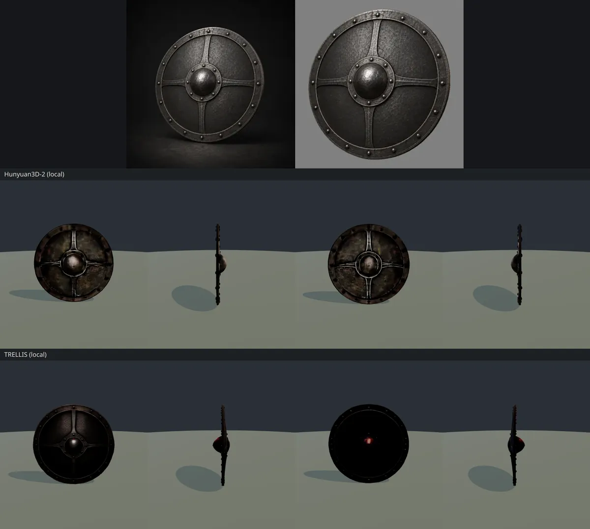 | 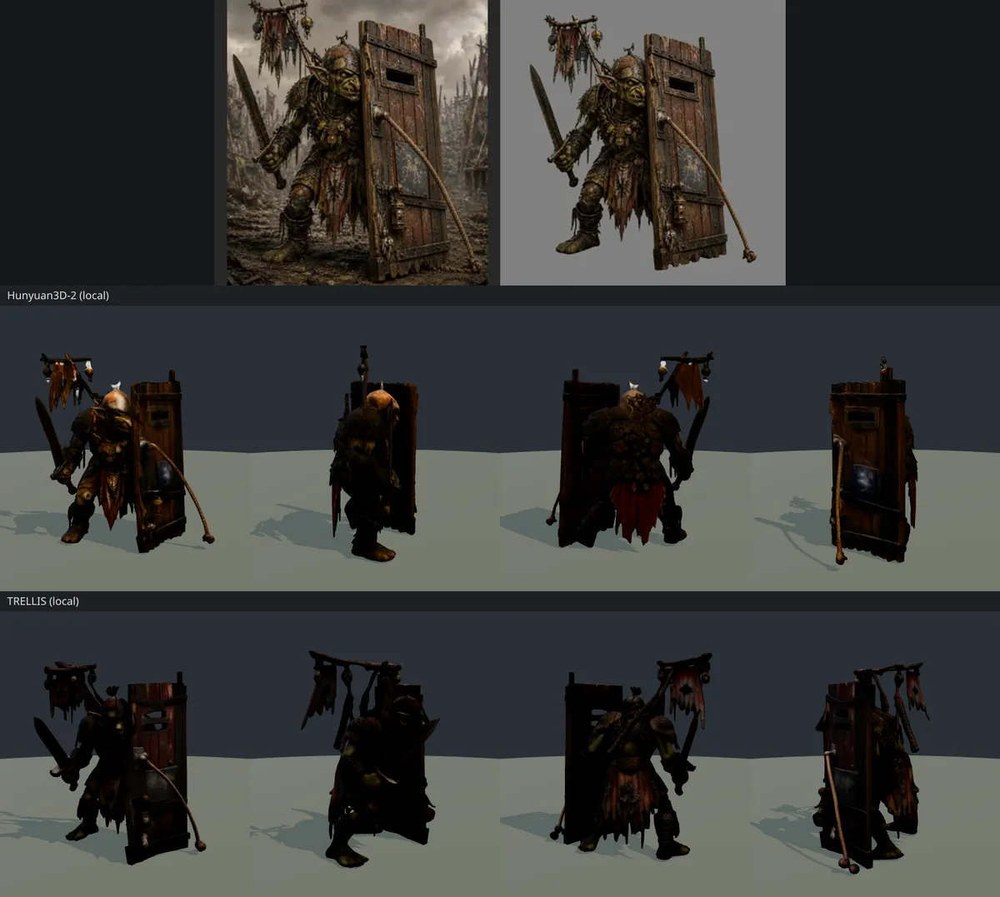 |

| Clay Figure (neutral-pose control) |
| --- |
| 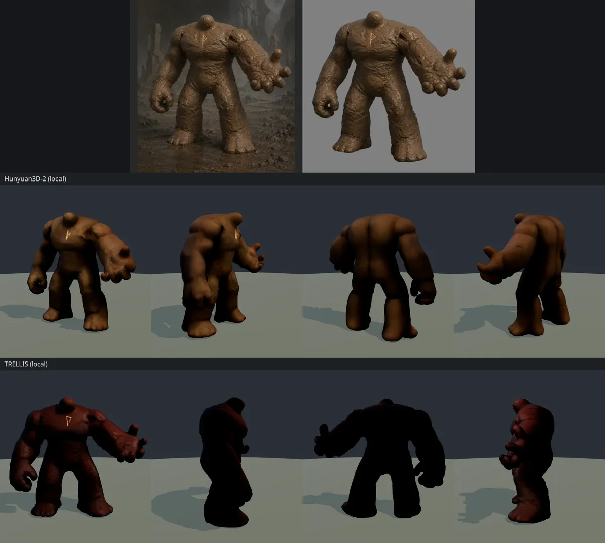 |

Animation frames, side view, five evenly spaced frames:

| | Walk | Attack |
| --- | --- | --- |
| TRELLIS goblin | 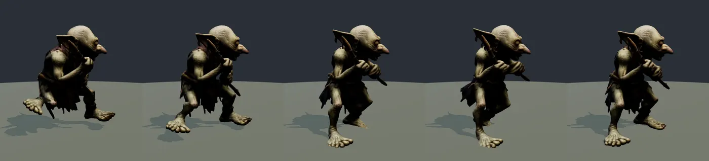 | 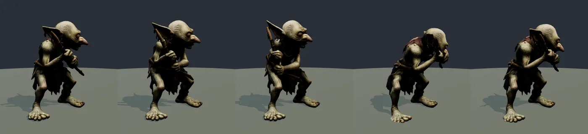 |
| Hunyuan goblin | 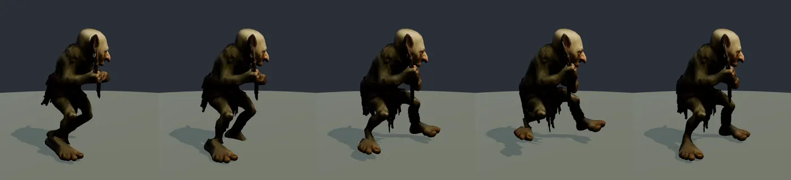 | 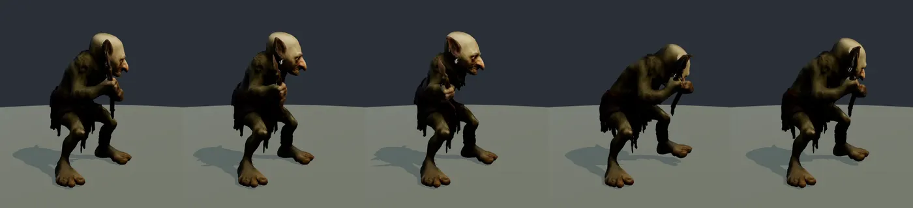 |
| TRELLIS boar | 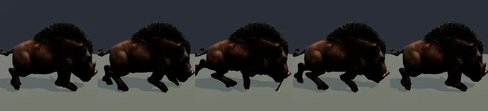 | 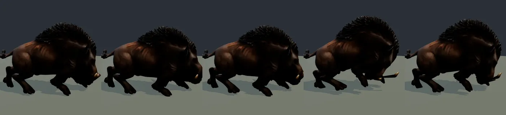 |
| Hunyuan boar | 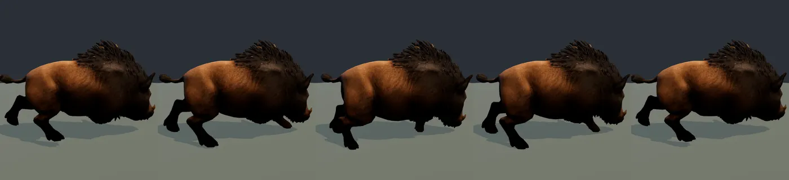 | 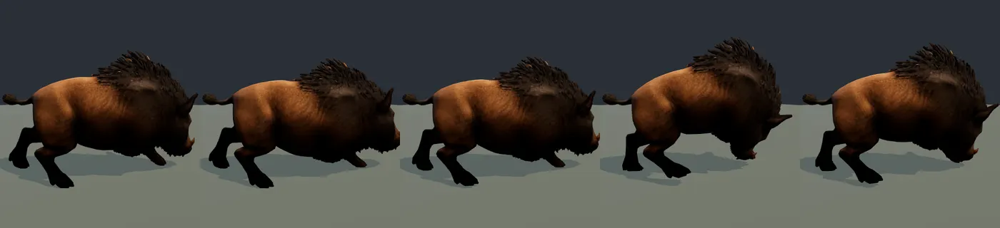 |
| TRELLIS golem | 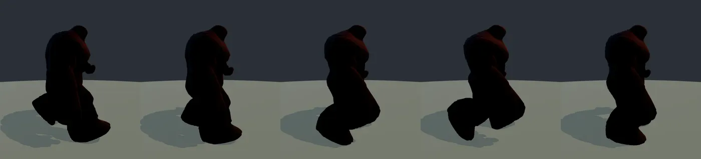 | 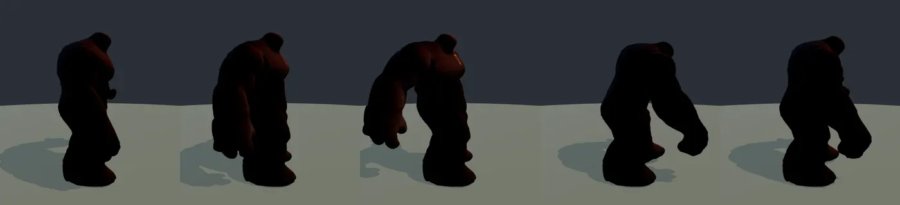 |
| Hunyuan golem | 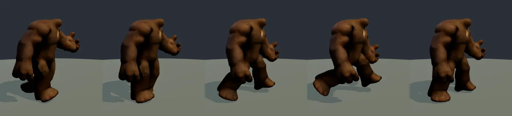 | 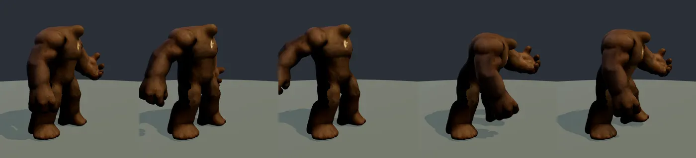 |

### Neutral-pose control: the Clay Figure

I added the Clay Figure to test the main hypothesis: that the action poses in the source art, not the
generators, are what make rigging hard. It stands neutrally with arms free and nothing in hand.

- **Both tools rigged it cleanly with no workaround.** After welding, each mesh was one shell, and Blender's
  bone heat weighted every vertex directly.
- **The clips read well.** The walk is a convincing heavy stomp, and the attack is a clean overhead arm
  slam. There is no prop bending and no limb fused to the body.
- **The hypothesis holds.** Neutral-pose source images turn the animation problem from "prototype only"
  into "workable with a template rig". The remaining issues are cosmetic: TRELLIS shifted the clay to red,
  and Hunyuan smoothed away the pitted surface.

## Do the three subjects look like one game?

**Within one tool, yes.** The goblin, boar and shield come out as one grim, realistic, earthy set. That is
because the source art is already consistent: one painterly-photoreal style with dramatic lighting.

**Across tools, no.** The two routes differ visibly, so a production pipeline must commit to one tool:

- TRELLIS is darker and sharper, with lighting baked into the albedo.
- Hunyuan is lighter, smoother and slightly glossy, and shifts hues: the boar goes orange, the raider's
  helmet goes orange.

**Not stylized.** The brief says "stylized". These models faithfully reproduce the source art's realism.
They do not read as a stylized game. Getting a stylized look means one of two things:

- stylize the 2D input first, for example a dedicated stylized front-view "model sheet" image per monster, or
- render with a stylized shader (toon ramp, outline), which also hides baked lighting.

## Verdict by asset kind

| Asset kind | Works? | Recommended route | Notes |
| --- | --- | --- | --- |
| **Props: shields, weapons, armor pieces** | **Yes**, with light cleanup | Hunyuan3D-2-class fidelity (or hosted) | Flat ornament needs the stronger texture model; TRELLIS lost the shield's cross bands. Backs are invented: Hunyuan mirrored the front design, so plan a quick back-face fix or a back reference image. 45–62 KB per item. |
| **Beasts: quadrupeds** | Static yes; animated only as a prototype | Either route, plus a rig step | The charge pose in the source art becomes the rest pose. Fur and bristles become solid spikes that defeat automatic skinning. |
| **Humanoids** | Static yes. Animated: yes from neutral-pose art (Clay Figure); prototype only from action-pose art | Hunyuan3D-2-class, plus a template rig | Crossed arms and held weapons fuse into the body. Rest pose is the art pose, not a T- or A-pose. Large carried objects (the raider's door) fuse to the body, which makes the raider hard to rig. A neutral source image avoids all of this. |

Between the two local routes, neither wins outright:

- **TRELLIS:** 5× faster, sharper on organic detail, worse on hard-surface ornament.
- **Hunyuan3D-2:** better props and cleaner topology (welded output is one watertight shell, so it rigs
  directly), but slower.

## Estimated cost and time for ~70 monsters and ~140 items

Assumptions:

- About 2 generation attempts per asset to pick a good seed.
- Human review of about 3 minutes per item.
- About 20 minutes per monster for landmark rigging, plus a check of shared clip templates.
- Generation runs unattended on this machine's 2 GPUs.
- Hosted USD prices are partly unverified; see the license section.

| Route | Compute / spend | Human time | Animation quality |
| --- | --- | --- | --- |
| Local TRELLIS | ~420 runs × 30 s ≈ 3.5 GPU-hours, under an hour wall-clock on 2 GPUs. $0 cash. | Items ≈ 7 h; monsters ≈ 23 h; **≈ 30 h total** | Prototype (procedural clips) |
| Local Hunyuan3D-2 | ~420 runs × 150 s ≈ 17.5 GPU-hours, about 9 h wall-clock on 2 GPUs. $0 cash. | Same, ≈ 30 h | Prototype |
| Hosted Tripo (pay-as-you-go) | Generation: 420 × $0.30–0.60 ≈ $125–250. Rig + 4 animations for 70 monsters: 70 × ($0.25 + 4 × $0.10) ≈ $45. **≈ $170–300 total.** | Items ≈ 7 h; monsters ≈ 6 h if auto-rig holds up | Unknown, needs the test below |
| Hosted Meshy (Pro credits) | 420 × 30 credits ≈ $250. Rig + 4 animations ≈ 70 × 17 credits ≈ $25. **≈ $275 total.** | Similar | Unknown; humanoid presets |

Whichever route is used, final-quality animation probably needs:

- one authored clip set per body plan (biped, quadruped, a few others): roughly 6–8 rigs × 4–6 clips, from an
  animator or a marketplace, and
- retargeting those clips onto each generated mesh.

That shared work is the long pole. It is not per-monster work.

## Open problems and options

1. **Posed source art (biggest issue).** Every monster image is an action pose: crouch, charge, braced behind
   a door. Image-to-3D bakes that pose in as the rest pose. Options:
   - Generate a dedicated neutral A-pose or 3/4 "model sheet" image per monster from the existing approved
     image, then convert that. Hunyuan3D-2mv and Tripo also accept multiview input.
   - Accept static or near-static monsters, with a cheap "breathing/lunge" deformation and VFX doing the
     work. That fits a first-person camera.
2. **Rigging.** Neither tool rigs. My local path:
   - landmarks placed on grid renders (~5 minutes per model),
   - welding, then bone heat,
   - a voxel proxy plus weight transfer as fallback,
   - Blender clips.

   It works but is manual and imprecise. Options:
   - Hosted auto-rig with animation presets (Tripo: $0.25 rig + $0.10 per clip; Meshy: 5 + 3 credits).
   - Open-source auto-riggers such as UniRig (not installed).
   - Mixamo for humanoids (needs an Adobe account).
   - One template skeleton per body plan with retargeted authored clips (most controllable).
3. **Fused props.** Spears, swords and door-shields fuse to hands and bodies, then bend when skinned. Options:
   - Inpaint the weapon out of the source.
   - Generate the weapon as its own prop (props work well).
   - Parent the prop to a hand bone at runtime. This also enables weapon swaps.
4. **Fur and bristles.** These become solid spikes that break bone heat and stretch under deformation.
   Options:
   - Weight via a coarse proxy (done here; causes stretching).
   - Stylize the bristles into chunkier cards before generation.
   - Use a shader-based fur shell.
5. **Baked lighting and hue drift.** TRELLIS bakes the source's dramatic lighting into albedo, so models read
   dark under game lights. Hunyuan's de-light pass helps but shifts hue. Options:
   - Color-match textures back to the source palette in post.
   - Add a stylized shader that tolerates baked shading.
6. **Facing is not canonical.** Each tool and image combination came out facing a different axis. TRELLIS
   follows the subject; Hunyuan follows the camera. Each asset needs a stored yaw (`facing.json`). This is
   cheap but must be in the pipeline.
7. **Invented backs.** Every back view is a guess, for example the shield's mirrored back and the raider's
   back. Acceptable for monsters seen mostly from the front. Props held in first person need a back check.

## License findings

Full notes with every source link: [`notes/licenses.md`](notes/licenses.md). Checked 2026-11-16.

| Tool | Commercial use of outputs | Source |
| --- | --- | --- |
| TRELLIS code and weights | MIT, no output restriction. **But** the stock GLB bake (`postprocessing_utils.to_glb`) runs `diff-gaussian-rasterization` (Inria, research/non-commercial only) and `nvdiffrast` (NVIDIA Source Code License, non-commercial "research or evaluation" only). Production use needs those swapped for permissive equivalents (for example gsplat, Apache-2.0; not verified) or licensed. | [TRELLIS LICENSE](https://raw.githubusercontent.com/microsoft/TRELLIS/main/LICENSE), [HF card](https://huggingface.co/microsoft/TRELLIS-image-large), [diff-gaussian-rasterization LICENSE](https://raw.githubusercontent.com/autonomousvision/mip-splatting/main/submodules/diff-gaussian-rasterization/LICENSE.md), [nvdiffrast LICENSE](https://raw.githubusercontent.com/NVlabs/nvdiffrast/main/LICENSE.txt) |
| Hunyuan3D-2 | Tencent claims no rights in outputs, and commercial use is allowed. **But** the license does not apply in the EU, UK or South Korea, and it bars using or displaying outputs outside its territory. It also requires a separate license above 1M MAU at release, and outputs may not be used to train other models. | [LICENSE](https://raw.githubusercontent.com/Tencent-Hunyuan/Hunyuan3D-2/main/LICENSE) |
| Meshy | Paid plans: the customer owns outputs and commercial use is allowed. Free plan: CC BY 4.0, owned by Meshy. The API requires a paid plan. | [Terms](https://www.meshy.ai/terms-of-use), [API pricing](https://docs.meshy.ai/en/api/pricing) |
| Tripo | Paid users hold usage rights; free tier is CC BY 4.0 (unverified: the terms page blocked fetching). Confirm that API pay-as-you-go counts as "paid". | [API pricing](https://developers.tripo3d.ai/en/pricing), [Terms](https://www.tripo3d.ai/terms) |
| Hyper3D Rodin | No limit on use of Rodin output; Deemos may use outputs to improve its service. The API needs the Business plan ($120/mo). | [Terms](https://hyper3d.ai/legal/terms), [API](https://hyper3d.ai/features/api) |
| BiRefNet / rembg (prep) | MIT | [BiRefNet](https://raw.githubusercontent.com/ZhengPeng7/BiRefNet/main/LICENSE), [rembg](https://raw.githubusercontent.com/danielgatis/rembg/main/LICENSE.txt) |

I am not a lawyer. Treat these as findings to confirm, not legal advice.

## Recommended next step

1. Run a ~$5 hosted test (Tripo or Meshy) on the same goblin and boar inputs. Compare:
   - generation fidelity against the table above, and
   - their auto-rig and walk/attack presets against the local rig.

   This settles whether hosted removes the animation bottleneck.
2. The Clay Figure already shows that neutral poses rig cleanly. Next, generate a neutral-pose model-sheet
   image of the goblin with the existing image pipeline, to confirm the fix works for a monster whose
   approved art is posed.

## Reproduce

```bash
# one-time installs (outside the repo, ~25 GB)
experiments/image-to-3d/scripts/install-trellis.sh
experiments/image-to-3d/scripts/install-hunyuan3d.sh
cd experiments/image-to-3d && pnpm install --ignore-workspace

# pipeline
~/.local/opt/image-to-3d/tools-venv/bin/python scripts/prepare_sources.py   # needs rembg, scipy
~/.local/opt/image-to-3d/TRELLIS/.venv/bin/python scripts/generate_trellis.py
~/.local/opt/image-to-3d/Hunyuan3D-2/.venv/bin/python scripts/generate_hunyuan3d.py
python3 scripts/make_rig_specs.py
blender -b -P scripts/blender_rig.py -- work/models/<tool>/<subject>/raw.glb rigging/<tool>--<subject>.json \
  work/models/<tool>/<subject>/rigged.glb work/models/<tool>/<subject>/rig-report.json
node scripts/optimize.mjs && node scripts/build_index.mjs && node scripts/screenshots.mjs
node scripts/serve.mjs   # viewer.html on 0.0.0.0:5180
```

Generated meshes, textures and cutouts live in `work/`, which is gitignored. Only scripts, rig landmark
specs, this report and small WebP previews are committed.
